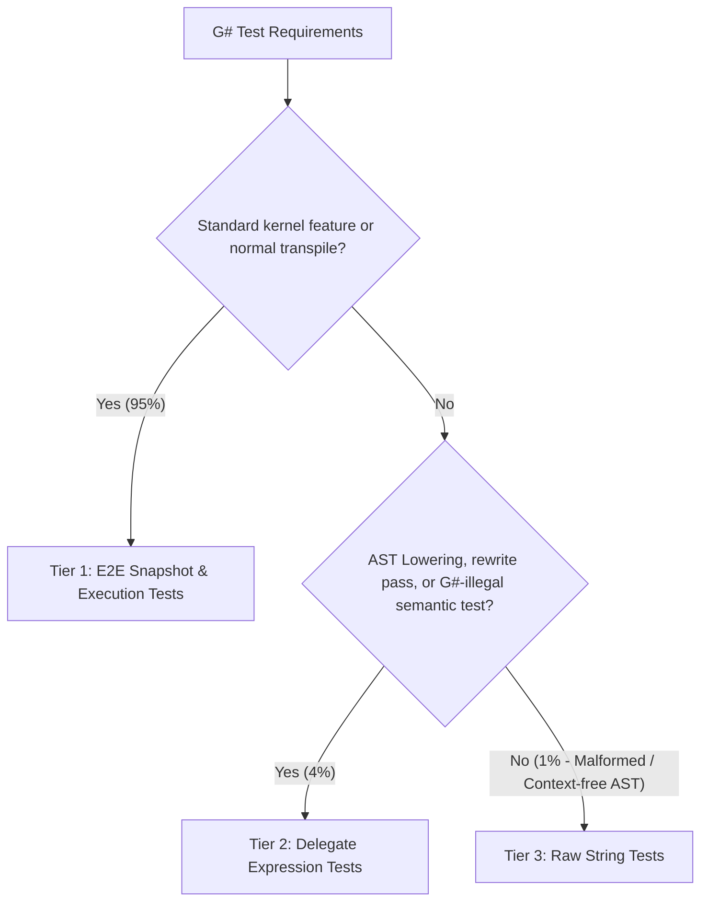

# G# Test Framework & Tier 1-3 Architecture Guidelines

This rule defines the standardized testing framework architecture for G# (Henicos). It enforces our core architectural principle: **"Ensuring G# behaves as valid C# whenever possible"** while maximizing developer experience (DX) and isolating compiler edge cases.

---

## 1. Core Testing Philosophy

1. **C# Mental Model First**: If code is intended to run as a G# GPU kernel, it should fundamentally be valid, compilable C# with IDE support (syntax highlighting, autocomplete, type-checking, and code formatting).
2. **Minimize Fragile String-based ASTs**: Avoid writing raw string code fragments (e.g., `ParseBlock("while(condition) { ... }")`). String-based syntax lacks semantic models, symbols, and compiler validation, making tests brittle and prone to artificial behaviors.
3. **Strict 3-Tier Hierarchy**: Tests must be classified into Tier 1 (default), Tier 2 (AST lowering/rewrite), or Tier 3 (isolated raw strings for malformed edge cases).

---

## 2. The 3-Tier Testing Architecture



### 2.1. Tier 1: E2E Snapshot & Execution Tests (~95% of tests)

* **Purpose**: Primary testing approach for features, control flow, math intrinsics, and general kernel transpilation.
* **Format**:
  * GPU kernel defined in a dedicated `.cu.cs` file (e.g., `ControlFlowKernels.cu.cs`) decorated with `[GpuKernel]`.
  * Transpiled end-to-end via `MegaCompiler` / Source Generator.
  * Verified via `Verify.Xunit` snapshots (`.verified.cs`) and/or runtime execution (`LaunchKernel(...)`).
* **Guarantee**: Full Roslyn semantic model and syntax tree validation. Guarantees that the kernel is valid C#.

#### Example (Tier 1):

```csharp
// tests/.../Syntax/ControlFlowKernels.cu.cs
namespace Kassyi.GSharp.Tests.Shared.Syntax;

public static partial class ControlFlowKernels
{
    [GpuKernel]
    public static void SimpleTernaryKernel(int[] a, int[] b, double[] result)
    {
        int tid = ThreadIndex.X;
        result[tid] = a[tid] > b[tid] ? a[tid] : b[tid] * 1.5;
    }
}

// tests/.../Syntax/ControlFlowTests.cs
public class ControlFlowTests
{
    [Fact]
    [Trait("Category", "Compiler")]
    public void TestSimpleTernaryKernelExecution()
    {
        int[] a = [10];
        int[] b = [20];
        double[] result = [0.0];

        ControlFlowKernels.LaunchSimpleTernaryKernel(a, b, result, blockDimX: 1);

        Assert.Equal(30.0, result[0]);
    }
}
```

---

### 2.2. Tier 2: Delegate Expression Tests (~4% of tests)

* **Purpose**: Testing internal AST passes (such as State Machine Lowering Phase 2.1–2.5), localized syntax rewriters, or testing diagnostics for syntax that is **legal in C# but prohibited in G#** (e.g., heap allocations or unsupported keywords).
* **Format**:
  * Written directly in C# using `Action` delegates or lambda expressions.
  * Utilizes `[CallerArgumentExpression]` in the test base runner (`RunLoweringTest`) to capture the syntax expression.
  * The test base parses the captured code with Roslyn into a `BlockSyntax` or `MethodDeclarationSyntax` and feeds it to the target rewriter.
* **Benefits**: Full IDE support (syntax highlighting, formatting, refactoring) and compile-time detection of accidental syntax errors.

#### Example (Tier 2):

```csharp
public class LoopLoweringTests : StateMachineTestBase
{
    [Fact]
    [Trait("Category", "Compiler")]
    public Task Lower_WhileLoop() =>
        RunLoweringTest(() =>
        {
            while (condition)
            {
                DoWork();
                Gpu.SyncThreads();
            }
        });
}

// Infrastructure definition:
public abstract class StateMachineTestBase
{
    protected Task RunLoweringTest(
        Action action,
        [CallerArgumentExpression(nameof(action))] string source = "")
    {
        // 1. Roslyn parses the extracted lambda body into a BlockSyntax
        // 2. Applies lowering / transpiler rewrites
        // 3. Verifies output via Verify.Xunit
    }
}
```

---

### 2.3. Tier 3: Raw String Tests (~1% of tests - Last Resort)

* **Purpose**: Strictly reserved for scenarios where valid C# code cannot be constructed, such as:
  * Context-free statement fragments.
  * Intentionally malformed or broken AST nodes to test compiler defensive error-handling.
  * Intermediate lowered AST structures that are syntactically impossible to write directly in C#.
* **Format**:
  * Explicitly isolated in dedicated helper methods (e.g., `RunRawLoweringTest(string rawCode)`).
  * Must include an inline comment explaining why Tier 1 or Tier 2 cannot be used.

#### Example (Tier 3):

```csharp
[Fact]
[Trait("Category", "Compiler")]
public Task Lower_MalformedIncompleteNode_DefensiveCheck()
{
    // Tier 3 Reason: Tests defensive handling when a context-free statement lacks an enclosing block/method.
    return RunRawLoweringTest("while(condition)");
}
```

---

## 3. Test Suite Hygiene Rules

### 3.1. Prohibition of Redundant `partial` Modifiers
* **Rule**: Do **NOT** declare test classes with the `partial` keyword (e.g. `public partial class FooTests`) unless the class is legitimately split across multiple physical files.
* **Allowed `partial` usages**:
  * Kernel classes in `.cu.cs` where the source generator emits companion host launcher methods into `.g.cs`.
  * Large test classes explicitly partitioned across multiple source files.

### 3.2. Categorization & Traits
* Follow `qa-testing-guidelines`:
  * Use `[Trait("Category", "Compiler")]`, `[Trait("Category", "SadPath")]`, `[Trait("Category", "GpuExecution")]`, etc.
  * Never hardcode ticket numbers or Feature IDs into `[Trait]` attributes.
