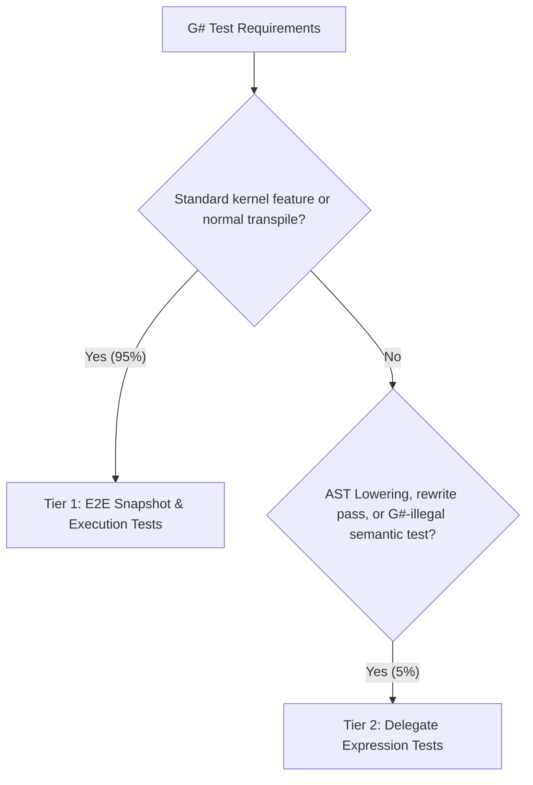

# G# Test Framework & Tier 1-3 Architecture Guidelines

This rule defines the standardized testing framework architecture for G# (Henicos). It enforces our core architectural principle: **"Ensuring G# behaves as valid C# whenever possible"** while maximizing developer experience (DX) and isolating compiler edge cases.

---

## 1. Core Testing Philosophy

1. **C# Mental Model First & .cs Priority**: If code is intended to run as a G# GPU kernel, it should fundamentally be valid, compilable C# with IDE support (syntax highlighting, autocomplete, type-checking, and code formatting). Unless testing deliberately illegal C# syntax (e.g. defensive compiler recovery), **95% of test cases can and must be written directly in `.cs` files / C# syntax. Writing in `.cs` is the absolute highest priority.**
2. **Snapshot Legitimacy as C# (`.verified.cs`)**: Existing and new snapshot tests producing `.verified.txt` must be rewritten wherever possible so that the generated output forms syntactically valid C# (e.g., wrapped in a dummy class/method or block context) and is emitted as `.verified.cs`.
3. **Minimize Fragile String-based ASTs**: Avoid writing raw string code fragments (e.g., `ParseBlock("while(condition) { ... }")`). String-based syntax lacks semantic models, symbols, and compiler validation, making tests brittle and prone to artificial behaviors.
4. **Strict 2-Tier Hierarchy**: Tests must be classified into Tier 1 (default), Tier 2 (AST lowering/rewrite).

---

## 2. The 2-Tier Testing Architecture



### 2.1. Tier 1: E2E Snapshot & Execution Tests (~95% of tests)

- **Purpose**: Primary testing approach for features, control flow, math intrinsics, and general kernel transpilation.
- **Format**:
    - GPU kernel defined in a dedicated `.cu.cs` file (e.g., `ControlFlowKernels.cu.cs`) decorated with `[GpuKernel]`.
    - Transpiled end-to-end via `MegaCompiler` / Source Generator.
    - Verified via `Verify.Xunit` snapshots (`.verified.cs`) and/or runtime execution (`LaunchKernel(...)`).
- **Guarantee**: Full Roslyn semantic model and syntax tree validation. Guarantees that the kernel is valid C#.

#### Example (Tier 1):

```csharp
// tests/.../Syntax/ControlFlowKernels.cu.cs
namespace Kassyi.GSharp.Tests.Shared.Syntax;

public static partial class ControlFlowKernels
{
    [GpuKernel]
    public static void SimpleTernaryKernel(int[] a, int[] b, double[] result)
    {
        int tid = ThreadIndex.X;
        result[tid] = a[tid] > b[tid] ? a[tid] : b[tid] * 1.5;
    }
}

// tests/.../Syntax/ControlFlowTests.cs
public class ControlFlowTests
{
    [Fact]
    [Category(TestCategory.Compiler)]
    [Scenario(TestScenario.HappyPath)]
    public void TestSimpleTernaryKernelExecution()
    {
        int[] a = [10];
        int[] b = [20];
        double[] result = [0.0];

        ControlFlowKernels.LaunchSimpleTernaryKernel(a, b, result, blockDimX: 1);

        Assert.Equal(30.0, result[0]);
    }
}
```

---

### 2.2. Tier 2: Delegate Expression Tests (~5% of tests)

- **Purpose**: Testing internal AST passes (such as State Machine Lowering Phase 2.1–2.5), localized syntax rewriters, or testing diagnostics for syntax that is **legal in C# but prohibited in G#** (e.g., heap allocations or unsupported keywords).
- **Format**:
    - Written directly in C# using `Action` delegates or lambda expressions.
    - Utilizes `[CallerArgumentExpression]` in the test base runner (`RunLoweringTest`) to capture the syntax expression.
    - The test base parses the captured code with Roslyn into a `BlockSyntax` or `MethodDeclarationSyntax` and feeds it to the target rewriter.
- **Benefits**: Full IDE support (syntax highlighting, formatting, refactoring) and compile-time detection of accidental syntax errors.

#### Example (Tier 2):

```csharp
public class LoopLoweringTests : StateMachineTestBase
{
    [Fact]
    [Category(TestCategory.Compiler)]
    [Scenario(TestScenario.HappyPath)]
    public Task Lower_WhileLoop() =>
        RunLoweringTest(() =>
        {
            while (condition)
            {
                DoWork();
                Gpu.SyncThreads();
            }
        });
}

// Infrastructure definition:
public abstract class StateMachineTestBase
{
    protected Task RunLoweringTest(
        Action action,
        [CallerArgumentExpression(nameof(action))] string source = "")
    {
        // 1. Roslyn parses the extracted lambda body into a BlockSyntax
        // 2. Applies lowering / transpiler rewrites
        // 3. Verifies output via Verify.Xunit
    }
}
```

---

## 3. Test Suite Hygiene Rules

### 3.1. Prohibition of Redundant `partial` Modifiers

- **Rule**: Do **NOT** declare test classes with the `partial` keyword (e.g. `public partial class FooTests`) unless the class is legitimately split across multiple physical files.
- **Allowed `partial` usages**:
    - Kernel classes in `.cu.cs` where the source generator emits companion host launcher methods into `.g.cs`.
    - Large test classes explicitly partitioned across multiple source files.

### 3.2. Categorization & Metadata Attributes (3-Axis Model)

- Follow `qa-testing-guidelines` (Definitions in `tests/Shared/Kassyi.GSharp.Tests.Infrastructure`, globally imported across test assemblies):
    - **Axis 1 (Execution Target)**: `[TestTarget(ExecutionTarget.GpuExecution)]`, `[TestTarget(ExecutionTarget.CpuExecution)]`
    - **Axis 2 (Domain Category)**: `[Category(TestCategory.Compiler)]`, `[Category(TestCategory.Runtime)]`, `[Category(TestCategory.Syntax)]`, `[Category(TestCategory.Stdlib)]`, etc.
    - **Axis 3 (Behavior Scenario)**: `[Scenario(TestScenario.HappyPath)]`, `[Scenario(TestScenario.SadPath)]`, `[Scenario(TestScenario.Boundary)]`
    - Never hardcode ticket numbers, roadmap IDs, or Feature IDs into test attributes.

### 3.3. Test Parallelization & Global State Protection

- **Default Parallelism**: By default, xUnit runs test classes in parallel. Do not interfere with this behavior for pure, stateless tests (e.g., AST logic, mathematical operations).
- **Global State Sequentialization**: Tests that mutate or depend on global process states (e.g., `NativeLibrary.Load`, `Environment.SetEnvironmentVariable`, `CudaEnvironment` initialization) MUST be isolated to run sequentially to prevent flaky tests and process zombification.
- **Rule**: Never use magic strings for collection names. Always use the strongly-typed constant from `TestCollections` defined in `Kassyi.GSharp.Tests.Infrastructure`.
    - **[NG]**: `[Collection("GlobalStateSequential")]` (Prone to AI hallucinations like "Global" or "NonParallel")
    - **[OK]**: `[Collection(TestCollections.GlobalStateSequential)]`
    - **GPU Stream / Gate Contention**: Any test that exercises `CudaStreamGate`, `CudaStreamCompletion`, or concurrent GPU kernel launches MUST be decorated with `[Collection(TestCollections.DeviceExclusive)]` so that randomized test execution (`just test-stability`) does not cause thread-pool or CUDA context starvation.

### 3.4. Snapshot Format & Fast-Hash Naming (`.verified.cs`)

- **Extension Priority**: Unless the target is purely non-code data (e.g. JSON dumps in stdlib math tests) or syntactically invalid edge cases, all snapshot tests **must emit `.verified.cs`**. If testing statements or partial constructs, the test harness must format/wrap them into valid C# code.
- **Short Hash Naming**: Use the standardized zero-allocation FNV-1a 64-bit 10-hex naming scheme:
    ```text
    Snap.{Prefix}_{Hash10}[_{Dialect}].g.verified.cs
    ```
- **Infrastructure**: Never clone or copy-paste `HashHelper` or snapshot naming methods into individual test assemblies. Use the centralized test foundation in `Kassyi.GSharp.Tests.Shared.Helpers`.
- **Strict Ban on Snapshot Tampering & Blind Promotion (Never Move the Goalposts)**:
    - **NEVER** directly edit, string-replace (`sd` / `sed`), or apply patches (`git apply`) to `.verified.*` snapshot files to make tests pass.
    - **NEVER** blindly copy `.received.*` to `.verified.*` in the same command/one-liner that runs `dotnet test` without inspecting the output first.
    - **Mandatory Inspection Workflow**:
        1. Run the test so the test runner emits `.received.*`.
        2. Read `.received.*` or inspect the diff against `.verified.*` (`git diff --no-index` / `read_file`) and verify that every line matches the intended design and specification.
        3. Only after verifying correctness, promote the specific `.received.*` file to `.verified.*`.
        4. If an unrelated existing snapshot changes, **DO NOT** overwrite `.verified.*`; treat it as a regression in your code (or a stop condition) and report or fix the implementation.

### 3.5. OS-Separated Build Outputs (`bin/<os>/`, `obj/<os>/`) & Repository Root Discovery

- Build outputs and intermediate files are strictly isolated by host OS (`bin/win/`, `obj/win/` vs `bin/linux/`, `obj/linux/`) via `Directory.Build.props` so Windows and WSL builds/tests can coexist without file locking or artifact pollution.
- **Rule**: In tests that locate repository files (`src/`, `Henicos.slnx`, YAML definitions), **NEVER** hardcode relative parent depth (e.g., `../../../../`) and never write your own root search. Use `RepositoryPaths.Root` / `RepositoryPaths.Combine(...)` from `Kassyi.GSharp.Tests.Infrastructure` (globally imported), which walks up to `Henicos.slnx`.

### 3.7. `tests/` Layout (Category → Project)

`tests/` mirrors `src/`: each test project sits under a category folder, never directly under `tests/`.

| Folder | Projects |
| ----- | ----- |
| `tests/Compiler/` | G# end-to-end suites: `Kassyi.GSharp.Tests.Shared` (shared project), `.Cpu`, `.Cuda`, `.Integration`, `Kassyi.GSharp.DocTest` |
| `tests/Shared/` | Test infrastructure: `Kassyi.GSharp.Tests.Infrastructure`, `Kassyi.GSharp.Tests.Generators` |
| `tests/Stdlib/` | `Kassyi.GSharp.Stdlib.GpuMath.Tests` |
| `tests/ZeroAlloc/` | `Kassyi.ZeroAlloc.Linq.Tests` |
| `tests/Apps/` | `Henicos.Benchmarks.Tests` |

`Directory.Build.props`, `BannedSymbols.txt` and `xunit.runner.json` stay at `tests/`. Add a new test project under the category of the `src/` project it covers, and add it to the matching `/tests/<Category>/` folder in `Henicos.slnx`.

### 3.6. Cross-Platform `justfile` Recipes

- When adding or modifying `justfile` recipes for both `[windows]` and `[unix]`:
    - **No Inline `exec`/`eval` Wrappers**: Do **NOT** use `python3 -c 'exec("...")'` to wrap multi-line scripts in `justfile`. Write clean, native POSIX shell (`sh` / `bash`) for `[unix]` and PowerShell for `[windows]`.
    - **WSL Non-Interactive Login Shell `PATH`**: When invoking WSL from Windows via `wsl -- bash -lc "..."`, note that Ubuntu's default `~/.bashrc` exits early for non-interactive shells (`case $- in *i*) ;; *) return;; esac`). User-scoped tool paths (`~/.dotnet`, `~/.cargo/bin`) must be configured in `~/.profile` or explicitly exported.

### 3.8. Test Convention Analyzers (`HNT*`)

`tests/Directory.Build.props` loads the analyzers of `tests/Shared/Kassyi.GSharp.Tests.Generators` into every test project. `tests/**` is generated code in `.editorconfig`, so each rule has its own severity there; an Error stops the build. A test method is a method with an attribute that derives from `Xunit.FactAttribute` (`[Fact]`, `[Theory]`, `[SkippableFact]`, `[SkippableTheory]`).

| ID | Severity | Reports |
| ----- | ----- | ----- |
| HNT0002 | Error | A test method without `[Category]`, `[TestTarget]`, `[Scenario]` or `[Trait("Category", ...)]` on the method or its class |
| HNT0004 | Warning | A test method that reaches no `Xunit.Assert`, `VerifyXunit.Verifier` or FluentAssertions call, also through the methods of the same assembly it calls and the overrides and interface implementations they dispatch to |
| HNT0005 | Warning | `System.Diagnostics.Debug.Assert` in a test method (removed in Release) |
| HNT0006 | Warning | An unseeded random source anywhere in a test assembly: `new Random()`, `Random.Shared`, `RandomNumberGenerator` |
| HNT0007 | Warning | `catch` or `catch (Exception)` without a `when` filter in a test method whose handler drops the exception: it neither assigns it, passes it to a method other than a Console / test output / Debug / Trace writer, asserts, nor ends in a `throw` (not a skip) with no `return`, `break` or `continue` before it |

HNT0001 (a required test base class) was removed (#597). HNT0003 is the compiler-side `TypeNameCheckAnalyzer`. The Warnings become Errors once the existing tests are clean. What a strong test needs beyond these checks: [property-test-design](../skills/property-test-design/SKILL.md) §8.

---

## 4. DEVELOPMENT METHODOLOGY (Test-Driven AI Vibe Coding)

This project strictly adheres to **Test-Driven AI Vibe Coding (テスト先行AIバイブコーディング)**.
When picking up tasks from the roadmap, you MUST follow this fundamental workflow:

1. **Phase 1: Golden Master / Snapshot Test Generation First**
    - Before writing ANY implementation code, you must create the necessary test cases.
    - You MUST design the tests covering happy paths, boundaries, and sad paths (exceptions) based on the `qa-testing-guidelines` **before** writing the actual logic.
    - For numeric and algorithm tests (GpuMath, CPU vs GPU comparisons), also follow [property-test-design](../skills/property-test-design/SKILL.md): define the properties first, and show that each check is reached and that a one-line mutant makes it fail.
2. **Phase 2: Isolated AST Lane Branching**
    - Work in isolated branches separated by the AST responsibility area (e.g., Expression, Statement) to prevent parallel implementation conflicts.
