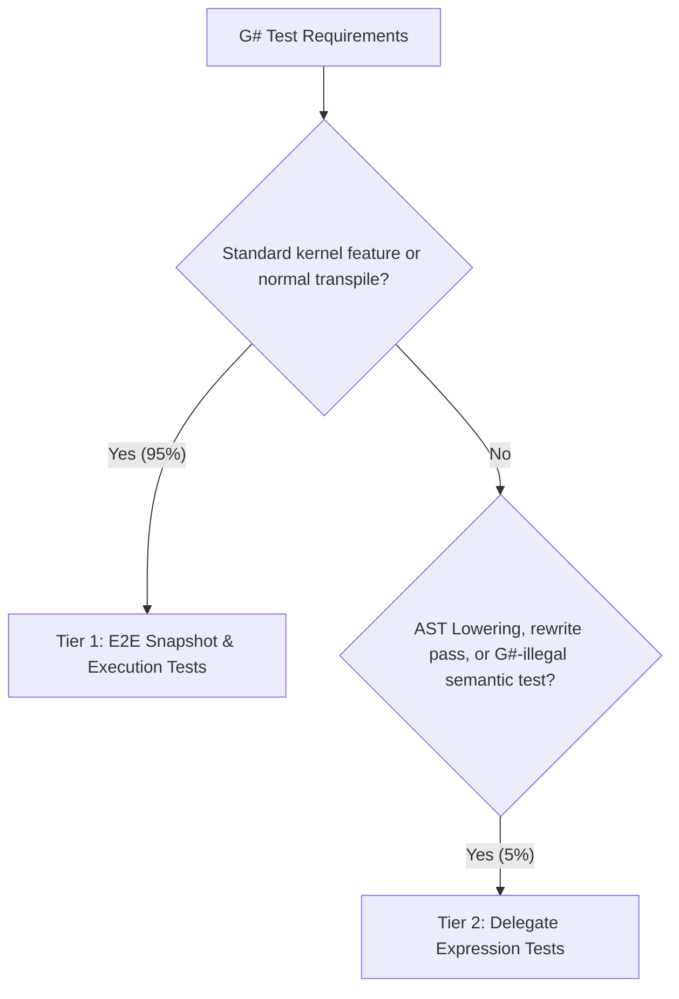

# G# Test Framework & Tier 1-3 Architecture Guidelines

This rule defines the standardized testing framework architecture for G# (Henicos). It enforces our core architectural principle: **"Ensuring G# behaves as valid C# whenever possible"** while maximizing developer experience (DX) and isolating compiler edge cases.

---

## 1. Core Testing Philosophy

1. **C# Mental Model First & .cs Priority**: If code is intended to run as a G# GPU kernel, it should fundamentally be valid, compilable C# with IDE support (syntax highlighting, autocomplete, type-checking, and code formatting). Unless testing deliberately illegal C# syntax (e.g. defensive compiler recovery), **95% of test cases can and must be written directly in `.cs` files / C# syntax. Writing in `.cs` is the absolute highest priority.**
2. **Snapshot Legitimacy as C# (`.verified.cs`)**: Existing and new snapshot tests producing `.verified.txt` must be rewritten wherever possible so that the generated output forms syntactically valid C# (e.g., wrapped in a dummy class/method or block context) and is emitted as `.verified.cs`.
3. **Minimize Fragile String-based ASTs**: Avoid writing raw string code fragments (e.g., `ParseBlock("while(condition) { ... }")`). String-based syntax lacks semantic models, symbols, and compiler validation, making tests brittle and prone to artificial behaviors.
4. **Strict 2-Tier Hierarchy**: Tests must be classified into Tier 1 (default), Tier 2 (AST lowering/rewrite).

---

## 2. The 2-Tier Testing Architecture



### 2.1. Tier 1: E2E Snapshot & Execution Tests (~95% of tests)

- **Purpose**: Primary testing approach for features, control flow, math intrinsics, and general kernel transpilation.
- **Format**:
    - GPU kernel defined in a dedicated `.cu.cs` file (e.g., `ControlFlowKernels.cu.cs`) decorated with `[GpuKernel]`.
    - Transpiled end-to-end via `MegaCompiler` / Source Generator.
    - Verified via `Verify.Xunit` snapshots (`.verified.cs`) and/or runtime execution (`LaunchKernel(...)`).
- **Guarantee**: Full Roslyn semantic model and syntax tree validation. Guarantees that the kernel is valid C#.

#### Example (Tier 1):

```csharp
// tests/.../Syntax/ControlFlowKernels.cu.cs
namespace Kassyi.GSharp.Tests.Shared.Syntax;

public static partial class ControlFlowKernels
{
    [GpuKernel]
    public static void SimpleTernaryKernel(int[] a, int[] b, double[] result)
    {
        int tid = ThreadIndex.X;
        result[tid] = a[tid] > b[tid] ? a[tid] : b[tid] * 1.5;
    }
}

// tests/.../Syntax/ControlFlowTests.cs
public class ControlFlowTests
{
    [Fact]
    [Category(TestCategory.Compiler)]
    [Scenario(TestScenario.HappyPath)]
    public void TestSimpleTernaryKernelExecution()
    {
        int[] a = [10];
        int[] b = [20];
        double[] result = [0.0];

        ControlFlowKernels.LaunchSimpleTernaryKernel(a, b, result, blockDimX: 1);

        Assert.Equal(30.0, result[0]);
    }
}
```

---

### 2.2. Tier 2: Delegate Expression Tests (~5% of tests)

- **Purpose**: Testing internal AST passes (such as State Machine Lowering Phase 2.1–2.5), localized syntax rewriters, or testing diagnostics for syntax that is **legal in C# but prohibited in G#** (e.g., heap allocations or unsupported keywords).
- **Format**:
    - Written directly in C# using `Action` delegates or lambda expressions.
    - Utilizes `[CallerArgumentExpression]` in the test base runner (`RunLoweringTest`) to capture the syntax expression.
    - The test base parses the captured code with Roslyn into a `BlockSyntax` or `MethodDeclarationSyntax` and feeds it to the target rewriter.
- **Benefits**: Full IDE support (syntax highlighting, formatting, refactoring) and compile-time detection of accidental syntax errors.

#### Example (Tier 2):

```csharp
public class LoopLoweringTests : StateMachineTestBase
{
    [Fact]
    [Category(TestCategory.Compiler)]
    [Scenario(TestScenario.HappyPath)]
    public Task Lower_WhileLoop() =>
        RunLoweringTest(() =>
        {
            while (condition)
            {
                DoWork();
                Gpu.SyncThreads();
            }
        });
}

// Infrastructure definition:
public abstract class StateMachineTestBase
{
    protected Task RunLoweringTest(
        Action action,
        [CallerArgumentExpression(nameof(action))] string source = "")
    {
        // 1. Roslyn parses the extracted lambda body into a BlockSyntax
        // 2. Applies lowering / transpiler rewrites
        // 3. Verifies output via Verify.Xunit
    }
}
```

---

## 3. Test Suite Hygiene Rules

### 3.1. Prohibition of Redundant `partial` Modifiers

- **Rule**: Do **NOT** declare test classes with the `partial` keyword (e.g. `public partial class FooTests`) unless the class is legitimately split across multiple physical files.
- **Allowed `partial` usages**:
    - Kernel classes in `.cu.cs` where the source generator emits companion host launcher methods into `.g.cs`.
    - Large test classes explicitly partitioned across multiple source files.

### 3.2. Categorization & Metadata Attributes (3-Axis Model)

- Follow `qa-testing-guidelines` (Definitions in `tests/Kassyi.GSharp.Tests.Common`, globally imported across test assemblies):
    - **Axis 1 (Execution Target)**: `[TestTarget(ExecutionTarget.GpuExecution)]`, `[TestTarget(ExecutionTarget.CpuExecution)]`
    - **Axis 2 (Domain Category)**: `[Category(TestCategory.Compiler)]`, `[Category(TestCategory.Runtime)]`, `[Category(TestCategory.Syntax)]`, `[Category(TestCategory.Stdlib)]`, etc.
    - **Axis 3 (Behavior Scenario)**: `[Scenario(TestScenario.HappyPath)]`, `[Scenario(TestScenario.SadPath)]`, `[Scenario(TestScenario.Boundary)]`
    - Never hardcode ticket numbers, roadmap IDs, or Feature IDs into test attributes.

### 3.3. Snapshot Format & Fast-Hash Naming (`.verified.cs`)

- **Extension Priority**: Unless the target is purely non-code data (e.g. JSON dumps in stdlib math tests) or syntactically invalid edge cases, all snapshot tests **must emit `.verified.cs`**. If testing statements or partial constructs, the test harness must format/wrap them into valid C# code.
- **Short Hash Naming**: Use the standardized zero-allocation FNV-1a 64-bit 10-hex naming scheme:
    ```text
    Snap.{Prefix}_{Hash10}[_{Dialect}].g.verified.cs
    ```
- **Infrastructure**: Never clone or copy-paste `HashHelper` or snapshot naming methods into individual test assemblies. Use the centralized test foundation in `Kassyi.GSharp.Tests.Shared.Helpers`.
