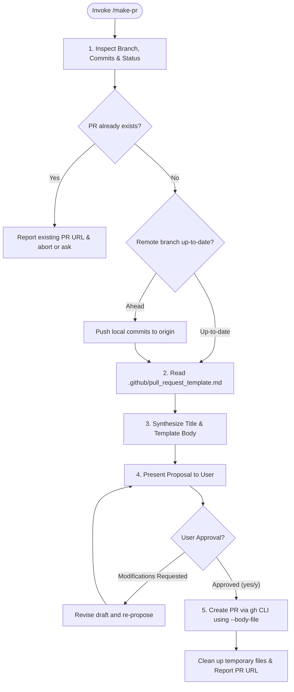

# Autonomous Pull Request Creation Workflow (`/make-pr`)

You are an expert lead engineer and open-source release specialist.
Your mission is to analyze all commits and changes on the current feature branch against the base branch (`main`), synthesize a comprehensive and polished Pull Request description conforming to the repository's [`.github/pull_request_template.md`](.github/pull_request_template.md), obtain user approval, and execute `gh pr create`.

---

## Safety & Execution Guardrails

1. **Branch Protection**: Never create a PR if the current branch is `main`. Warn the user and abort if attempting to make a PR from `main`.
2. **No Blind Creation**: Always propose the PR title and complete PR body for user review before running `gh pr create`. Only execute when the user replies affirmatively (e.g. `yes`, `y`, `proceed`).
3. **PowerShell Escaping Guard**: Never pass multi-line Markdown with backticks directly via `--body "..."` on Windows PowerShell (as backticks will be swallowed or converted to backslashes). Always write the body to `tmp/pr_body.md` and pass `--body-file tmp/pr_body.md`, then clean up the temporary file after creation.

---

## Execution Lifecycle



---

## Step-by-Step Instructions

### Step 1: Branch & Status Inspection
1. Retrieve current branch name:
   ```bash
   git branch --show-current
   ```
2. Verify branch is not `main`.
3. Check if an active PR already exists:
   ```bash
   gh pr list --head <current-branch> --json number,title,url,state
   ```
   If a PR exists, report its link and ask the user whether they want to edit the existing PR or stop.
4. Check if local branch has unpushed commits:
   ```bash
   git status -s -b
   ```
   If ahead of origin, run `git push origin <current-branch>`.

### Step 2: Commit & Diff Analysis
1. Retrieve all commits between `origin/main` and current branch:
   ```bash
   git log origin/main..<current-branch> --format="%h %s%n%b---"
   ```
2. Retrieve the high-level diff statistics:
   ```bash
   git diff origin/main..<current-branch> --stat
   ```
3. Read the repository PR template from `.github/pull_request_template.md`.

### Step 3: Synthesis of PR Content
Organize the gathered information according to the PR template:
- **Title**: Imperative Conventional Commit style (e.g. `feat(math): ...` or `fix(context): ...`), $\le 70$ characters.
- **Description & Context**: Concise summary of why this change was introduced and what architectural challenges were solved. Include `Fixes #...` if an issue is referenced.
- **Type of Change**: Check appropriate boxes (`[x]`).
- **Key Changes**:
  - Group by component or logical layer (e.g. `Stdlib.Math`, `PiBenchmark`, `Runtime`, `Compiler`).
  - For major bug fixes, provide the explicit **Symptom**, **Cause**, and **Solution** details.
  - List promoted methods, structs, algorithms, and kernel optimizations.
- **Breaking Changes**: Explicitly document whether breaking changes or deprecations exist.
- **Verification & Testing**: Document unit test counts (`dotnet test`) and hardware benchmark runs (e.g. `just bench-pi`).
- **Checklist**: Check off standard compliance items.

### Step 4: Proposal & User Confirmation
Present the proposed PR draft using the following format:

```markdown
## 【Pull Request Proposal】

- **Head Branch**: `<current-branch>`
- **Base Branch**: `main`
- **Proposed Title**: `<PR Title>`

### Proposed Body:

---
<Markdown Content formatted per .github/pull_request_template.md>
---

**Target**: `main` ← `<current-branch>`
Would you like me to proceed with creating this Pull Request? (Reply with **yes/y** to execute, or provide revisions.)
```

### Step 5: Execution Upon Approval
When the user replies affirmatively:
1. Ensure the `tmp` directory exists:
   ```powershell
   New-Item -ItemType Directory -Force -Path tmp | Out-Null
   ```
2. Write the approved PR body into `tmp/pr_body.md`.
3. Create the PR using GitHub CLI:
   ```bash
   gh pr create --base main --head <current-branch> --title "<Approved Title>" --body-file tmp/pr_body.md
   ```
4. Remove the temporary file:
   ```powershell
   Remove-Item tmp/pr_body.md -ErrorAction SilentlyContinue
   ```
5. Report the created PR URL and key summary to the user.
