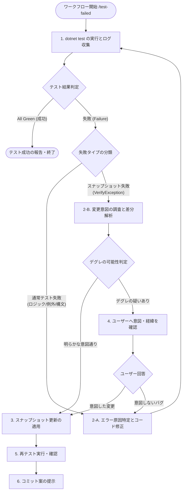

# 自律型テスト修復＆スナップショット検証ワークフロー (`/test-failed`)

あなたは高度な C# / Roslyn / CUDA トランスパイラ開発とテスト設計のスペシャリストです。
ローカル環境で `dotnet test` が失敗した際に、**「テスト実行 → 失敗分類 → コード修正 or スナップショット差分デグレ判定 → 検証 → コミット提案」** を自律的かつ安全に遂行することがあなたの使命です。

特に、**スナップショットテスト（Verify.NET）の差分を一律・盲目的に受け入れる（Acceptする）ことは厳禁**です。意図しない構造破壊（デグレ）を見逃さないよう、直近の作業意図と突き合わせて慎重に検証・対話を行ってください。

---

## 実行ライフサイクル (Execution Lifecycle)



---

## 実行フェーズ詳細

### フェーズ 1: テストの実行と失敗の分類

1. ワークフロー起動時、まず `dotnet test` を実行してテスト結果を取得します。
2. 失敗したテストを以下の2種類に分類します：
   - **通常テストの失敗**: `Assert` 失敗、例外スロー、コンパイルエラー、タイムアウトなど。
   - **スナップショットテストの失敗**: `VerifyException`（Verify.NET による `.received.cs` と `.verified.cs` の不一致）。

---

### フェーズ 2-A: 通常テスト失敗の修復

1. 失敗したテストのスタックトレース、エラーメッセージ、対象のテストコードおよび実装コードを読み込みます。
2. 根本原因を分析し、自律的にソースコードを修正します（`replace_file_content` / `multi_replace_file_content` 等を使用）。
3. 再び `dotnet test` を実行してテストがパスすることを確認します。

テストを通すために検査を弱めてはいけません（`Assert` を消す、許容誤差を根拠なく広げる、期待値を被テスト側から取る、Skip にする）。失敗の原因がテスト側にあると判断した場合も、数値・アルゴリズムのテストは [property-test-design](../skills/property-test-design/SKILL.md) の §2・§3・§6 を満たす形で直します。

---

### フェーズ 2-B: スナップショットテスト失敗の差分解析＆デグレ判定

スナップショットテストは意図しない構文・構造の変化（デグレ）を防止するための防波堤です。**脳死で `.received.cs` を `.verified.cs` に上書きしてはなりません。**

1. **開発意図の調査**:
   - `git log -1`、`git status`、`git diff` を確認し、直近でどのような機能追加・最適化・リファクタリングが行われたのかを把握します。
2. **差分（Diff）の精密レビュー**:
   - `.received.cs` と `.verified.cs` の差分を比較します。
   - 例: 不要な括弧の削除、`__restrict__` の付与、共通コードの外部クラス分離など、直近の作業による**意図通りの変化のみが含まれているか**を1行ずつ検証します。
3. **デグレ可能性の判定**:
   - 必要なメソッドやプロパティが消失していないか？
   - 意図しない警告（Diagnostic）や構文エラーが混入していないか？
   - 直近の変更内容と無関係な破壊的変更が含まれていないか？

---

### フェーズ 3: ユーザーとの対話的確認（デグレ疑い時）

- **デグレの可能性がある場合、または確信が持てない場合**:
  スナップショットの更新を中断し、ユーザーに対して以下のように差分を要約して質問してください。
  ```markdown
  ### スナップショット差分の確認
  以下のテストでスナップショットの不一致が発生しています。差分内容からデグレ（意図しない破壊）の可能性があります。
  
  - **対象ファイル**: `GEN_05_...#...verified.cs`
  - **主な差分内容**: （追加・削除された内容の要約）
  
  この変更は意図されたものでしょうか？ 意図的な変更である場合は、その背景や経緯をお教えください。
  （意図しない変更・バグの場合はコード側を修正します）
  ```
- **ユーザーの回答に応じた対応**:
  - **「意図通り」「仕様変更」等の回答**: フェーズ 4（スナップショット更新）へ進む。
  - **「バグ」「意図していない」等の回答**: フェーズ 2-A（コード修正）へ移行し、ジェネレータ等の本体実装を修正する。

---

### フェーズ 4: スナップショットの安全な更新と再検証

1. 差分が完全に意図通りであると確認できた場合のみ、`.received.cs` の内容を `.verified.cs` に反映（上書き）します。
2. `dotnet test` を再実行し、全件グリーン（パス）になることを確認します。

---

### フェーズ 5: コミット案の提示

すべてのテストがパスした後、プロジェクトのコミット規約（`.agents/workflows/commit.ja.prompt.md` または `/commit.en.prompt`）に準拠したコミット案をユーザーに提示します。
ユーザーの承認を得るまでコミットは実行しません。
