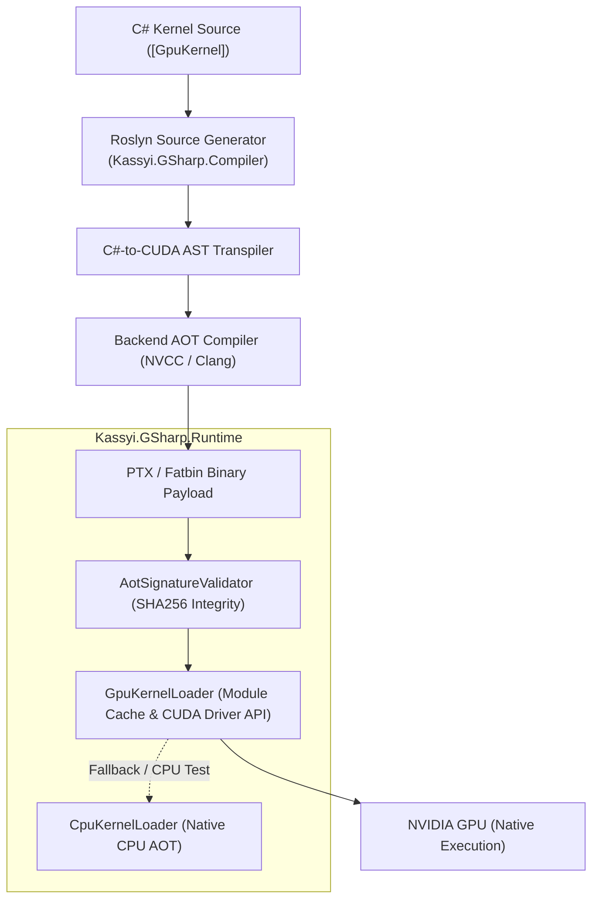

# G# (GSharp)

<p align="center">
  
</p>

**A zero-overhead C#-to-CUDA AOT transpiler. Write bare-metal GPU kernels in standard C#.**

[](LICENSE) [](https://dotnet.microsoft.com/) [](https://developer.nvidia.com/cuda-toolkit)

🔥 **Highlights:**
- **Zero-Allocation Architecture:** 100% value-type (`struct`) driven, absolutely no garbage collection overhead on the device.
- **10.7x Speedup vs CPU:** Outperforms standard `System.Numerics` + PLINQ by over 10.7x in vectorized data processing, achieving 109+ Million elements/sec on a single GPU.
- **World-Class Compute:** Achieves over 1,000,000 Digits/s (Chudnovsky algorithm) in multi-precision arithmetic.

**Open bugs** (milestones M1–M3, redrawn daily by [bug-curve.yml](.github/workflows/bug-curve.yml)):


---

## What is G#?

G# isn't a general-purpose language or a heavy runtime wrapper. It's a high-performance **GPU compute dialect** embedded directly into the .NET ecosystem.

Using Microsoft's Roslyn compiler as a front-end, G# lets you write bare-metal GPU kernels with the type safety and tooling of C# (Visual Studio, Rider, IntelliSense).

At build time, G# intercepts your C# kernel AST and transpiles it into optimized native CUDA C++ and PTX Fatbin payloads. It generates zero-allocation host wrappers entirely behind the scenes.

---

## The Mental Model: C# Syntax, CUDA Semantics

You write C#, but the runtime semantics are strictly native CUDA.

- **Syntax:** Familiar loops, value `struct`s, primitives, local functions, and pattern matching.
- **Architecture:** There is no .NET CLR, managed heap (`class`, `string`, LINQ), or garbage collector in the kernel. Standard BCL methods (like `MathF` or `BitOperations`) act as zero-cost compile-time markers that lower into hardware PTX intrinsics.
- **Execution:** You program massively parallel hardware threads structured into Grids, Blocks, and Warps, with direct access to registers, Shared Memory, and VRAM.

Skip the C++ headers, CMake setups, and P/Invoke boilerplate. Write C#, command bare-metal NVIDIA hardware.

---

## Quick Start (Hello GPU)

Here’s a self-contained C# program that renders a 1080p Mandelbrot set (over 500 million operations) across thousands of GPU cores in **under 2 milliseconds (~1.8 ms on an RTX 3070 Ti, 63x faster than single-threaded CPU)**.

```csharp
using Kassyi.GSharp.Core;

int width = 1920, height = 1080;
int[] image = new int[width * height];

// Launch on the GPU (auto-generated partial method on the same class)
Mandelbrot.LaunchRender(image, width, height, gridDimX: 128, blockDimX: 256);

public static partial class Mandelbrot
{
    [GpuKernel]
    public static void Render(int[] output, int width, int height)
    {
        // Distribute work across GPU cores automatically
        Gpu.GridStrideLoop(width * height, id =>
        {
            float cx = (id % width - width * 0.7f) * 0.0025f;
            float cy = (id / width - height * 0.5f) * 0.0025f;
            float zx = 0, zy = 0;
            int iter = 0;

            // Partial unroll by 4 to maximize ILP without register spilling
            Gpu.Hint.Unroll(4);
            while (zx * zx + zy * zy < 4.0f && ++iter < 256)
            {
                float temp = zx * zx - zy * zy + cx;
                zy = 2.0f * zx * zy + cy;
                zx = temp;
            }
            output[id] = iter;
        });
    }
}
```

### Native CUDA Interop (`[CudaImport]`)

Need to integrate existing, highly tuned CUDA C++ (`.cu`) kernels into your .NET application? G# seamlessly binds native `.fatbin` or `.ptx` binaries with zero P/Invoke boilerplate. Kernel entry point constants are automatically parsed from `.cu` files and exposed via `NativeCudaKernels`:

```csharp
using System.Runtime.InteropServices;

public static partial class NativeInterop
{
    public const string FatbinName = "native_kernels.fatbin";

    [CudaImport(FatbinName, EntryPoint = NativeCudaKernels.ReductionKernel_Native)]
    public static partial void LaunchReduction(
        [In] Float4[] input, [Out] float[] output, int n,
        uint gridDimX, uint blockDimX);
}
```

#### Zero-Boilerplate Bindings from YAML

Host libraries (cuBLAS, cuRAND, your own `.dll` / `.so`) and kernels in third-party `.fatbin` modules can be bound by describing them in YAML. The `NativeApiGenerator` source generator evaluates the file at compile time, so IntelliSense, XML documentation and type checking are available immediately, without any reflection or runtime parsing.

```xml
<ItemGroup>
  <AdditionalFiles Include="native/*.yml" GSharpApi="true" />
</ItemGroup>
```

```yaml
# native/my_kernels.yml: kernels inside a fatbin shipped next to the application
namespace: MyApp.Native
className: MyKernels
moduleName: ./native/my_custom_kernels.fatbin   # relative to AppContext.BaseDirectory
methods:
  - name: SgemmCustom
    entryPoint: sgemm_kernel_v1                  # kernel symbol resolved via cuModuleGetFunction
    summary: User-defined custom matrix multiplication kernel.
    parameters:
      - { name: a, type: "float[]", description: Matrix A. }
      - { name: c, type: "float[]", description: Matrix C. }
      - { name: n, type: int }
      - { name: gridDimX, type: uint }
      - { name: blockDimX, type: uint }
```

```csharp
MyKernels.SgemmCustom(a, c, n, gridDimX: 64, blockDimX: 256);
```

A definition with `libraryName` instead of `moduleName` produces `[DllImport]` bindings; `libraryNames` lists per-platform probing candidates (bare names, paths relative to the application, or `%ENV%`-expanded paths). The built-in showcases [`cublas_api.yml`](src/NativeApi/cublas_api.yml) and [`curand_api.yml`](src/NativeApi/curand_api.yml) are consumed exactly this way and exposed as `CuBlasApi` / `CuRandApi`:

```csharp
using var scope = new GpuKernelLoader.CudaContextScope();
CuBlasApi.cublasCreate_v2(out var handle);
CuBlasApi.cublasSgemm_v2(handle, CuBlasOperation.None, CuBlasOperation.None,
    m, n, k, 1.0f, dA.DevicePointer, m, dB.DevicePointer, k, 0.0f, dC.DevicePointer, m);
CuBlasApi.cublasDestroy_v2(handle);
```

> [!NOTE]
> Fatbins loaded through `moduleName` go through the same signature verification as `[CudaImport]` modules. Schema and syntax errors in a definition are reported as [GSH0052](docs/spec/en/03_bcl_api/diagnostics/GSH0052.md) / [GSH0053](docs/spec/en/03_bcl_api/diagnostics/GSH0053.md) on the offending YAML line.

---

## How It Works



1. **Roslyn Compilation**: During `dotnet build`, the Roslyn Incremental Generator detects `[GpuKernel]` methods.
2. **AST Transpilation**: The C# syntax tree is parsed, validated against zero-allocation rules, and emitted as optimized CUDA C++ (`.cu`).
3. **AOT Binary Embedding**: NVCC compiles the device code into PTX / Fatbin payloads, embedded with SHA256 checksums.
4. **Zero-Allocation Launch**: Generated wrappers marshal parameters and dispatch kernels via the CUDA Driver API with zero reflection.

---

## Repository Structure

| Project                      | Description                                                                                                   |
| ---------------------------- | ------------------------------------------------------------------------------------------------------------- |
| **`Kassyi.GSharp.Core`**     | Core attributes (`[GpuKernel]`), execution primitives (`ThreadIndex`), hardware intrinsics, and macros.       |
| **`Kassyi.GSharp.Compiler`** | Roslyn Source Generator and AST transpiler. Handles static analysis and generates host wrappers.              |
| **`Kassyi.GSharp.Runtime`**  | High-performance runtime for AOT caching, RAII VRAM management (`GpuBuffer<T>`), and CUDA Driver API interop. |
| **`Kassyi.GSharp.Stdlib`**   | GPU-accelerated math libraries (arbitrary-precision arithmetic, NTT, Fermat PRP tests).                       |
| **`Henicos.Benchmarks`**     | Hardware validation suites (Chudnovsky Pi calculation, large-scale modular reduction, SGEMM).                 |

---

## Project Origins

### Why "G#"?

A simple portmanteau of **GPU + C#**. Visually, **G** is just a **C** with an extra stroke, reflecting C# syntax scaling to GPU parallelism. (Musically, G# is the natural fifth dominant over C, nodding to the harmony between host orchestration and bare-metal compute.)

### The "Henicos" Codename

From the Greek _hén_ (_ἕν_), meaning unity. The framework was born from a specific mathematical challenge: proving the primality of a 43-million-digit algebraic number ($N = 2X^2 - X + 11$ where $X = 2^{71428571}$) via specialized hardware modular reduction. Hitting bare-metal GPU limits in C# required a frictionless AOT pipeline—leading to G#.

---

## Documentation

Specs, guides, and API references are available in [`docs/spec/en/`](docs/spec/en/):

- [1. Getting Started & Philosophy](docs/spec/en/00_getting_started/00_index.md)
- [2. Language Specification](docs/spec/en/01_language/00_index.md)
- [3. Compiler & Runtime Architecture](docs/spec/en/02_architecture/00_index.md)
- [4. BCL API & Intrinsics](docs/spec/en/03_bcl_api/00_index.md)
- [5. Guides & Best Practices](docs/spec/en/04_guides/00_index.md)

---

## Reporting a Bug

Run the environment report and paste its output into the bug report. From a clone with the .NET 10 SDK: `just env-info` (or `dotnet run tools/collect-env/collect-env.cs`). Without a clone: download `collect-env-win-x64.exe` or `collect-env-linux-x64` from the latest release. The report leaves out your user name, host name, serial numbers and profile paths.

---

## License

MIT License. See [LICENSE](LICENSE) for details.

## Trademark Notice
CUDA and NVIDIA are trademarks or registered trademarks of NVIDIA Corporation. Henicos (G#) is an independent open-source project and is not affiliated with, sponsored, or endorsed by NVIDIA Corporation.