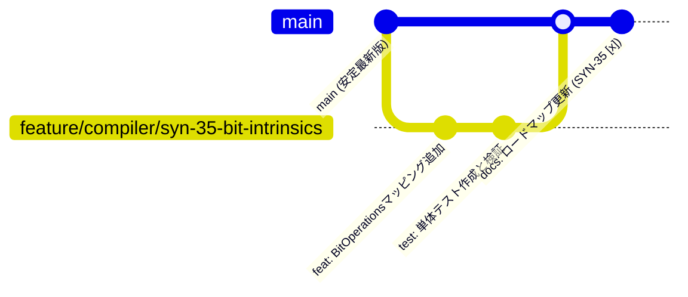

# G# (GSharp) ブランチ戦略 & 開発運用ガイドライン

本ドキュメントは、G# (GSharp) および GpuBigInt (GBI) の長期的な大規模開発を円滑かつ安全に進めるための Git ブランチ命名規則および開発運用フローを定義します。

---

## 1. 基本方針 (Core Principles)

- **`main` ブランチの健全性維持**: `main` ブランチは常にすべての単体テストおよび統合テストが通過するビルド可能状態を保ちます。
- **1タスク 1ブランチ (Atomic Feature Branches)**: ロードマップ管理表 (`docs/roadmap-index.md`) のタスク単位（`SYN-xx`, `GSH-xx`, `GBI-xx`）で独立したフィーチャーブランチを作成します。
- **AIエージェントとの文脈境界の明確化**: ブランチをタスクごとに分けることで、AIエージェントの処理範囲・コンテキスト汚染を防止し、確実な差分レビューとテスト検証を行います。

---

## 2. ブランチ命名規則 (Branch Naming Conventions)

ブランチ名は以下のフォーマットに準拠して作成します。

```text
<kind>/<layer>/<task-id>-<short-name>
```

### パラメータ定義

- **`kind` (種類)**
  - `feature`: 新機能、C#構文サポート、アルゴリズムの追加
  - `refactor`: リファクタリング、アーキテクチャの変更
  - `fix`: バグ修正、動作不具合の解消
  - `docs`: ドキュメントやスクリプトの整備

- **`layer` (対象レイヤー)**
  - `core`: `Kassyi.GSharp.Core` (属性、共通例外、マーカー)
  - `compiler`: `Kassyi.GSharp.Compiler` (ソースジェネレータ、トランスパイラ)
  - `runtime`: `Kassyi.GSharp.Runtime` (JitEngine, CUDA API wrapper)
  - `stdlib`: `Kassyi.GSharp.Stdlib.Math` (GpuBigInt等の標準ライブラリ)
  - `native`: `Kassyi.GSharp.Stdlib.Math.Cuda` (CUDA C++ ネイティブ実装)
  - `apps`: `Henicos.Cli`, `Henicos.PiBenchmark` 等の検証アプリ

### 具体的命名例

| 種別 | コマンド例 | 対象タスクの例 |
| :--- | :--- | :--- |
| **構文拡張** | `git checkout -b feature/compiler/syn-35-bit-intrinsics main` | SYN-35: ビット演算 Intrinsics |
| **トランスパイラ** | `git checkout -b feature/compiler/gsh-01-ternary-expr main` | GSH-01: 三項演算子の複雑展開 |
| **GPU基盤** | `git checkout -b feature/stdlib/gbi-01-memory-pool main` | GBI-01: メモリプールの実装 |
| **ランタイム** | `git checkout -b feature/runtime/gsh-07-jit-cache main` | GSH-07: JITディスクキャッシュ |
| **バグ修正** | `git checkout -b fix/compiler/visitor-null-ref main` | トランスパイラ訪問のNull例外修正 |

---

## 3. 標準開発運用フロー (Development Workflow)



### ステップバイステップ手順

1. **タスクの選定**
   - `docs/roadmap-index.md` のマイルストーン（Tier 1 〜 Tier 4）から着手するタスクを選択。
2. **フィーチャーブランチの作成**
   - 最新の `main` からブランチを作成：
     ```bash
     git checkout main
     git pull origin main
     git checkout -b feature/<layer>/<task-id>-<short-name>
     ```
3. **実装および検証**
   - 目的の機能を実装し、単体テストを追加。
   - `dotnet test Henicos.slnx` で全体のビルドおよび全テスト通過を確認。
4. **`main` へのマージ**
   - 検証完了後、`main` ブランチへマージ（または Pull Request のマージ）。
5. **ロードマップ進捗の更新**
   - タスクのステータスを更新し、メモ欄に変更内容を記入します。
   - 以下のUIを起動して進捗状況（ステータスやメモ）を更新し、変更をオートセーブで保存します。
     ```bash
     just run-ui
     ```
