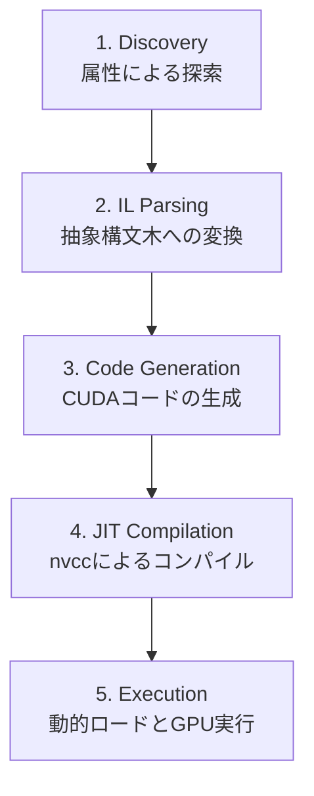

# G# (Kassyi.GSharp) アーキテクチャと現在までの功績

## 1. G# とは何か？ (概要)
G#（Kassyi.GSharp）は、**「C# で書かれた普通のメソッドを、実行時 (JIT) に GPU 用のネイティブコード (CUDA) に変換して実行する」** ための自作トランスパイラ（変換器）です。

通常、GPUを動かすためには C++ (CUDA C++) を書かなければなりませんが、G# システムは **C# の中間言語 (.NET IL) を読み取り、それを CUDA C++ に逆変換（トランスパイル）し、裏でコンパイルして呼び出す** という「ブラックボックス」を全自動でやってくれます。

---

## 2. システムはどう動いているのか？ (パイプラインの全貌)

ボタン（`TranspilerRunner.Run`）を押してから GPU が動くまでの間、システム内部では以下の 5 つのフェーズが高速で実行されています。

### ① 探索 (Discovery)
- **担当クラス**: `TranspilerRunner`
- 対象となるアセンブリ（DLL）の中をリフレクション（`Mono.Cecil`）で探し回り、`[GpuKernel]` 属性がついたメソッド（例: `DummyMath.SimpleLoop`）を自動的に見つけ出します。

### ② 解析とAST化 (IL Parsing)
- **担当クラス**: `AstBuilder`
- 見つけたメソッドの中身（.NET の中間言語 IL）を1行ずつ読み取ります。「変数をスタックに積む」「足し算をする」といった命令を解読し、意味のあるツリー構造（**AST: 抽象構文木**）に組み替えます。

### ③ コード生成 (Code Generation)
- **担当クラス**: `CudaGenerator`
- 構築された AST（ツリー）を上から順番になぞりながら、対応する **CUDA C++ のソースコード** を直接メモリ上（`StringBuilder`）に書き出します。

### ④ JIT コンパイル (JIT Compilation)
- **担当クラス**: `JitCompiler` / `NvccCompiler`
- 生成された C++ コードを一時ファイル（`.cu`）として保存し、裏でこっそり NVIDIA のコンパイラ（`nvcc.exe`）を起動します。
- `nvcc` が C++ コードを GPU 向けのマシン語バイナリ（`.dll`）にコンパイルします。終わったら不要になった一時ファイルは綺麗に掃除（クリーンアップ）されます。

### ⑤ 動的ロードと実行 (Execution)
- **担当クラス**: `NativeModuleLoader` / `JitCompiledKernel<T>`
- 出来上がった `.dll` を `NativeLibrary.Load` を使って C# プロセスに動的に読み込みます。
- 最後に C# から P/Invoke (関数ポインタ) を通じてその DLL を呼び出すことで、**見事 GPU 上で計算が走ります**。使い終わったら安全に DLL をアンロード（メモリ解放）します。

---

## 3. 現在までの功績 (品質保証とリファクタリングの歴史)

この「ブラックボックス」は初期段階では非常に壊れやすく、セキュリティやメモリリークの危険を抱えていましたが、直近の改修により **超安全・爆速・拡張可能なコンパイラ基盤** へと進化しました。

| フェーズ | 達成した功績・改善内容 |
| :--- | :--- |
| **Phase 01** ドメインモデル不変性 | **ASTノードの Immutable 化** `IAstNode` を C# 9 の `record` へ移行。構築後のツリーが外部から書き換えられるバグを構造的に根絶しました。 |
| **Phase 02** フェイルファスト化 | **ILパーサーの解体と安全装置** 巨大な `switch` 文を解体し、`Dictionary` ベースの戦略パターンへリファクタリング。未知の命令が来た瞬間に `NotSupportedException` を投げ、意図しない破壊的コードの生成を防ぐ（フェイルファスト）仕組みを構築しました。 |
| **Phase 03** インフラのセキュア化 | **JITパイプラインの堅牢化** コマンドインジェクションを防ぐための `ArgumentList` 化、一時ファイルの確実な削除 (`try-finally`)、DLLの安全なライフサイクル管理 (`IDisposable`) を実装し、リソースリークを根絶しました。 |
| **Phase 04** 自動探索化 | **ハードコードの排除** テスト対象のメソッドを名前で直接指定するのをやめ、`[GpuKernel]` 属性がついたメソッドを動的に抽出して走査する自動化アーキテクチャに変更しました。 |
| **Phase 05** パフォーマンス最適化 | **Direct Token Streaming の導入** 文字列操作によるゴミ（アロケーション）をゼロにするため、中間の `Stack<string>` を廃止し、AST から直接出力バッファへコードを流し込む超高速なコード生成（ゼロアロケーション）を実現しました。 |
| **Phase 06** プロジェクトの分離 | **GSharp の独立（コンポーネント化）** `Henicos` の内部に同居していた機能を、独立したクラスライブラリ `Kassyi.GSharp` として完全分離。他のどんなプロジェクトからでも「アセンブリを渡せばGPUコードにしてくれる」汎用ライブラリへと昇華させました。 |

### 今後の展望 (Next Steps)
現状の G# システムは単純なループ計算を変換できる状態にありますが、今後は **分岐命令（if / else 等）の解析 (CFG: Control Flow Graph 解析)** や、さらに複雑な型（構造体や配列）を C# と GPU の間でやり取りするインフラストラクチャの拡張が期待されます。
