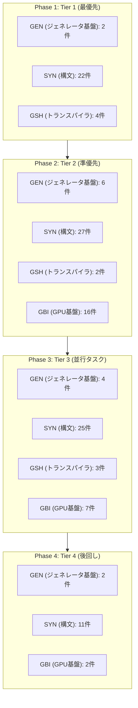

# G# (GSharp) & GpuBigInt (GBI) 開発ロードマップ & 進捗管理インデックス

最終更新日: 2026-08-25  
対象モジュール: `Kassyi.Generators.GSharp`, `Kassyi.GSharp.Runtime`, `Kassyi.GSharp.GpuBigInt`

---

## 1. ドキュメント構成 & 詳細進捗表一覧

各ドメインごとの詳細な課題・構文対応状況・トラッキング用チェックボックスは以下の分割ファイルで管理されています。AIは実装タスクの着手・完了に合わせて各個別ファイルを参照・更新します。

| ドキュメント                                                                      | 主な対象領域                   | 主な内容                                                                                                    |
| :-------------------------------------------------------------------------------- | :----------------------------- | :---------------------------------------------------------------------------------------------------------- |
| **[ブランチ戦略 & 運用ガイドライン](./branching_strategy.md)**                   | Git運用・開発プロセス           | タスクIDに基づくブランチ命名規則（`feature/<layer>/<task-id>-*`）とマージフロー            |
| **[GBI 課題 & 演算子進捗管理表](./roadmaps/gbi_roadmap.md)**                      | `GpuBigInt` モジュール         | メモリプール(GBI-01)、ModPowテスト復帰(GBI-02)、GPUリダクション(GBI-03)、記号演算子・関数型演算子の網羅状況 |
| **[G# トランスパイラ & ランタイム課題](./roadmaps/gsharp_transpiler_issues.md)**  | `Generators.GSharp`, `Runtime` | 三項演算子、タプル、ローカル関数、スタック配列、JITディスクキャッシュ等のアーキテクチャ課題                 |
| **[G# ソースジェネレータ・コア基盤課題](./roadmaps/gsharp_generator_core.md)**    | `Generators.GSharp`, `Core`    | 自動生成ラッパー、JITバインディング、エラー診断ハンドリング等の基本基盤                                     |
| **[C# 構文・シュガー対応 & 永久非対応一覧](./roadmaps/gsharp_syntax_support.md)** | 言語機能・AST走査              | SYN-01〜SYN-93 の全構文対応状況、および GPU アーキテクチャ上永久非対応（UNS-01〜14）の定義                  |

---

## 2. 全体開発ロードマップ & マイルストーン

<!-- BEGIN GENERATED ROADMAP -->

### 直近のマイルストーン & 推奨着手順

1. **マイルストーン 1: Tier 1 (即効性の高いブロッカー解放)**
    - **GSH-08**: Macro DSL と Intrinsics サポート (Score: 45)
    - **GEN-01**: C# ラッパーと CUDA 連携の基本機能（JITバインディング） (Score: 45)
    - **SYN-35**: ビット演算 Intrinsics (BitOperations) (Score: 45)
    - **SYN-77**: インライン PTX / C++ 埋め込み (Score: 45)
    - **SYN-90**: 複雑な制御フロー（if-else ネストとループの複合） (Score: 45)
    - **SYN-91**: 基本制御構文（switch, do-while, 論理演算） (Score: 45)
    - **SYN-92**: ユーザー定義構造体のカーネル引数および操作 (Score: 45)
    - **SYN-93**: デバイスメソッド ([GpuDeviceFunction]) の呼び出し・再利用 (Score: 45)
    - **SYN-94**: Macro DSL (Gpu.GridStrideLoop, ForUnroll, SingleThread) (Score: 45)
    - **GSH-01**: 三項演算子 (`? :`) の複雑式展開 (Score: 42)
    - **GEN-02**: NVRTC コンパイルエラーの例外ラップ (Score: 41)
    - **SYN-09**: デフォルトリテラル (default) (Score: 41)
    - **SYN-28**: [MethodImpl(AggressiveInlining)] マッピング (Score: 41)
    - **SYN-68**: Math / MathF / Math.Clamp 関数群 (Score: 41)
    - **SYN-03**: インライン out var 変数宣言 (Score: 39)
    - **SYN-36**: ポインタ後置増減 (Score: 39)
    - **SYN-04**: Null合体 / 複合代入 (??, ??=) (Score: 38)
    - **SYN-17**: Target-typed new() のネスト完全対応 (Score: 38)
    - **SYN-44**: 拡張メソッド (this 引数) (Score: 38)
    - **SYN-46**: ワープシャッフル・同期プリミティブ (Score: 38)
    - **SYN-49**: アトミック演算完全マッピング (Score: 38)
    - **GSH-03**: ローカル関数の非サポート (Score: 37)
    - **GSH-04**: スタック固定長配列・stackalloc の限定性 (Score: 37)
    - **SYN-07**: ローカル関数 (local functions) (Score: 37)
    - **SYN-13**: stackalloc と固定長スタック配列 (Score: 37)
    - **SYN-01**: Switch 式 (switch expression) (Score: 36)
    - **SYN-05**: 三項演算子 (`? :`) の型変換・ネスト (Score: 36)
    - **SYN-08**: ラムダ式・無名関数 (Score: 36)
2. **マイルストーン 2: Tier 2 (難易度が高い重要インフラ)**
    - **GBI-11**: 乗算 (*) (Score: 35)
    - **GEN-13**: カーネル引数マーシャリングのヒープアロケーション完全排除 (Score: 35)
    - **SYN-02**: パターンマッチング (is / 結合 / リレーショナル) (Score: 35)
    - **SYN-29**: [LoopUnroll(N)] 属性によるアンロール制御 (Score: 35)
    - **SYN-47**: 動的共有メモリ (Score: 35)
    - **SYN-70**: foreach ループ on Span<T> (Score: 35)
    - **SYN-14**: fixed バッファ・ポインタピン留め (Score: 34)
    - **GSH-02**: タプル構文の一般化 (Score: 33)
    - **SYN-15**: Span<T> / ReadOnlySpan<T> のカーネル内使用 (Score: 33)
    - **SYN-18**: 構造化束縛・タプル宣言分解 (Score: 33)
    - **SYN-22**: 構造体内演算子オーバーロード (Score: 33)
    - **GBI-12**: 除算・剰余 (/, %) (Score: 32)
    - **GBI-17**: GpuBigInteger.DivRem (Score: 32)
    - **GBI-20**: GpuBigInteger.GreatestCommonDivisor (Score: 32)
    - **SYN-12**: コレクション式 ([1, 2, 3]) (Score: 32)
    - **SYN-24**: enum の基底型指定とビットフラグ (Score: 32)
    - **SYN-27**: nameof(...) 式の静的文字列解決 (Score: 32)
    - **SYN-37**: Unsafe クラスの低レベルポインタ演算 (Score: 32)
    - **SYN-40**: 自動実装プロパティ (Score: 32)
    - **SYN-41**: 計算式プロパティ (=>) (Score: 32)
    - **SYN-73**: Debug.Assert / Trace.Assert (Score: 32)
    - **SYN-75**: [Conditional("DEBUG")] 属性 (Score: 32)
    - **SYN-25**: 文字列補間 ($"") のデバッグ出力化 (Score: 31)
    - **SYN-38**: 固定長バッファ (fixed uint buffer[64]) (Score: 31)
    - **GBI-10**: 加算・減算 (+, -) (Score: 30)
    - **GBI-13**: ビット論理演算 (&, |, ^, ~) (Score: 30)
    - **GBI-14**: ビットシフト (<<, >>) (Score: 30)
    - **GBI-15**: 比較演算 (==, !=, <, >, <=, >=) (Score: 30)
    - **GBI-21**: GpuBigInteger.ModInverse (Score: 30)
    - **GBI-22**: CompareTo / Equals (Score: 30)
    - **GBI-23**: GetBitLength / GetByteCount (Score: 30)
    - **GBI-24**: IsZero / IsOne / IsEven (Score: 30)
    - **GSH-09**: コンパイルタイムアウト時のプロセスツリー終了 (Score: 30)
    - **GEN-03**: ログ出力とフォーマットの非同期実行 (Score: 30)
    - **GEN-04**: MeasureScope による実行時間計測ログ (Score: 30)
    - **GEN-10**: 異なるアーキテクチャ指定時のPTX生成差異 (Score: 30)
    - **GEN-11**: JitConstant とアンロールによるPTX出力最適化 (Score: 30)
    - **GEN-12**: インメモリでのPTX実行検証 (Score: 30)
    - **SYN-19**: 構造体のプライマリコンストラクタ (Score: 30)
    - **SYN-32**: MemoryMarshal.Cast<TFrom, TTo> (Score: 30)
    - **SYN-63**: Unsafe.NullRef<T>() / IsNullRef (Score: 30)
    - **SYN-65**: ネイティブ整数 (nint, nuint) (Score: 30)
    - **SYN-76**: コンパイル時定数評価 (constexpr 伝播) (Score: 30)
    - **GBI-03**: CPU-Fallback メソッドの GPU リダクション化 (Score: 29)
    - **SYN-11**: Index & Range 構文 (^1, [1..5]) (Score: 29)
    - **SYN-23**: readonly struct / readonly メソッド (Score: 29)
    - **SYN-34**: ハードウェア SIMD ベクトル (Vector128) (Score: 29)
    - **SYN-39**: 明示的 / 暗黙的型変換演算子 (Score: 29)
    - **GBI-01**: GSharpJitProvider メモリプールの実装 (Score: 28)
    - **GBI-04**: Square 専用 JIT カーネルのディスパッチ (Score: 28)
    - **GBI-19**: GpuBigInteger.Square (Score: 28)
3. **マイルストーン 3: Tier 3 (並行作業・隙間タスク)**
    - **GBI-02**: Test_ModPow_Correctness の Skip 解除と検証 (Score: 27)
    - **GSH-06**: PTX / C++ コンパイルエラーの行番号マッピング (Score: 27)
    - **SYN-20**: record struct と with 式 (Score: 27)
    - **SYN-21**: 構造体内インデクサ (this[int index]) (Score: 27)
    - **SYN-30**: ジェネリック構造体 (struct Vector<T>) (Score: 27)
    - **SYN-45**: Nullable 値型 (Score: 27)
    - **SYN-69**: 64ビット飽薄 / キャリー演算 (Score: 27)
    - **SYN-74**: CallerMemberName / CallerLineNumber (Score: 27)
    - **SYN-43**: checked / unchecked ブロック・式 (Score: 26)
    - **SYN-60**: ラムダ式のデフォルト引数 (Score: 26)
    - **SYN-61**: ラムダ式の明示的戻り値型指定 (Score: 26)
    - **GBI-18**: GpuBigInteger.ModPow (Score: 25)
    - **GBI-25**: GpuBigInteger.Sqrt (Score: 25)
    - **GEN-14**: ゼロ長配列 (`new T[0]`) 引数のエッジケース処理 (Score: 25)
    - **SYN-16**: 2次元インデクサ / 多次元配列 (Score: 25)
    - **SYN-26**: UTF-8 文字列リテラル (Score: 24)
    - **SYN-33**: ref フィールド / ref struct メンバ (Score: 24)
    - **SYN-62**: scoped ref / scoped Span<T> (Score: 24)
    - **SYN-72**: 多重ループ脱出 (名前付き break) (Score: 24)
    - **SYN-81**: ref readonly 戻り値 (Score: 24)
    - **SYN-88**: 暗黙のスタック配列 (stackalloc[]) (Score: 24)
    - **SYN-80**: params Span<T> (Score: 23)
    - **GSH-05**: ジェネリクス (<T>) の制約解決 (Score: 21)
    - **SYN-06**: ref 条件式 (ref ternary) (Score: 21)
    - **SYN-58**: プロパティパターン (Score: 21)
    - **SYN-59**: 位置パターン (Score: 21)
    - **SYN-64**: 半精度浮動小数点数 (Half) (Score: 21)
    - **SYN-66**: 128ビット整数 (Score: 21)
    - **SYN-82**: volatile フィールド修飾子 (Score: 21)
    - **SYN-83**: [module: SkipLocalsInit] 属性 (Score: 21)
    - **SYN-84**: タプル宣言分解の foreach ループ (Score: 21)
    - **GBI-16**: インクリメント/デクリメント (++, --) (Score: 20)
    - **GBI-26**: ローカル変数宣言時の GpuBigIntExpr 診断 (Score: 20)
    - **GBI-27**: 代入時の GpuBigIntExpr 診断 (Score: 20)
    - **GBI-28**: レガシー名前空間の宣言診断 (Score: 20)
    - **GSH-07**: JIT ディスクキャッシュ機構 (Score: 20)
    - **GEN-05**: 異常系経路での診断情報出力 (Score: 20)
    - **GEN-06**: 包括的仕様カーネルの生成コード診断 (Score: 20)
    - **GEN-07**: 未対応機能の診断レポート (Score: 20)
4. **マイルストーン 4: Tier 4 (後回し・ニッチ領域)**
    - **SYN-42**: 静的抽象メンバ (static abstract) (Score: 19)
    - **SYN-71**: switch 内の goto case (Score: 19)
    - **SYN-57**: リストパターン (Score: 18)
    - **SYN-78**: テンソルコア・WMMA (Score: 18)
    - **SYN-79**: ファイルローカル型 (file struct) (Score: 18)
    - **SYN-86**: 関数ポインタの呼出規約 (Score: 18)
    - **SYN-31**: アンマネージド関数ポインタ (Score: 16)
    - **GBI-06**: 式木の Kernel Fusion (Score: 15)
    - **SYN-48**: グリッド協調グループ同期 (Score: 15)
    - **SYN-87**: #line hidden / #line default (Score: 15)
    - **SYN-50**: 非同期コピー / TMA (Score: 13)
    - **SYN-67**: BFloat16 / FP8 型 (Score: 12)
    - **GBI-05**: Lehmer's GCD の大桁並列化 (Score: 11)
    - **GEN-08**: ジェネレータのスナップショット一貫性テスト (Score: 10)
    - **GEN-09**: テストケースとスナップショットの整合性保証 (Score: 10)

<!-- END GENERATED ROADMAP -->

---

## 4. 優先度スコアリング基準 (Priority Scoring Criteria)

タスクの着手優先度（Tier 1 〜 Tier 4）は、以下の基準による機械的なスコアリングで決定されます。これは大規模開発のベストプラクティス（遅延コスト最小化・WSJF法）に基づいています。

**指標定義 (1〜5点)**

- **$B$ (Blocker / 依存度)**: 他の実装やカーネルがブロックされる度合い（5: 完全ブロック / 1: 自己完結）
- **$E$ (Ease / 実装の容易さ)**: 難易度の逆数。実装コストの低さ（5: 極めて簡単・半日 / 1: 大規模設計・リスク大）
- **$G$ (Generality / 汎用性)**: コード内での出現頻度や利用される範囲（5: 日常的に全域で使用 / 1: 極めてニッチ）

**スコア計算式**
$$ \text{Priority Score} = (B \times 4.0) + (E \times 3.0) + (G \times 2.0) $$

- **Tier 1 (最優先)**: ブロック度が高く、実装が容易（即効で他を解放）
- **Tier 2 (準優先)**: ブロック度は高いが、実装難易度も高い（早期に着手してパイプラインを疎通）
- **Tier 3 (並行タスク)**: ブロック度は低いが、実装が容易（隙間時間に処理）
- **Tier 4 (後回し)**: ブロック度が低く、実装難易度も高い（性能チューニング、極小ニッチ構文など）

※実際の計算およびロードマップのフェーズ再編は、自動化スクリプト (`scripts/calculate_priorities.js`) を用いて機械的に算出します。
