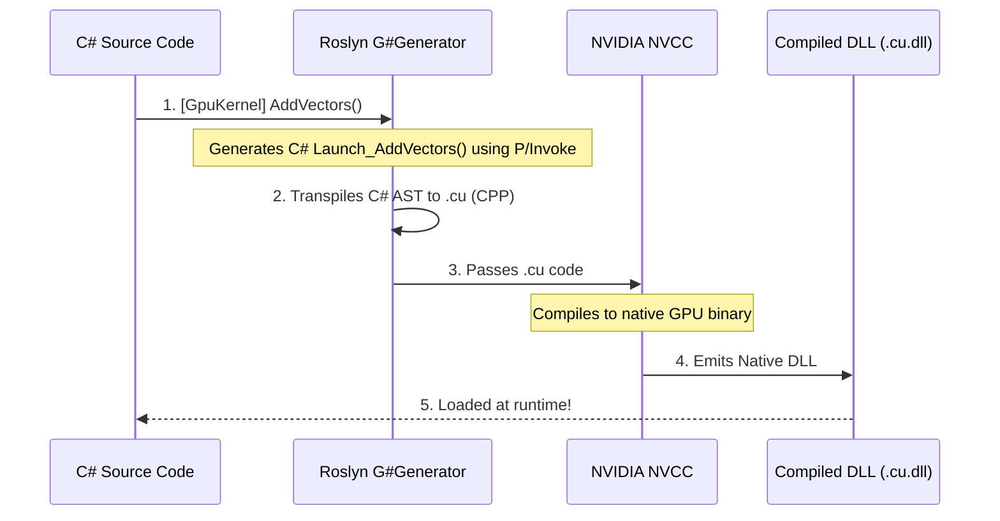

# 0. Getting Started with G# (GSharp)

Welcome to G#! 

Before diving into the complex architecture and deep API references, it is important to understand what G# actually is. **G# is not a new programming language.** It is a framework that allows you to write standard C# code and execute it natively on NVIDIA GPUs with zero overhead.

If you know C#, you already know how to write GPU code in G#.

This guide will walk you through the "Hello World" of GPU programming: **Vector Addition** (adding two arrays together in parallel).

---

## 0.1 The "Hello GPU" Example: Vector Addition

In traditional CUDA C++, parallel programming requires you to understand grids, blocks, and manually calculate global thread indices (e.g., `int tid = threadIdx.x + blockIdx.x * blockDim.x;`).

G# eliminates this boilerplate. By using the built-in `Gpu.GridStrideLoop` macro, you can write GPU kernels that look exactly like standard C# `for` loops or LINQ expressions. The transpiler will automatically map this to the optimal parallel execution structure on the device.

Here is how you write a GPU kernel in G#:

```csharp
using Kassyi.GSharp.Core;

namespace MyGpuApp;

public static partial class MathKernels
{
    // 1. Mark the method with [GpuKernel] to tell G# this runs on the GPU.
    [GpuKernel]
    public static void AddVectors(float[] a, float[] b, float[] result, int length)
    {
        // 3. Use the GridStrideLoop macro. 
        // You do NOT need to calculate thread indices manually!
        Gpu.GridStrideLoop(length, i => 
        {
            result[i] = a[i] + b[i];
        });
    }
}
```

> [!TIP]
> Under the hood, `Gpu.GridStrideLoop` is intercepted by the G# Transpiler at compile-time and converted into a highly optimized CUDA C++ loop. It safely divides the work across thousands of GPU cores without you having to manage the math.

### (Optional) For CUDA Veterans: The Manual Way

If you are coming from a traditional CUDA C++ background, you might be wondering where `threadIdx.x` and `blockIdx.x` went. Do not worry! G# provides a direct 1:1 mapping to all CUDA intrinsics. You can write the exact same kernel using traditional manual index math if you prefer fine-grained control:

```csharp
[GpuKernel]
public static void AddVectorsManual(float[] a, float[] b, float[] result, int length)
{
    // Direct equivalent to: int tid = threadIdx.x + blockIdx.x * blockDim.x;
    int tid = ThreadIndex.X + BlockIndex.X * BlockDimension.X;
    
    if (tid < length)
    {
        result[tid] = a[tid] + b[tid];
    }
}
```
Both the macro and the manual approach transpile to native CUDA C++ and run with identical performance.

---

## 0.2 Executing from the Host (CPU)

Writing the kernel is only half the battle. In GPU programming, you must orchestrate the **Host-Device Interaction**: allocating memory on the CPU, sending it to the GPU, and launching the kernel.

G# makes this incredibly easy. When you write a `[GpuKernel]`, the Roslyn Source Generator automatically creates a companion C# method prefixed with `Launch_` (in this case, `Launch_AddVectors`). 

You simply call this generated method from your standard CPU code!

```csharp
using System;
using MyGpuApp;

public class Program
{
    public static unsafe void Main()
    {
        int length = 1_000_000; // 1 Million elements

        // 1. Allocate standard C# arrays on the CPU (Host)
        float[] arrayA = new float[length];
        float[] arrayB = new float[length];
        float[] result = new float[length];

        // Initialize data
        for (int i = 0; i < length; i++)
        {
            arrayA[i] = 1.0f;
            arrayB[i] = 2.0f;
        }

        Console.WriteLine("Launching GPU Kernel...");

        // 2. The transpiler automatically generates this 'Launch_AddVectors' wrapper!
        MathKernels.Launch_AddVectors(
            a: arrayA,
            b: arrayB,
            result: result,
            length: length,
            gridDimX: 256,          // Customize CUDA Grid dimensions here
            blockDimX: 256          // Customize CUDA Block dimensions here
        );

        // 3. The GPU modifies the memory directly.
        Console.WriteLine($"Result[0] = {result[0]}"); // Output: 3.0
    }
}
```

> [!IMPORTANT]
> The `Launch_` method handles all the heavy lifting of P/Invoke and DLL loading for you. Because G# focuses on **Zero-Allocation**, you use C# arrays and pass them by `ref` or as pointers to avoid creating expensive copies on the Managed Heap.

---

## 0.3 The Explicit Output Buffer Pattern

Traditional CUDA kernels must return `void`. G# enforces this same contract. To return values from a kernel, you allocate an output buffer (array) on the host and pass it directly to the generated launcher.

```csharp
[GpuKernel]
public static void ComputeMagnitude(PhysicsVector[] particles, float[] output, int length)
{
    int tid = ThreadIndex.X + BlockIndex.X * BlockDimension.X;
    if (tid < length)
    {
        var p = particles[tid];
        output[tid] = MathF.Sqrt(p.X * p.X + p.Y * p.Y + p.Z * p.Z);
    }
}
```

On the host side, you simply allocate the array and pass it to the `Launch_` method, and the GPU populates it directly!

```csharp
// 1. Allocate an array exactly matching the total items to process
float[] magnitudes = new float[25600];

// 2. Pass the output array to the generated Launch_ wrapper
MathKernels.Launch_ComputeMagnitude(
    particles: particlesArray,
    output: magnitudes,
    length: 25600,
    gridDimX: 100,
    blockDimX: 256
);
```

> [!WARNING]
> Ensure your output array is sized correctly for your calculation, and avoid reallocating it inside a hot game loop (e.g., `Update()`). Pre-allocate output buffers once to adhere to **Zero-Allocation** best practices.

---

## 0.4 Under the Hood: What just happened?

When you click "Build" in Visual Studio, a complex sequence of events happens automatically in milliseconds:



1. **Interception**: The G# Roslyn Source Generator detects the `[GpuKernel]` attribute.
2. **Transpilation**: It translates the C# AST (Abstract Syntax Tree) directly into raw CUDA C++ (`.cu`). The `GridStrideLoop` is expanded into native thread math.
3. **Native Compilation**: It silently invokes NVIDIA's `nvcc` compiler to build a native `.dll` / `.so`.
    * **NVCC Fallback**: If `nvcc` is not installed or not found in the system PATH, the transpiler safely skips the C++ compilation phase and emits a mock CPU-based C# stub. This allows developers on non-GPU hardware (like MacBooks) to still compile and write code without breaking the .NET build.
4. **P/Invoke Generation**: It generates the `Launch_AddVectors` method in your C# project, seamlessly bridging the managed and unmanaged worlds.

## 0.5 Next Steps

Now that you know how to write and launch a basic kernel, you can explore the advanced features of G#:
* Learn about the syntax constraints in [01_language/05_limitations.md](01_language/05_limitations.md).
* Explore built-in mathematical limits in [03_bcl_api/02_math_gpubigfloat.md](03_bcl_api/02_math_gpubigfloat.md).
* Deep dive into the transpiler architecture in [02_architecture/01_aot_transpiler.md](02_architecture/01_aot_transpiler.md).
