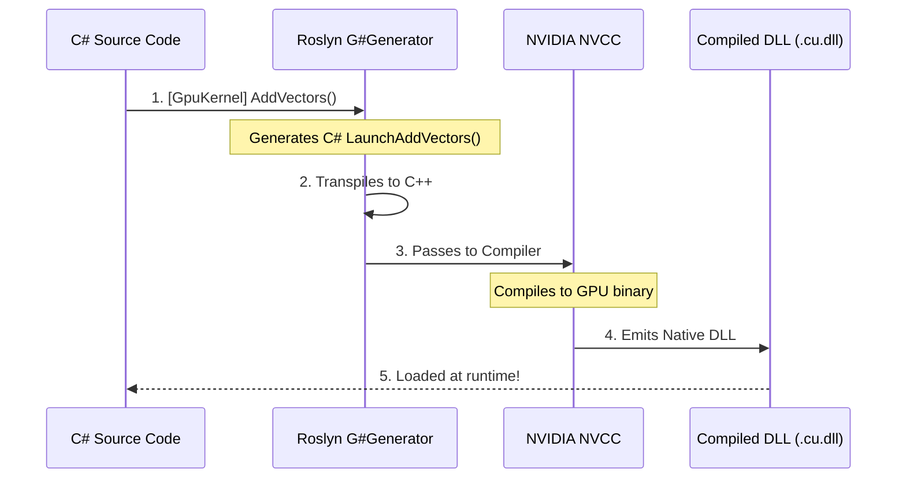

# 0. Getting Started with G# (GSharp)

Welcome to G#! 

Before diving into the complex architecture and deep API references, it is important to understand what G# actually is. **G# is not a new programming language.** It is a framework that allows you to write standard C# code and execute it natively on NVIDIA GPUs with zero overhead.

If you know C#, you already know how to write GPU code in G#.

This guide will walk you through the "Hello World" of GPU programming: **Vector Addition** (adding two arrays together in parallel).

---

## 0.1 The "Hello GPU" Example: Vector Addition

In traditional CUDA C++, parallel programming requires you to understand grids, blocks, and manually calculate global thread indices (e.g., `int tid = threadIdx.x + blockIdx.x * blockDim.x;`).

G# eliminates this boilerplate. By using the built-in `Gpu.GridStrideLoop` macro, you can write GPU kernels that look exactly like standard C# `for` loops or LINQ expressions. The transpiler will automatically map this to the optimal parallel execution structure on the device.

Here is how you write a GPU kernel in G#:

```csharp
// Execution Context: G# Kernel (GPU)
using Kassyi.GSharp.Core;

namespace MyGpuApp;

public static partial class MathKernels
{
    // 1. Mark the method with [GpuKernel] to tell G# this runs on the GPU.
    [GpuKernel]
    public static void AddVectors(float[] a, float[] b, float[] result, int length)
    {
        // 3. Use the GridStrideLoop macro. 
        // You do NOT need to calculate thread indices manually!
        Gpu.GridStrideLoop(length, i => 
        {
            result[i] = a[i] + b[i];
        });
    }
}
```

> [!TIP]
> Under the hood, `Gpu.GridStrideLoop` is automatically converted into a highly optimized CUDA loop. It safely divides the work across thousands of GPU cores without you having to manage the math.

### (Optional) For CUDA Veterans: The Manual Way

If you are coming from a traditional CUDA C++ background, you might be wondering where `threadIdx.x` and `blockIdx.x` went. Do not worry! G# provides a direct 1:1 mapping to all CUDA intrinsics. You can write the exact same kernel using traditional manual index math if you prefer fine-grained control:

```csharp
// Execution Context: G# Kernel (GPU)
[GpuKernel]
public static void AddVectorsManual(float[] a, float[] b, float[] result, int length)
{
    // Direct equivalent to: int tid = threadIdx.x + blockIdx.x * blockDim.x;
    int tid = ThreadIndex.X + BlockIndex.X * BlockDimension.X;
    
    if (tid < length)
    {
        result[tid] = a[tid] + b[tid];
    }
}
```
Both the macro and the manual approach transpile to native CUDA C++ and run with identical performance.

---

## 0.2 Executing from the Host (CPU)

Writing the kernel is only half the battle. In GPU programming, you must orchestrate the **Host-Device Interaction**: allocating memory on the CPU, sending it to the GPU, and launching the kernel.

G# orchestrates this seamlessly. When you write a `[GpuKernel]`, the Roslyn Source Generator automatically creates a companion C# method prefixed with `Launch` (in this case, `LaunchAddVectors`). 

You simply call this generated method from your standard CPU code!

```csharp
// Execution Context: Host (CPU)
using System;
using MyGpuApp;

public class Program
{
    public static unsafe void Main()
    {
        int length = 1_000_000; // 1 Million elements

        // 1. Allocate standard C# arrays on the CPU (Host)
        float[] arrayA = new float[length];
        float[] arrayB = new float[length];
        float[] result = new float[length];

        // Initialize data
        for (int i = 0; i < length; i++)
        {
            arrayA[i] = 1.0f;
            arrayB[i] = 2.0f;
        }

        Console.WriteLine("Launching GPU Kernel...");

        // 2. The transpiler automatically generates this 'LaunchAddVectors' wrapper!
        MathKernels.LaunchAddVectors(
            a: arrayA,
            b: arrayB,
            result: result,
            length: length,
            gridDimX: (length + 255) / 256, // Grid: (Total Elements + BlockSize - 1) / BlockSize
            blockDimX: 256                  // Block: 256 is a safe and optimal default for beginners
        );

        // 3. The GPU modifies the memory directly.
        Console.WriteLine($"Result[0] = {result[0]}"); // Output: 3.0
    }
}
```

> [!TIP]
> **Understanding Grid and Block Dimensions**
> When launching a GPU kernel, you must specify how the hardware should parallelize your work.
> - **`blockDimX`**: The number of threads in a group (Block). NVIDIA GPUs schedule execution in physical units of 32 threads known as **Warps**. To prevent performance degradation (Warp Divergence or under-utilization), your block size should always be a multiple of 32. **`256`** is a highly optimal baseline for most workloads.
> - **`gridDimX`**: The number of groups (Grids) needed to process your entire dataset. Calculate this using integer division: `(TotalElements + BlockSize - 1) / BlockSize`.
> 
> To learn the precise concepts behind Grids and Blocks, see [Execution Context](../03_bcl_api/execution_context/00_index.md).

> [!WARNING]
> **PCIe Memory Transfer Costs**
> The `Launch` method abstracts away the underlying P/Invoke and `cuMemcpy` calls. However, every time you pass a C# array to the GPU, it incurs a significant hardware transfer cost across the PCIe bus. By default, arrays are copied Host-to-Device before execution, and Device-to-Host after execution. 
> To eliminate redundant transfers in performance-critical code, explicitly decorate your arrays with `[In]` (Host-to-Device only) or `[Out]` (Device-to-Host only) attributes. See [Parameter Interop Attributes](../03_bcl_api/attributes/ParameterInteropAttributes.md) for details.

---

## 0.3 Returning Data from Kernels (Auto-Allocation & Explicit Buffers)

Traditional CUDA kernels must return `void`. While G# supports this (and it is recommended for maximum control), G# introduces a powerful feature: **Auto-Allocated Returns**.

If your `[GpuKernel]` returns a value type (e.g., `float`, `int`, `struct`) or an array, the transpiler will automatically convert this into an explicit output buffer under the hood. The `Launch` method will dynamically allocate an array of size `gridDim * blockDim` (one element per thread) and return it to you!

```csharp
// Execution Context: G# Kernel (GPU)
[GpuKernel]
public static float ComputeMagnitude(PhysicsVector[] particles)
{
    int tid = ThreadIndex.X + BlockIndex.X * BlockDimension.X;
    var p = particles[tid];
    
    // Each thread simply returns its calculated value!
    return MathF.Sqrt(p.X * p.X + p.Y * p.Y + p.Z * p.Z);
}
```

On the host side, you simply call the `Launch` method. G# automatically allocates the array for you and populates it with each thread's result:

```csharp
// Execution Context: Host (CPU)
// The generated Launch method returns a float[] sized exactly to the total thread count!
float[] magnitudes = MathKernels.LaunchComputeMagnitude(
    particles: particlesArray,
    gridDimX: 100,
    blockDimX: 256  // Returns a float[25600]
);
```

> [!WARNING]
> While Auto-Allocation is incredibly convenient for prototyping and rapid development, allocating large arrays during hot game loops (e.g., `Update()`) can trigger Managed Heap Garbage Collection (GC) pauses. For performance-critical code, it is recommended to fallback to the **Explicit Output Buffer Pattern** by passing pre-allocated arrays to `void` returning kernels to adhere to strict **Zero-Allocation** best practices.

---

## 0.4 The G# Philosophy: Strict Ownership Model

When dealing with scarce GPU memory and high-performance orchestration on the CPU, managing `IDisposable` resources can quickly lead to memory leaks or double-dispose hazards. Standard C# struggles to enforce strict ownership rules for injected dependencies.

To solve this, G# implements a **Strict Ownership Model** for `IDisposable` resources via its custom Roslyn Analyzer (`ObjectLifecycleAnalyzer`). 

* By default, injected resources are considered **Borrowed** (the receiving class must not dispose them). 
* When ownership must be transferred, G# uses the `[TakesOwnership]` attribute, strictly enforcing that the receiving class fully manages and disposes the resource.

This eliminates ambiguity and provides compile-time guarantees against memory leaks and double-free bugs. For detailed rules and patterns, see [Memory Safety Patterns](04_guides/02_memory_safety_patterns.md).

---

## 0.5 Under the Hood: What just happened?

When you click "Build" in Visual Studio, a complex sequence of events happens automatically in milliseconds:



G# acts as a seamless bridge. It automatically analyzes your `[GpuKernel]` methods at compile-time and translates them into highly optimized NVIDIA GPU binaries. It also generates the `LaunchAddVectors` method so you can easily call your GPU code from standard C# without manually managing unmanaged pointers or native DLL loading.

## 0.6 Next Steps

Now that you know how to write and launch a basic kernel, you can explore the advanced features of G#:
* Learn about the syntax constraints in [01_language/05_limitations.md](01_language/05_limitations.md).
* Browse all GPU intrinsics and math APIs in the [BCL API Overview](03_bcl_api/01_api_overview.md).
* Deep dive into the transpiler architecture in [02_architecture/01_aot_transpiler.md](02_architecture/01_aot_transpiler.md).
