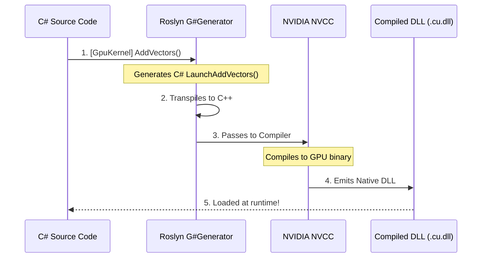

# 3. The "Hello GPU" Tutorial

This guide will walk you through the "Hello World" of GPU programming. A GPU's true advantage shines not in simple addition, but in executing computationally heavy workloads in parallel.

## Step 1: Project Setup

First, ensure you have a project configured with the necessary package references and target dialect. Create a new console application and add the G# Compiler package:

```bash
dotnet new console -n MyGpuApp
cd MyGpuApp
dotnet add package Kassyi.GSharp.Compiler
```

Then, configure your `.csproj` to enable the source generator and select a backend dialect (e.g., `Cuda` or `Cpu`):

```xml
<Project Sdk="Microsoft.NET.Sdk">
  <PropertyGroup>
    <OutputType>Exe</OutputType>
    <TargetFramework>net8.0</TargetFramework>
    <!-- G# Configuration -->
    <GSharpTargetDialect>Cuda</GSharpTargetDialect>
  </PropertyGroup>
</Project>
```

## Step 2: The Code

Here is a complete, self-contained `Program.cs` that you can copy, paste, and run immediately (`dotnet run`).

It simulates a complex mathematical transformation (similar to physics or financial modeling) across **100 million elements**. A CPU would take seconds to process this massive dataset, but a modern GPU finishes it in milliseconds.

```csharp
// Execution Context: G# Kernel (GPU)
using System;
using Kassyi.GSharp.Core;

namespace MyGpuApp;

// ==========================================
// 1. GPU KERNEL DEFINITION
// ==========================================
public static partial class MathKernels
{
    // Mark the method with [GpuKernel] to tell G# this executes on the GPU.
    [GpuKernel]
    public static void ProcessHeavySimulation(float[] data, float[] result, int length)
    {
        // Gpu.GridStrideLoop automatically distributes work across thousands of GPU cores.
        // No internal loops—each thread performs a complex operation once.
        Gpu.GridStrideLoop(length, i =>
        {
            float val = data[i];

            // A computationally expensive formula applied to tens of millions of elements
            result[i] = MathF.Exp(-MathF.Abs(val)) * MathF.Sin(val) * MathF.Cos(val) + MathF.Sqrt(MathF.Abs(val));
        });
    }
}

// ==========================================
// 2. HOST (CPU) ORCHESTRATION & EXECUTION
// ==========================================
public class Program
{
    public static void Main()
    {
        int length = 100_000_000; // 100 Million elements

        // Allocate standard C# arrays on the CPU (Host)
        float[] data = new float[length];
        float[] result = new float[length];

        // Initialize data on the CPU
        for (int i = 0; i < length; i++)
        {
            data[i] = (float)i / length;
        }

        Console.WriteLine("Launching GPU Kernel across 100,000,000 elements...");
        Console.WriteLine("Processing complex mathematical transformations...");

        // The Roslyn Source Generator automatically emits this companion 'Launch...' method!
        MathKernelsWrapper.LaunchProcessHeavySimulation(
            data: data,
            result: result,
            length: length,
            gridDimX: (length + 255) / 256, // Grid: (Total Elements + BlockSize - 1) / BlockSize
            blockDimX: 256                  // Block: 256 threads per block (optimal baseline)
        );

        // The GPU modifies the memory directly and marshals results back.
        Console.WriteLine($"Result[0]          = {result[0]}");
        Console.WriteLine($"Result[{length - 1}] = {result[length - 1]}");
    }
}
```

> [!TIP]
> **Best Practice: Separating Kernels into `.cu.cs` Files in Production**
> While placing the kernel and host logic together in a single file is ideal for quick experiments and "Hello World" prototyping, in real-world production projects it is strongly recommended to isolate GPU kernels into dedicated files (such as `MathKernels.cu.cs`) or isolated classes.
> Separating device code helps developers avoid confusing CPU and GPU execution contexts, and allows automated code review tools and Roslyn analyzers to clearly enforce architectural boundaries.

---

## Understanding Kernel & Host Mechanics

### 1. Writing Kernels with Macros vs Manual Indexing

The `Gpu.GridStrideLoop` macro used above is converted at compile time into a highly optimized CUDA loop. It safely divides work across thousands of GPU cores without you having to manage hardware thread indexing.

#### (Optional) For CUDA Veterans: The Manual Way

If you come from a traditional CUDA C++ background and want fine-grained control over `threadIdx.x` and `blockIdx.x`, G# provides direct 1:1 hardware intrinsics:

```csharp
// Execution Context: G# Kernel (GPU)
[GpuKernel]
public static void ProcessHeavySimulationManual(float[] data, float[] result, int length)
{
    // Direct equivalent to: int tid = threadIdx.x + blockIdx.x * blockDim.x;
    int tid = ThreadIndex.X + BlockIndex.X * BlockDimension.X;

    if (tid < length)
    {
        float val = data[tid];
        result[tid] = MathF.Exp(-MathF.Abs(val)) * MathF.Sin(val) * MathF.Cos(val) + MathF.Sqrt(MathF.Abs(val));
    }
}
```

Both the macro and manual approaches transpile to native CUDA C++ with identical performance.

### 2. Understanding Grid and Block Dimensions

When launching a GPU kernel, you specify how hardware should parallelize execution:

- **`blockDimX`**: The number of threads in a block. NVIDIA GPUs schedule execution in physical units of 32 threads known as **Warps**. Your block size should always be a multiple of 32. **`256`** is a safe and optimal baseline.
- **`gridDimX`**: The number of blocks needed to process the dataset. Calculate this using integer ceiling division: `(TotalElements + BlockSize - 1) / BlockSize`.

To learn more about Grids and Blocks, see [Execution Context](../03_bcl_api/execution_context/00_index.md).

> [!WARNING]
> **PCIe Memory Transfer Costs & Implicit Device Allocation**
> The `Launch` method abstracts away the underlying CUDA Driver API calls. However, passing standard managed C# arrays (e.g., `float[]`) directly to the GPU incurs two critical overheads per execution:
>
> 1. **Implicit Device Memory Allocation**: The host runtime must allocate temporary device buffers (`cuMemAlloc`) and free them (`cuMemFree`) for every launch call.
> 2. **PCIe Bus Transfers**: Data is marshaled across the physical PCIe bus—Host-to-Device before execution, and Device-to-Host after execution.
>
> While passing C# arrays directly offers unmatched convenience for prototyping and one-off batch processing, executing this inside high-frequency hot paths (such as 60+ FPS game loops or real-time simulation updates) causes driver overhead and PCIe saturation.
> For peak performance and strict **Zero-Allocation**, allocate persistent device memory upfront using [`GpuBuffer<T>`](../02_architecture/02_runtime_loader.md#251-gpubuffert-native-memory-wrapper) or pre-allocated native device pointers and reuse them across frames.
>
> _Tip: When passing standard arrays, you can also decorate parameters with `[In]` or `[Out]` to eliminate one-way redundant copies. See [Parameter Interop Attributes](../03_bcl_api/attributes/ParameterInteropAttributes.md)._

---

## Returning Data from Kernels (Auto-Allocation & Explicit Buffers)

Traditional CUDA kernels must return `void`. While G# supports this (and it is recommended for maximum control), G# introduces a powerful feature: **Auto-Allocated Returns**.

If your `[GpuKernel]` returns a value type (e.g., `float`, `int`, `struct`) or an array, the transpiler will automatically convert this into an explicit output buffer under the hood. The `Launch` method will dynamically allocate an array of size `gridDim * blockDim` (one element per thread) and return it to you!

```csharp
// Execution Context: G# Kernel (GPU)
[GpuKernel]
public static float ComputeMagnitude(PhysicsVector[] particles)
{
    int tid = ThreadIndex.X + BlockIndex.X * BlockDimension.X;
    var p = particles[tid];

    // Each thread simply returns its calculated value!
    return MathF.Sqrt(p.X * p.X + p.Y * p.Y + p.Z * p.Z);
}
```

On the host side, you simply call the `Launch` method. G# automatically allocates the array for you and populates it with each thread's result:

```csharp
// Execution Context: Host (CPU)
// The generated Launch method returns a float[] sized exactly to the total thread count!
float[] magnitudes = MathKernelsWrapper.LaunchComputeMagnitude(
    particles: particlesArray,
    gridDimX: 100,
    blockDimX: 256  // Returns a float[25600]
);
```

> [!WARNING]
> While Auto-Allocation is incredibly convenient for prototyping and rapid development, allocating large arrays during hot game loops (e.g., `Update()`) triggers Managed Heap Garbage Collection (GC) pauses on the CPU. For performance-critical code, fallback to the **Explicit Output Buffer Pattern** to adhere to strict **Zero-Allocation** best practices.

### The Explicit Output Buffer Pattern

For peak performance, allocate persistent device memory upfront using `GpuBuffer<T>` and reuse it. Pass the `DevicePointer` directly to the `_Device` variant of the generated launcher:

```csharp
// Execution Context: Host (CPU)
// 1. Allocate a persistent device buffer once (e.g., during initialization)
using GpuBuffer<float> gpuMagnitudes = new GpuBuffer<float>(25600);

// 2. In your hot loop, launch using the _Device suffix method and pass the pointer
MathKernelsWrapper.LaunchComputeMagnitude_Device(
    particles: particlesArray,
    magnitudes: gpuMagnitudes.DevicePointer, // Pass the native device pointer
    gridDimX: 100,
    blockDimX: 256
);
```

---

## Under the Hood: What just happened?

When you click "Build" in Visual Studio, a complex sequence of events happens automatically in milliseconds:



G# acts as a seamless bridge. It automatically analyzes your `[GpuKernel]` methods at compile-time and translates them into highly optimized NVIDIA GPU binaries. It also generates the `LaunchAddVectors` method so you can easily call your GPU code from standard C# without manually managing unmanaged pointers or native DLL loading.

## See also

### Architecture

- [2. Compiler and Runtime Architecture](../02_architecture/00_index.md)
- [8. Comprehensive Example](../02_architecture/03_comprehensive_example.md)

### BCL API > Execution Context

- [Execution Context](../03_bcl_api/execution_context/00_index.md)

### BCL API > Gpu Class

- [Gpu Class](../03_bcl_api/gpu_class/00_index.md)
- [Gpu.GridStrideLoop Method (G#)](../03_bcl_api/gpu_class/GridStrideLoop.md)
