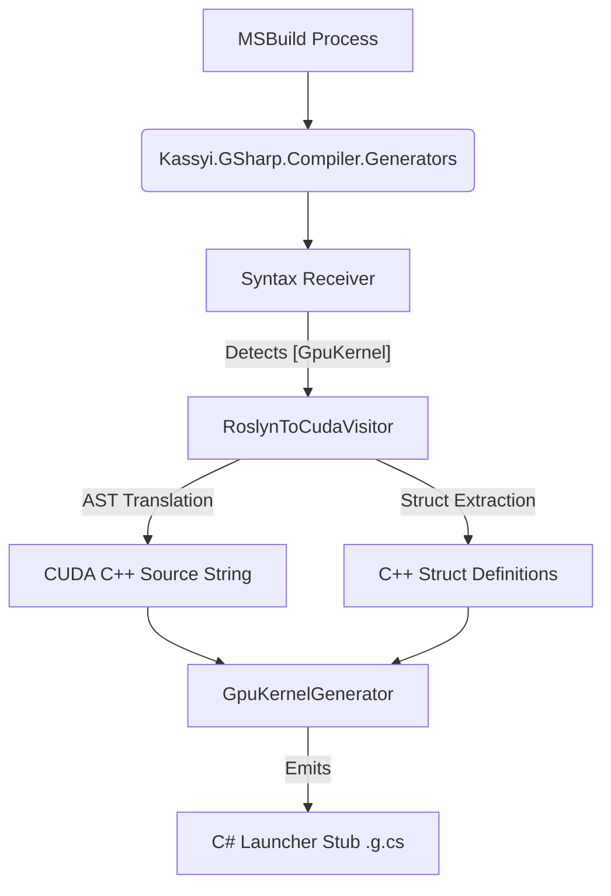

# 1. Generator Architecture (`Kassyi.GSharp.Compiler.Generators`)

This document defines the internal architecture of the Ahead-Of-Time (AOT) transpilation layer implemented via Roslyn Source Generators.

## 1.1 Pipeline Overview

The `Kassyi.GSharp.Compiler.Generators` project intercepts the MSBuild compilation process, analyzes the C# Abstract Syntax Tree (AST), and generates both the intermediary C++ source strings and the C# execution stubs.



1. **Syntax Receiver**: Scans for methods decorated with the `[GpuKernel]` attribute.
2. **AST Translation**: Delegates the syntax node of the decorated method to `RoslynToCudaVisitor`.
3. **Source Construction**: Converts the C# AST into a raw CUDA C++ string.
4. **Stub Emission**: Injects a new `.g.cs` file into the host project containing a launcher method that interfaces with the G# Runtime (`GpuKernelLoader`).

## 1.2 Translation Algorithm (`RoslynToCudaVisitor`)

The core translation logic resides in the `RoslynToCudaVisitor` class, inheriting from `CSharpSyntaxWalker`. It traverses the C# syntax nodes recursively and emits equivalent C++ tokens.

### 1.2.1 Struct Extraction and Generation

During AST traversal, if the transpiler encounters a user-defined custom `struct` (whether passed by value, by pointer, or used as an array element), it tracks it in a `_usedStructs` set. Before generating the final C++ method, the transpiler dynamically emits the C++ equivalent of all collected `struct` definitions at the top of the source string to ensure type definitions are valid in CUDA.

> [!NOTE]
> To prevent Multiple Definition errors (e.g., `class has already been defined`) when multiple kernels utilizing the same struct are JIT-compiled together in a shared dynamic source string, the generator automatically wraps every emitted struct definition with a preprocessor header guard (e.g., `#ifndef __GSHARP_STRUCT_Name__`).

### 1.2.2 Parameter Filtering

The transpiler analyzes parameter attributes during signature generation.

- Parameters marked with `[Constant]` are intentionally omitted from the generated `__global__ void` C++ signature.
- Instead, they are deferred to the `GpuKernelGenerator` for preprocessor `#define` injection.

### 1.2.3 Transpiler Dialect Architecture (Two-Tier Design)

A defining and powerful feature of the G# Transpiler is its "Two-Tier Architecture." The core AST traversal and logical analysis (e.g., semantic resolution, hoisting, control flow) are entirely decoupled from the target language's syntax generation.

This separation of concerns is achieved through the `ITranspilerDialect` interface. The `RoslynToCudaVisitor` does not hardcode C++ strings directly; instead, it delegates syntax formatting to the active Dialect.

- **Yaml Dialect Generation**: Dialects are not manually implemented in C#. Instead, the transpiler uses a data-driven YAML generation system (`YamlDialectGenerator`). Dialects are defined via `.yml` files (specifying Types, Intrinsics, StructPrefix, etc.) which are compiled into `ITranspilerDialect` C# classes (e.g., `GSharpCudaDialect.g.cs`) at build-time.

- **Current Implementation**: The transpiler utilizes two distinct dialects during the build process:
    1. **`CpuDialect` (Default Fallback)**: Transpiles C# into standard C++17. This dialect ensures that every GPU kernel has a functional, native CPU-side fallback compiled as a shared library. It implements parallel grid-stride loops using OpenMP (`#pragma omp parallel for`) and standard `std::thread` constructs. It does not support CUDA-specific intrinsic synchronization (e.g., `__syncthreads()`) or warp-level shuffle operations, gracefully falling back to standard barriers where possible.
    2. **`CudaCppDialect` (Hardware Execution)**: Layers G# over NVIDIA's CUDA C++. It handles the translation of C# syntax into valid CUDA C++ equivalents, maps mathematical built-ins to fast PTX hardware intrinsics (e.g., `__sinf`), and manages execution grid dimensions. It generates the encrypted CUDA Fatbin payload.

Both dialects share core responsibilities like converting C# `ref` to C++ pointers, pointer-arithmetic array accesses, and resolving custom struct dependencies.

- **Future-Proof Extensibility**: Because of this decoupling, G# can easily "speak" different languages. By simply defining a new dialect (e.g., `OpenCLDialect`, `MetalDialect`, or `HlslDialect`) and swapping the `ITranspilerDialect` implementation, the exact same C# kernel can be natively compiled for AMD, Apple Silicon, or DirectX backends without rewriting the core AST transpilation engine.

### 1.2.4 Structural Macro Expansion (`MacroTranspiler`)

To provide C# developers with idiomatic, high-level control structures without incurring runtime delegate invocation overhead, the G# compiler incorporates a dedicated `MacroTranspiler` subsystem based on extensible transpiler rules.

Instead of translating AST nodes directly into literal C++ function calls, the `MacroTranspiler` intercepts specific method invocations (such as `Gpu.GridStrideLoop` and `Gpu.ForUnroll`) and performs deep structural rewriting of the AST at compile-time (e.g., lambda inlining and native CUDA `for` loop emission).

> [!NOTE]
> For a detailed explanation of the supported macros, their C# syntax, and the resulting CUDA C++ equivalent code, please refer to the API reference:
> **[2.6 Transpiler Macros](../03_bcl_api/02_gpu_class.md#26-transpiler-macros)**.

## 1.3 Output Buffer Contract & Auto-Allocation

Traditionally, standard C# methods can return arbitrary values, while GPU kernels are required to return `void`. G# bridges this gap by offering two approaches to outputting data:

**1. Explicit Output Buffer Contract (`void` kernels)**
This is the recommended approach for strict Zero-Allocation environments:

1. Allocate an output array (e.g., `float[] results`) on the host.
2. Pass it directly into the generated `Launch_` wrapper.
3. The transpiler seamlessly maps this array to a device pointer and copies the mutated data back to the host after execution.

**2. Auto-Allocated Returns (Value/Array returning kernels)**
For developer ergonomics, `[GpuKernel]` methods can return unmanaged value types or single-dimensional arrays. When a kernel specifies a non-void return type:

1. The `Launch_` method dynamically allocates an output array of size `gridDim * blockDim` on the host.
2. Under the hood, the transpiler injects an implicit `__gsharp_auto_result` device pointer into the kernel signature.
3. Each thread evaluates the `return` statement and assigns the result directly into `__gsharp_auto_result[tid]`.
4. The populated array is returned directly by the `Launch_` wrapper.

## 1.4 Stub Emission (`GpuKernelGenerator`)

Once the CUDA C++ string is constructed, `GpuKernelGenerator` creates a C# partial class containing a launcher method (e.g., `Launch[MethodName]`).

### 1.4.1 Launcher Signature

The generator appends seven implicit trailing parameters to every launcher method to control CUDA execution dimensions and dynamic shared memory. These default to 1 and 0 respectively:

```csharp
// Context: Host C# (CPU)
public static void Launch_[KernelName](
    /* Original non-Constant parameters */,
    uint gridDimX = 1, uint gridDimY = 1, uint gridDimZ = 1,
    uint blockDimX = 1, uint blockDimY = 1, uint blockDimZ = 1,
    uint sharedMemBytes = 0)
```

### 1.4.2 Ahead-Of-Time (AOT) Fatbin Loading

The generated launcher method does **not** dynamically construct or compile C++ strings at runtime. Instead, it utilizes an Ahead-Of-Time (AOT) loading strategy:

1. The launcher invokes `GpuKernelLoader.LoadAotKernel` to load a pre-compiled `.fatbin` or `.dll` payload directly from disk.
2. The `macros` argument in the launcher signature (intended for dynamic `#define` injections) is unused in the current AOT implementation.

### 1.4.3 Zero-Allocation Pointer Marshaling

The launcher generates `unsafe` memory marshaling code to construct the kernel parameters array. To achieve zero-allocation kernel dispatch, the launcher allocates the parameter array on the stack using `stackalloc void*[N]`, completely bypassing the garbage collector (GC) and eliminating heap allocation overhead.

- **Array Marshaling**: If a parameter is an array, the launcher automatically computes its byte size, allocates GPU memory (`cuMemAlloc_v2`), pins the host array (`GCHandle.Alloc`), and copies the data Host-to-Device (`cuMemcpyHtoD_v2`).

### 1.4.4 Deep Struct Marshaling

To support advanced contexts (e.g., `NttContext` in GpuBigInt) containing managed arrays (`T[]`), the transpiler implements a recursive Deep Struct Marshaling protocol.

When a struct parameter is detected, the `GpuKernelGenerator` recursively traverses its AST graph to locate any internal `IArrayTypeSymbol` fields. If found, the generator emits:

1. **Shadow Structures**: A native proxy struct (e.g., `__Native_NttContext`) where all `T[]` fields are replaced with `IntPtr`.
2. **Deep Allocation**: During invocation, `Marshal_NttContext` performs a deep traversal. For every non-null host array field (including arrays of custom structs), it computes the total byte length, issues `cuMemAlloc_v2`, pins the host array with `GCHandle`, executes a `cuMemcpyHtoD_v2`, and injects the resulting GPU device pointer into the corresponding `IntPtr` field of the shadow structure. If it is an array of custom structs, it dynamically allocates a temporary shadow array (`__Native_T[]`) on the host, recursively marshals each element, and then pins and copies the shadow array to the device.
3. **Data Recovery**: After kernel execution, `Unmarshal_NttContext` traverses the shadow struct and issues `cuMemcpyDtoH_v2` calls to pull modified array data from the GPU back into the host's managed arrays before cleaning up the handles.

> [!IMPORTANT]
> This implicit deep marshaling empowers developers to pass complex, nested C# objects into the GPU without manually writing verbose and unsafe P/Invoke memory management code.
> However, deep marshaling applies **only to the standard `Launch_*` (host-array) path**. When invoking the zero-allocation `Launch_*_Device` overload (which expects pre-allocated device pointers), passing structs that contain managed arrays (`T[]`) is prohibited. The generator detects this and intentionally throws a `NotSupportedException` in the `_Device` launcher to prevent corrupted pointer mapping.

```csharp
// Example: A struct containing a managed array field
public struct AdvancedContext
{
    public float[] Data;
}

[GpuKernel]
public static void Process(AdvancedContext ctx) { /* ... */ }

// Host Invocation:
var ctx = new AdvancedContext { Data = new float[100] };

// ✅ Allowed: The host-array launcher automatically performs deep struct marshaling
KernelWrapper.Launch_Process(ctx);

// ❌ Prohibited: The _Device overload expects pre-allocated device pointers.
// A struct containing a managed array (T[]) cannot be mapped safely here.
// Throws NotSupportedException: "Passing a struct with arrays is not supported when isDevicePtr is true."
KernelWrapper.Launch_Process_Device(ctx);
```

- **Scalar Marshaling**: Primitive types are passed directly using zero-allocation pointer pinning via the `fixed` statement (e.g., `fixed (float* p = &val)`). This completely eliminates the need for expensive heap allocations (such as `Marshal.AllocHGlobal`).
- **Execution & Cleanup**: The launcher invokes the runtime via `CpuKernelLoader.LoadAotKernel` (or `GpuKernelLoader.LoadAotKernel` for GPU execution) and subsequently dispatches the execution logic (e.g., `cuLaunchKernel`). Post-execution, it automatically copies the array data back Device-to-Host (`cuMemcpyDtoH_v2`) and frees all allocated device memory.
- **Exceptions**: `[Constant]` parameters are strictly excluded from this marshaling array, as they exist exclusively in the preprocessor domain.

### 1.4.5 CPU Launcher Generation (`WriteCpuLauncher`)

When the transpiler is configured to use the `CpuDialect` (Standard C++), the generator automatically invokes `WriteCpuLauncher`. This process emits a standard `extern "C"` C++ wrapper function (e.g., `__gsharp_launch_KernelName`) that translates the flat GPU grid/block indexing scheme into nested standard C++ `for` loops. This enables the generated native binary to be directly invoked from C# via P/Invoke on CPU-only machines without modifying the host C# API signature.

> [!NOTE]
> The CPU compilation task (`CompileCppToNativeTask`) is currently hardcoded for Windows. It strictly requires MSVC (`cl.exe`, `vswhere.exe`) and only outputs Windows `.dll` binaries for x64 and arm64. There is currently no implementation for Linux/macOS `.so` files via GCC/Clang. Furthermore, the build process (`ArtifactHelper.cs`) silently appends a 32-byte SHA256 checksum to the end of every compiled artifact (`.fatbin` and `.dll`) for integrity validation.

## 1.5 MSBuild Configuration Properties

The `GpuKernelGenerator` reads several MSBuild properties via `AnalyzerConfigOptions` to control the compilation pipeline. These properties must be prefixed with `build_property.` when accessed:

- `GSharpTargetDialect`: Specifies the target transpilation dialect (e.g., `Cuda` or `Cpu`).
- `GSharpEmitSource`: If `true`, the compiler emits the intermediate C++ source files to disk for debugging.
- `IntermediateOutputPath`: Used to determine where to output generated artifacts and intermediate files.
