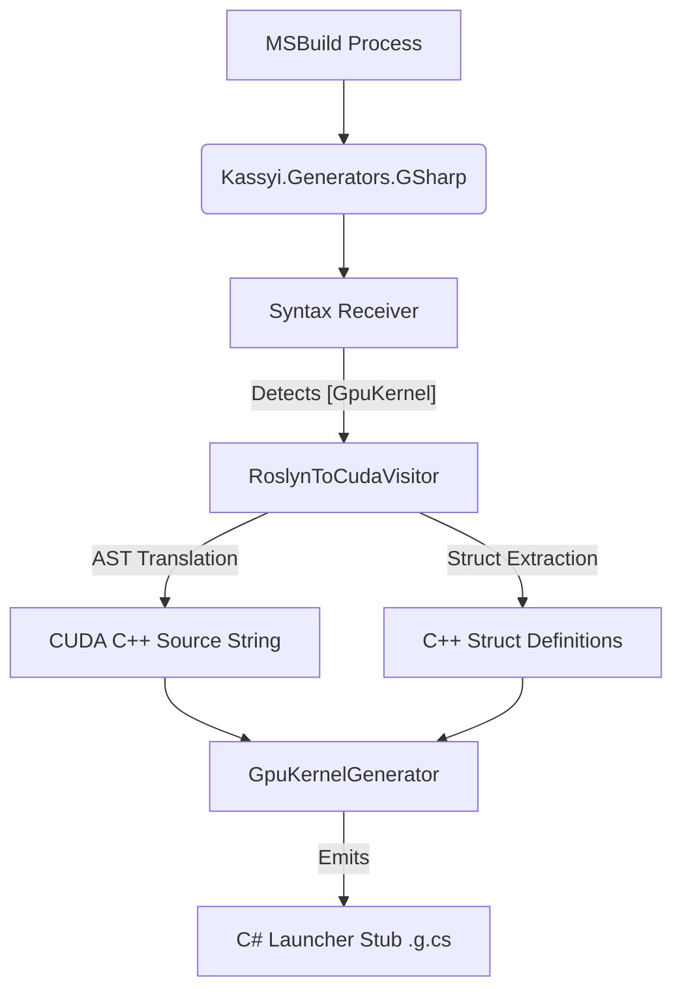

# 1. Generator Architecture (`Kassyi.Generators.GSharp`)

This document defines the internal architecture of the Ahead-Of-Time (AOT) transpilation layer implemented via Roslyn Source Generators.

## 1.1 Pipeline Overview

The `Kassyi.Generators.GSharp` project intercepts the MSBuild compilation process, analyzes the C# Abstract Syntax Tree (AST), and generates both the intermediary CUDA C++ source strings and the C# execution stubs.



1. **Syntax Receiver**: Scans for methods decorated with the `[GpuKernel]` attribute.
2. **AST Translation**: Delegates the syntax node of the decorated method to `RoslynToCudaVisitor`.
3. **Source Construction**: Converts the C# AST into a raw CUDA C++ string.
4. **Stub Emission**: Injects a new `.g.cs` file into the host project containing a launcher method that interfaces with the G# Runtime (`GpuKernelLoader`).

## 1.2 Translation Algorithm (`RoslynToCudaVisitor`)

The core translation logic resides in the `RoslynToCudaVisitor` class, inheriting from `CSharpSyntaxWalker`. It traverses the C# syntax nodes recursively and emits equivalent C++ tokens.


### 1.2.1 Struct Extraction and Generation
During AST traversal, if the transpiler encounters a user-defined custom `struct` (whether passed by value, by pointer, or used as an array element), it tracks it in a `_usedStructs` set. Before generating the final C++ method, the transpiler dynamically emits the C++ equivalent of all collected `struct` definitions at the top of the source string to ensure type definitions are valid in CUDA.

> [!NOTE]
> To prevent Multiple Definition errors (e.g., `class has already been defined`) when multiple kernels utilizing the same struct are JIT-compiled together in a shared dynamic source string, the generator automatically wraps every emitted struct definition with a preprocessor header guard (e.g., `#ifndef __GSHARP_STRUCT_Name__`).

### 1.2.2 Parameter Filtering
The transpiler analyzes parameter attributes during signature generation.
* Parameters marked with `[Constant]` are intentionally omitted from the generated `__global__ void` C++ signature.
* Instead, they are deferred to the `GpuKernelGenerator` for preprocessor `#define` injection.

### 1.2.3 Transpiler Dialect Architecture (Two-Tier Design)
A defining and powerful feature of the G# Transpiler is its "Two-Tier Architecture." The core AST traversal and logical analysis (e.g., semantic resolution, hoisting, control flow) are entirely decoupled from the target language's syntax generation.

This separation of concerns is achieved through the `ITranspilerDialect` interface. The `RoslynToCudaVisitor` does not hardcode C++ strings directly; instead, it delegates syntax formatting to the active Dialect.

* **Current Implementation**: The default dialect is `CudaCppDialect`, which layers G# over NVIDIA's CUDA C++. It handles the translation of C# syntax into valid C++ equivalents (e.g., converting C# `ref` to C++ pointers or references, translating intrinsic attributes, and mapping mathematical built-ins).

## 1.3 Host-Side Diagnostics & Developer Experience (DX)

Unlike traditional GPU compilers (like NVCC) that only analyze the device code, G# leverages its position as a Roslyn Analyzer to seamlessly inspect the **Host C# Code** calling the generated `Launch_` kernels. This enables powerful, context-aware Developer Experience (DX) guardrails.

### 1.3.1 Implicit Allocation Warnings in Tight Loops
To maximize ease of use, G# allows `[GpuKernel]` methods to return arrays directly, which the transpiler handles by auto-generating a `Launch_` method that allocates the array on the Managed Heap on behalf of the user. 

While highly convenient, implicit heap allocations inside a tight host loop (such as a game engine's `Update()` loop or a `while(true)` event pump) cause severe Garbage Collector (GC) spikes. 
To prevent this, the `Kassyi.Generators.GSharp` analyzer actively scans the host-side Abstract Syntax Tree. If it detects a `Launch_` method invocation that triggers an implicit allocation nested inside a `for`, `foreach`, `while`, or `do-while` loop, it surfaces an immediate diagnostic warning in the IDE:

> **Warning GSH0006**: *Implicit heap allocation detected inside a host loop. To prevent GC spikes, consider pre-allocating the buffer outside the loop and passing it via the pointer/ref overload.*

This holistic approach to static analysis ensures that developers enjoy high-level syntax sugar without accidentally sacrificing the strict "Zero-Allocation" performance requirements of realtime GPU applications.
* **Future-Proof Extensibility**: Because of this magical decoupling, G# can easily "speak" different languages. By simply defining a new dialect (e.g., `OpenCLDialect`, `MetalDialect`, or `HlslDialect`) and swapping the `ITranspilerDialect` implementation, the exact same C# kernel can be natively compiled for AMD, Apple Silicon, or DirectX backends without rewriting the core AST transpilation engine.

## 1.3 Stub Emission (`GpuKernelGenerator`)

Once the CUDA C++ string is constructed, `GpuKernelGenerator` creates a C# partial class containing a launcher method (e.g., `Launch[MethodName]`).

### 1.3.1 Launcher Signature
The generator appends seven implicit trailing parameters to every launcher method to control CUDA execution dimensions and dynamic shared memory. These default to 1 and 0 respectively:
```csharp
// Context: Host C# (CPU)
public static void Launch_[KernelName](
    /* Original non-Constant parameters */,
    uint gridDimX = 1, uint gridDimY = 1, uint gridDimZ = 1, 
    uint blockDimX = 1, uint blockDimY = 1, uint blockDimZ = 1, 
    uint sharedMemBytes = 0)
```

### 1.3.2 Dynamic String Assembly
The generated launcher method constructs the final C++ source string dynamically at runtime:
1. It injects `#define [Name] [Value]` directives at the top of the string for all parameters marked with `[Constant]`.
2. It appends the static C++ logic generated by `RoslynToCudaVisitor`.

### 1.3.3 Zero-Allocation Pointer Marshaling
The launcher generates `unsafe` memory marshaling code to construct the kernel parameters array. To achieve zero-allocation kernel dispatch, the launcher allocates the parameter array on the stack using `stackalloc void*[N]`, completely bypassing the garbage collector (GC) and eliminating heap allocation overhead.

* **Array Marshaling**: If a parameter is an array, the launcher automatically computes its byte size, allocates GPU memory (`cuMemAlloc_v2`), pins the host array (`GCHandle.Alloc`), and copies the data Host-to-Device (`cuMemcpyHtoD_v2`).

### 1.3.4 Deep Struct Marshaling
To support advanced contexts (e.g., `NttContext` in GpuBigInt) containing managed arrays (`T[]`), the transpiler implements a recursive Deep Struct Marshaling protocol.

When a struct parameter is detected, the `GpuKernelGenerator` recursively traverses its AST graph to locate any internal `IArrayTypeSymbol` fields. If found, the generator emits:
1. **Shadow Structures**: A native proxy struct (e.g., `__Native_NttContext`) where all `T[]` fields are replaced with `IntPtr`.
2. **Deep Allocation**: During invocation, `Marshal_NttContext` performs a deep traversal. For every non-null host array field, it computes the total byte length, issues `cuMemAlloc_v2`, pins the host array with `GCHandle`, executes a `cuMemcpyHtoD_v2`, and injects the resulting GPU device pointer into the corresponding `IntPtr` field of the shadow structure.
3. **Data Recovery**: After kernel execution, `Unmarshal_NttContext` traverses the shadow struct and issues `cuMemcpyDtoH_v2` calls to pull modified array data from the GPU back into the host's managed arrays before cleaning up the handles.

> [!IMPORTANT]
> This implicit deep marshaling empowers developers to pass complex, nested C# objects into the GPU without manually writing verbose and unsafe P/Invoke memory management code.

* **Scalar Marshaling**: Primitive types are passed directly using zero-allocation pointer pinning via the `fixed` statement (e.g., `fixed (float* p = &val)`). This completely eliminates the need for expensive heap allocations (such as `Marshal.AllocHGlobal`).
* **Execution & Cleanup**: The launcher invokes `GpuKernelLoader.GetOrCompileKernel` and subsequently `CudaDriverApi.cuLaunchKernel`. Post-execution, it automatically copies the array data back Device-to-Host (`cuMemcpyDtoH_v2`) and frees all allocated device memory.
* **Exceptions**: `[Constant]` parameters are strictly excluded from this marshaling array, as they exist exclusively in the preprocessor domain.

## 1.4 Security and Virtualization-Based Obfuscation (VBO)

To protect proprietary AOT kernel binaries from reverse engineering, the generator supports Virtualization-Based Obfuscation (VBO) and static payload encryption.

### 1.4.1 AOT Kernel Encryption
During the AOT build phase, the generator conditionally generates a secure 256-bit AES-GCM key for each kernel. The transpiled CUDA source string (or the compiled PTX/Fatbin) is encrypted at rest using this key.
The wrapper emitter injects the encrypted payload directly into the host C# assembly alongside a magic header (`GSHPENC1`).

### 1.4.2 VBO Strategies (`IVmStrategy`)
Instead of embedding the raw AES key inside the host binary where it can be easily extracted, the generator employs a Strategy Pattern (`IVmStrategy`) to emit a deterministic Virtual Machine that derives the key at runtime.
Supported strategies include:
- `ArithmeticVmStrategy`: Uses an arithmetic accumulator VM.
- `AutomatonVmStrategy`: A state-machine permutation automaton.
- `NandStackVmStrategy`: A minimal Turing-complete NAND stack VM.
- `RegisterVmStrategy`: A multi-register load/store/xor VM.

The C# wrapper executes this VM to compute the correct decryption key dynamically before passing the decrypted payload to the NVIDIA driver via the Runtime Loader.

