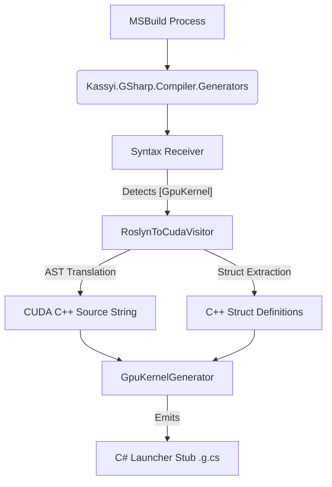

# 1. Generator Architecture (`Kassyi.GSharp.Compiler.Generators`)

This document defines the internal architecture of the Ahead-Of-Time (AOT) transpilation layer implemented via Roslyn Source Generators.

## 1.1 Pipeline Overview

The `Kassyi.GSharp.Compiler.Generators` project intercepts the MSBuild compilation process, analyzes the C# Abstract Syntax Tree (AST), and generates both the intermediary C++ source strings and the C# execution stubs.



1. **Syntax Receiver**: Scans for methods decorated with the `[GpuKernel]` attribute.
2. **AST Translation**: Delegates the syntax node of the decorated method to `RoslynToCudaVisitor`.
3. **Source Construction**: Converts the C# AST into a raw CUDA C++ string.
4. **Stub Emission**: Injects a new `.g.cs` file into the host project containing a launcher method that interfaces with the G# Runtime (`GpuKernelLoader`).

## 1.2 Translation Algorithm (`RoslynToCudaVisitor`)

The core translation logic resides in the `RoslynToCudaVisitor` class, inheriting from `CSharpSyntaxWalker`. It traverses the C# syntax nodes recursively and emits equivalent C++ tokens.

### 1.2.1 Struct Extraction and Generation

During AST traversal, if the transpiler encounters a user-defined custom `struct` (whether passed by value, by pointer, or used as an array element), it tracks it in a `_usedStructs` set. Before generating the final C++ method, the transpiler dynamically emits the C++ equivalent of all collected `struct` definitions at the top of the source string to ensure type definitions are valid in CUDA.

Structs with the same name in different C# namespaces never share a C++ name: the C++ name is derived from the full C# path (e.g., a C# struct `Math.Vector2` becomes `__gsharp_ty_Math__Vector2`; see [1.2.6](#126-identifier-naming-cppnameresolver)).

> [!NOTE]
> To prevent Multiple Definition errors (e.g., `class has already been defined`) when multiple kernels utilizing the same struct are JIT-compiled together in a shared dynamic source string, the generator automatically wraps every emitted struct definition with a preprocessor header guard named after the struct's C++ name (e.g., `#ifndef __GSHARP_STRUCT___gsharp_ty_Math__Vector2__`).

### 1.2.2 Parameter Filtering

The transpiler analyzes parameter attributes during signature generation.

- Parameters marked with `[Constant]` are intentionally omitted from the generated `__global__ void` C++ signature.
- Instead, they are deferred to the `GpuKernelGenerator` for preprocessor `#define` injection.

### 1.2.3 Transpiler Dialect Architecture (Two-Tier Design)

A defining and powerful feature of the G# Transpiler is its "Two-Tier Architecture." The core AST traversal and logical analysis (e.g., semantic resolution, hoisting, control flow) are entirely decoupled from the target language's syntax generation.

This separation of concerns is achieved through the `ITranspilerDialect` interface. The `RoslynToCudaVisitor` does not hardcode C++ strings directly; instead, it delegates syntax formatting to the active Dialect.

- **Yaml Dialect Generation**: Dialects are not manually implemented in C#. Instead, the transpiler uses a data-driven YAML generation system (`YamlDialectGenerator`). Dialects are defined via `.yml` files (specifying the Backend, Capabilities, Types, and Intrinsics) which are compiled into `ITranspilerDialect` C# classes (e.g., `GSharpCudaDialect.g.cs`) at build-time.

- **Current Implementation**: The transpiler utilizes two distinct dialects during the build process:
    1. **`CpuDialect` (Default Fallback)**: Transpiles C# into standard C++17. This dialect ensures that every GPU kernel has a functional, native CPU-side fallback compiled as a shared library. It implements parallel grid-stride loops using OpenMP (`#pragma omp parallel for`) and standard `std::thread` constructs. It does not support CUDA-specific intrinsic synchronization (e.g., `__syncthreads()`) or warp-level shuffle operations, gracefully falling back to standard barriers where possible.
    2. **`CudaCppDialect` (Hardware Execution)**: Layers G# over NVIDIA's CUDA C++. It handles the translation of C# syntax into valid CUDA C++ equivalents, maps mathematical built-ins to fast PTX hardware intrinsics (e.g., `__sinf`), and manages execution grid dimensions. It generates the encrypted CUDA Fatbin payload.

Both dialects share core responsibilities like converting C# `ref` to C++ pointers, pointer-arithmetic array accesses, and resolving custom struct dependencies.

- **Future-Proof Extensibility**: Because of this decoupling, G# can easily "speak" different languages. By simply defining a new dialect (e.g., `OpenCLDialect`, `MetalDialect`, or `HlslDialect`) and swapping the `ITranspilerDialect` implementation, the exact same C# kernel can be natively compiled for AMD, Apple Silicon, or DirectX backends without rewriting the core AST transpilation engine.

### 1.2.4 Structural Macro Expansion (`MacroTranspiler`)

To provide C# developers with idiomatic, high-level control structures without incurring runtime delegate invocation overhead, the G# compiler incorporates a dedicated `MacroTranspiler` subsystem based on extensible transpiler rules.

Instead of translating AST nodes directly into literal C++ function calls, the `MacroTranspiler` intercepts specific method invocations (such as `Gpu.GridStrideLoop` and `Gpu.ForUnroll`) and performs deep structural rewriting of the AST at compile-time (e.g., lambda inlining and native CUDA `for` loop emission).

> [!NOTE]
> For a detailed explanation of the supported macros, their C# syntax, and the resulting CUDA C++ equivalent code, please refer to the API reference:
> **[Gpu Class Reference](../03_bcl_api/gpu_class/00_index.md)**.

### 1.2.5 Call-Site Argument Normalization and Constant Default Synthesis

In C++, function call syntax strictly requires arguments to match the declaration parameter order, and omitting optional arguments depends on default values present in the C++ declaration header. To ensure full compatibility with modern C# call-site ergonomics without violating static determinism, `InvocationExpressionTranspilerRule` performs compile-time argument normalization:

1. **Semantic Symbol Resolution**: During AST traversal of an `InvocationExpressionSyntax`, the rule queries `IMethodSymbol.Parameters` from Roslyn's `SemanticModel`.
2. **Positional and Named Binding**: Each parameter declared in the method signature is sequentially bound. Named arguments (`NameColonSyntax`) are mapped by parameter name and normalized into their declaration sequence, regardless of caller order (e.g., `Method(b: 2, a: 1)` emits `Method(1, 2)`).
3. **Default Constant Synthesis**: If an optional parameter is omitted by the caller (`IParameterSymbol.HasExplicitDefaultValue`), the transpiler synthesizes the compile-time default constant literal directly into the argument list (e.g., `Method(10)` emits `Method(10, 0)`). Default expressions are extracted from the declaring syntax (`ParameterSyntax.Default`) or formatted deterministically from `ExplicitDefaultValue` into C++ literal syntax (with appropriate type suffixes and `nullptr` mapping).
4. **Variadic `params` Support**: For methods with `params` array arguments, trailing positional arguments are emitted sequentially without loss of caller ordering.
5. **Evaluation Order**: C# evaluates the arguments in the written order; C++ evaluates them in an unspecified order. When an argument changes what another reads (a `ref` argument, an increment, a call that writes memory), or a constructor's arguments are written in another order than its parameters, the call is emitted as an immediately invoked lambda that stores the arguments in `__gsharp_seq_<n>` temporaries in the written order and then calls the function (§1.6).

### 1.2.6 Identifier Naming (`CppNameResolver`)

The transpiler derives the C++ name of every user declaration from its symbol rather than copying the C# text. Any legal C# name can therefore be used, including C++ keywords (`register`, `template`), alternative tokens (`and`, `not`), verbatim identifiers (`@class`), CUDA built-ins (`threadIdx`), standard macros (`NULL`), and names the generated code calls itself (`min`).

| Declaration | Generated name |
| :--- | :--- |
| Parameter, local, `out var`, `foreach` variable, label, local function, lambda parameter | `__gsharp_id_{ordinal}_{name}`, where `ordinal` is the declaration's position within the containing method |
| Instance field or property of a struct that G# emits | `__gsharp_mb_{name}` |
| Struct that G# emits | `__gsharp_ty_{path}` |
| Type parameter | `__gsharp_tp_{name}` |
| Static `[GpuDeviceFunction]` method | `__gsharp_fn_{path}` |
| `[GpuKernel]` entry point | `__gsharp_k_{path}`; the CPU dialect also emits `__gsharp_launch_{path}` (exported launcher) and `__gsharp_context_{path}` (per-thread context), and the managed CPU path `__gsharp_statemachine_{path}` |
| Members of dialect-mapped types (`float4.x`), prelude types, external names | unchanged |

The ordinal keeps distinct symbols distinct even when lowering flattens their scopes, for example when the CPU dialect hoists locals into the per-thread context struct. [GSH0055](../03_bcl_api/diagnostics/GSH0055.md) rejects `__` in user identifiers, so these names cannot collide with user code. Because every name is derived, a C++ keyword is an ordinary method or type name ([GSH0056](../03_bcl_api/diagnostics/GSH0056.md) is retired).

#### Global names

Types, device functions and kernels share one C++ scope, so their names encode the whole C# path of the declaration, and two different declarations never get the same name:

- The path is the namespaces, the containing types and the declaration itself, joined with `__` (`N1.Outer.Inner` becomes `N1__Outer__Inner`; a device function `Math.Clamp` becomes `__gsharp_fn_Math__Clamp`).
- Inside one segment, `_` is written as `_u` and any character other than an ASCII letter or digit as `_x` followed by six hexadecimal digits, so `A.B_C` (`A__B_uC`) and `A.B.C` (`A__B__C`) stay apart.
- A segment may carry markers after the name: `_a{n}` for a generic arity (`G<T>` and `G<T, U>` differ), `_f{n}` for a `file` type (its position among same-named `file` types, ordered by file path), and `_o{n}` for an overloaded method (its position in declaration order among the methods with that name in the type). Each overload therefore has its own C++ name, and the overload that C# selected is the one that runs; C++ overload resolution, which differs from C# (an `int` argument is ambiguous between `long` and `double`), never applies.
- A constructed generic struct uses the name of its definition; the type arguments become C++ template arguments.
- A name longer than 200 characters is cut and ends with `_h` and a 10-digit hash of the whole name.

The generated wrapper source of a kernel class is added under the encoded path of the class (`N1__K.g.cs`), so kernel classes with the same name in different namespaces can coexist.

When nvcc or the host C++ compiler fails, the build log adds a line that maps the generated names in its output back to C# names (`__gsharp_id_0_data = data`, `__gsharp_fn_Math__Clamp = Math.Clamp`).

C# names written inside a `Gpu.InlinePtx` string literal are not renamed; reference C# values through interpolation holes instead (see [Gpu.InlinePtx](../03_bcl_api/gpu_class/InlinePtx.md)).

## 1.3 Output Buffer Contract & Auto-Allocation

Traditionally, standard C# methods can return arbitrary values, while GPU kernels are required to return `void`. G# bridges this gap by offering two approaches to outputting data:

**1. Explicit Output Buffer Contract (`void` kernels)**
This is the recommended approach for strict Zero-Allocation environments:

1. Allocate an output array (e.g., `float[] results`) on the host.
2. Pass it directly into the generated `Launch` wrapper.
3. The transpiler seamlessly maps this array to a device pointer and copies the mutated data back to the host after execution.

**2. Auto-Allocated Returns (Value/Array returning kernels)**
For developer ergonomics, `[GpuKernel]` methods can return unmanaged value types or single-dimensional arrays. When a kernel specifies a non-void return type:

1. The `Launch` method dynamically allocates an output array of size `gridDim * blockDim` on the host.
2. Under the hood, the transpiler injects an implicit `__gsharp_auto_result` device pointer into the kernel signature.
3. Each thread evaluates the `return` statement and assigns the result directly into `__gsharp_auto_result[tid]`.
4. The populated array is returned directly by the `Launch` wrapper.

## 1.4 Stub Emission (`GpuKernelGenerator`)

Once the CUDA C++ string is constructed, `GpuKernelGenerator` injects a launcher method into the user's codebase.

### 1.4.1 Generated Host API Specifications

The transpiler strictly adheres to the following naming conventions and rules when emitting the host launcher:

1. **Partial Class Injection**: The Source Generator enhances the user's kernel class (which must be declared with the `partial` modifier, enforced by `GSH0036`) by emitting additional launcher methods and nested interop contexts directly into `[ContainingType]` (e.g., `MyKernels`).
2. **Method Prefix**: The generated method name is always `Launch` followed by the original kernel name (e.g., `Launch[KernelName]`). For raw pointer / device-memory dispatch, a companion overload `Launch[KernelName]Ptr` is generated.
    - **Overloaded kernels**: `Launch[KernelName]` stays a C# overload with the kernel's own parameter types. Because the `IntPtr` form of `Launch[KernelName]Ptr` would erase the element types, an overloaded kernel's public `Launch[KernelName]Ptr` takes each array-like and `ref` / `out` parameter as a typed `GpuBuffer<T>` and forwards to a private `IntPtr` implementation. The other per-kernel host members are keyed `[KernelName]__o{n}`. Overloads that still map to the same wrapper signature (for example `int[]` and `ref int`) are reported as [GSH0059](../03_bcl_api/diagnostics/GSH0059.md).
3. **Trailing Execution Dimensions and Configuration**: The generator appends eight implicit trailing parameters to every launcher method to control CUDA execution dimensions, dynamic shared memory, and compile-time macro definitions (`gridDimX/Y/Z` and `blockDimX/Y/Z` defaulting to 1, `sharedMemBytes` defaulting to 0, `hStream` defaulting to `default`, and `macros` of type `ReadOnlySpan<KeyValuePair<string, string>>` defaulting to `default`).
4. **Return Value Array Mapping**: If the kernel returns `void`, the launcher returns `void`. If the kernel returns a value type `T`, the launcher returns an array `T[]` allocated to the size of `gridDim * blockDim`.
5. **Parameter Default Values Preservation**: If a kernel entry point (`[GpuKernel]`) defines default parameter values (e.g., `int stride = 1`), `WrapperEmitter` preserves those default values in the generated host launcher method signature. Callers on the CPU host can invoke the kernel without providing trailing optional arguments or using C# named arguments directly.

```csharp
// Original Kernel Signature
// public partial class MyKernels {
//     [GpuKernel] public static T KernelName(int arg1, int stride = 1) { ... }
// }

// Generated Launcher Signature (in partial class MyKernels)
public partial class MyKernels
{
    public static T[] LaunchKernelName(
        int arg1, // Original non-Constant parameters
        int stride = 1, // Preserved default parameter value
        uint gridDimX = 1, uint gridDimY = 1, uint gridDimZ = 1,
        uint blockDimX = 1, uint blockDimY = 1, uint blockDimZ = 1,
        uint sharedMemBytes = 0,
        IntPtr hStream = default,
        ReadOnlySpan<KeyValuePair<string, string>> macros = default);
}
```

### 1.4.2 Ahead-Of-Time (AOT) Fatbin Loading

The generated launcher method does **not** dynamically construct or compile C++ strings at runtime. Instead, it utilizes an Ahead-Of-Time (AOT) loading strategy:

1. The launcher invokes `GpuKernelLoader.LoadAotKernel` to load a pre-compiled `.fatbin` or `.dll` payload directly from disk.
2. The `macros` argument in the launcher signature (intended for dynamic `#define` injections) is unused in the current AOT implementation.

### 1.4.3 Zero-Allocation Pointer Marshaling

The launcher generates `unsafe` memory marshaling code to construct the kernel parameters array. To achieve zero-allocation kernel dispatch, the launcher allocates the parameter array on the stack using `stackalloc void*[N]`, completely bypassing the garbage collector (GC) and eliminating heap allocation overhead.

- **Array Marshaling**: If a parameter is an array, the launcher automatically computes its byte size, allocates GPU memory (`cuMemAlloc_v2`), pins the host array (`GCHandle.Alloc`), and copies the data Host-to-Device (`cuMemcpyHtoD_v2`).

### 1.4.4 Deep Struct Marshaling

To support advanced contexts (e.g., `NttContext` in GpuBigInt) containing managed arrays (`T[]`), the transpiler implements a recursive Deep Struct Marshaling protocol.

When a struct parameter is detected, the `GpuKernelGenerator` recursively traverses its AST graph to locate any internal `IArrayTypeSymbol` fields. If found, the generator emits:

1. **Shadow Structures**: A native proxy struct (e.g., `__Native_NttContext`) where all `T[]` fields are replaced with `IntPtr`.
2. **Deep Allocation**: During invocation, `Marshal_NttContext` performs a deep traversal. For every non-null host array field (including arrays of custom structs), it computes the total byte length, issues `cuMemAlloc_v2`, pins the host array with `GCHandle`, executes a `cuMemcpyHtoD_v2`, and injects the resulting GPU device pointer into the corresponding `IntPtr` field of the shadow structure. If it is an array of custom structs, it dynamically allocates a temporary shadow array (`__Native_T[]`) on the host, recursively marshals each element, and then pins and copies the shadow array to the device.
3. **Data Recovery**: After kernel execution, `Unmarshal_NttContext` traverses the shadow struct and issues `cuMemcpyDtoH_v2` calls to pull modified array data from the GPU back into the host's managed arrays before cleaning up the handles.

> [!IMPORTANT]
> This implicit deep marshaling empowers developers to pass complex, nested C# objects into the GPU without manually writing verbose and unsafe P/Invoke memory management code.
> However, deep marshaling applies **only to the standard `Launch*` (host-array) path**. When invoking the zero-allocation `Launch*_Device` overload (which expects pre-allocated device pointers), passing structs that contain managed arrays (`T[]`) is prohibited. The generator detects this and intentionally throws a `NotSupportedException` in the `_Device` launcher to prevent corrupted pointer mapping.

```csharp
// Execution Context: G# Kernel (GPU)
// Example: A struct containing a managed array field
public struct AdvancedContext
{
    public float[] Data;
}

public partial class MyKernels
{
    [GpuKernel]
    public static void Process(AdvancedContext ctx) { /* ... */ }
}

// Host Invocation:
var ctx = new AdvancedContext { Data = new float[100] };

// ✅ Allowed: The host-array launcher automatically performs deep struct marshaling
MyKernels.LaunchProcess(ref ctx);

// ❌ Prohibited: The Ptr overload expects pre-allocated device pointers.
// A struct containing a managed array (T[]) cannot be mapped safely here.
// Throws NotSupportedException: "Passing a struct with arrays is not supported when isDevicePtr is true."
MyKernels.LaunchProcessPtr(ctx);
```

- **Scalar Marshaling**: Primitive types are passed directly using zero-allocation pointer pinning via the `fixed` statement (e.g., `fixed (float* p = &val)`). This completely eliminates the need for expensive heap allocations (such as `Marshal.AllocHGlobal`).
- **Execution & Cleanup**: The launcher invokes the runtime via `CpuKernelLoader.LoadAotKernel` (or `GpuKernelLoader.LoadAotKernel` for GPU execution) and subsequently dispatches the execution logic (e.g., `cuLaunchKernel`). Post-execution, it automatically copies the array data back Device-to-Host (`cuMemcpyDtoH_v2`) and frees all allocated device memory.
- **Exceptions**: `[Constant]` parameters are strictly excluded from this marshaling array, as they exist exclusively in the preprocessor domain.

### 1.4.5 CPU Launcher Generation (`WriteCpuLauncher`)

When the transpiler is configured to use the `CpuDialect` (Standard C++), the generator automatically invokes `WriteCpuLauncher`. This process emits a standard `extern "C"` C++ wrapper function (e.g., `__gsharp_launch_MyApp__MyKernels__KernelName`) that translates the flat GPU grid/block indexing scheme into nested standard C++ `for` loops. This enables the generated native binary to be directly invoked from C# via P/Invoke on CPU-only machines without modifying the host C# API signature.

> [!NOTE]
> The CPU compilation task (`CompileCppToNativeTask`) is currently hardcoded for Windows. It strictly requires MSVC (`cl.exe`, `vswhere.exe`) and only outputs Windows `.dll` binaries for x64 and arm64. There is currently no implementation for Linux/macOS `.so` files via GCC/Clang. Furthermore, the build process (`ArtifactHelper.cs`) silently appends a 32-byte SHA256 checksum to the end of every compiled artifact (`.fatbin` and `.dll`) for integrity validation.

## 1.5 MSBuild Configuration Properties

The `GpuKernelGenerator` reads several MSBuild properties via `AnalyzerConfigOptions` to control the compilation pipeline. These properties must be prefixed with `build_property.` when accessed:

- `GSharpTargetDialect`: Specifies the target transpilation dialect (e.g., `Cuda` or `Cpu`).
- `GSharpEmitSource`: If `true`, the compiler embeds the generated C++ source in the assembly as string constants (`{Kernel}_Source`, `{Kernel}_FullSource` and the shared `Source`). Defaults to `false` when unset.
- `IntermediateOutputPath`: Used to determine where to output generated artifacts and intermediate files.
- `GSharpExportDeviceCode`: If `false`, the assembly writes no device code records for other assemblies and no managed state machines for them (§1.7). Defaults to `true` when unset. Set it to `false` in an application or a test assembly that no other assembly calls into; a library keeps the default.

### 1.5.1 Target GPU Architectures (`GSharpTargetArchitectures`)

`GSharpTargetArchitectures` selects the GPU code that nvcc puts into the fatbin. It is read by the `GSharpCompileCuda` target (not by the generator) and is a list of `arch,code` pairs separated by `;`. Each pair becomes one `-gencode arch=<arch>,code=<code>` option: `code=sm_XY` adds native code (SASS) for compute capability X.Y, and `code=compute_XY` adds PTX that the driver compiles (JIT) for the GPU at load time.

When the property is empty, the default is `compute_86,sm_86;compute_86,compute_86` (`CompileCudaToFatbinTask.DefaultTargetArchitectures`):

| GPU compute capability | What runs |
| :- | :- |
| 8.6, 8.9 (for example RTX 30xx, RTX 40xx) | The sm_86 SASS. A cubin runs on its own major version from its minor version up |
| 8.7 (Jetson Orin, Tegra), 9.0 and newer (Hopper, Blackwell) | The compute_86 PTX, JIT-compiled by the driver on the first load and then kept in the driver's JIT cache (`CUDA_CACHE_PATH`). Tegra GPUs are not binary compatible with the desktop sm_86 SASS |
| 7.5 (Turing, T4), 8.0 (A100) | Nothing: loading the module throws `InvalidOperationException`, which names the GPU and lists the images in the fatbin |

Both default entries come from one compute_86 PTX, so the PTX costs only its space in the fatbin, not build time. To run on 7.5 or 8.0 GPUs, list them with the default entries:

```xml
<PropertyGroup>
  <GSharpTargetArchitectures>compute_75,sm_75;compute_80,sm_80;compute_86,sm_86;compute_86,compute_86</GSharpTargetArchitectures>
</PropertyGroup>
```

Each additional SASS architecture runs ptxas once more and adds its code to the fatbin. Keep the compute_86 PTX entry so that newer GPUs can still JIT-compile the module. A kernel that uses an instruction an older architecture lacks fails to build for that architecture.

Next to each fatbin, the build writes `<fatbin>.nvcc`, a record of the nvcc options, the source list, the public key the fatbin is signed with (`GSHARP_SIGNING_KEY`) and the nvcc version used. A fatbin is rebuilt when its sources are newer or when the record differs from the current command, so changing `GSharpTargetArchitectures` (or the default, the signing key or the CUDA Toolkit) rebuilds the fatbin on the next build without cleaning `obj/`. For the fatbins that `GSharpCompileCuda` builds, the record is listed in `FileWrites`, so `dotnet clean` removes it.

The record does not cover the `NVCC_PREPEND_FLAGS` / `NVCC_APPEND_FLAGS` environment variables, the version of the host C++ compiler, or the headers that the generated source includes. After changing one of them, rebuild (`dotnet build --no-incremental`) or delete the fatbins under `obj/`.

### 1.5.2 Native Sources and the Artifact Manifest

Each time the generator writes the native module (`Kassyi.GSharp.Kernels_{assembly}.g.cu` or `.g.cpp`, with its `.gsym.json`), it also writes `$(IntermediateOutputPath)Kassyi.GSharp.Kernels.artifacts`, which lists the file name of that module. An assembly without kernels gets an empty list. The `GSharpCompileCuda` and `GSharpCompileCpu` targets compile only the listed `.cu` and `.cpp` files, not every such file under `obj/`, and add them, the manifest and the symbol files to `FileWrites`.

A source that an earlier build wrote and the current one did not (the other dialect after `GSharpTargetDialect` changed, an old assembly name, kernels that were all removed) is therefore not compiled again, and MSBuild's `IncrementalClean` deletes it together with its fatbin or native library at the end of the build. The generator writes nothing in an IDE design-time build, so the manifest of the last real build stays in place.

## 1.6 Expression Lowering (IIFE)

To support expressive C# syntax like `switch` expressions, tuple swaps `(a,b) = (b,a)`, and null-coalescing `??` without incurring managed heap allocations or breaking C++ structural constraints, the transpiler employs **Immediately Invoked Function Expressions (IIFE)**.

When the transpiler encounters these nodes in the Roslyn AST, it lowers them into inline C++ lambda closures:

```cpp
// Execution Context: Generated C++ (GPU)
// C# switch expression lowered to C++ IIFE
output = [&]() {
    switch(val) {
        case 1: return 3.14f;
        default: return -1.0f;
    }
}();
```

### 1.6.1 Evaluation Order Sequences

The same lambda keeps the C# order of evaluation where C++ does not (call arguments, binary operands, the target and
the value of an assignment). `EvaluationOrder` decides from what each operand reads and writes (`ExpressionEffects`; a
call by what its callee writes, `DeviceFunctionEffects`) whether two operands interfere, and only then stores them in
temporaries, up to the last one that interferes:

```cpp
// Execution Context: Generated C++ (GPU)
// C#: a[i] = Next(ref i);   C++17 would evaluate Next(&i) before a[i]
([&]() {
auto&& __gsharp_seq_0 = a[i];
int __gsharp_seq_1 = Next(&i);
return __gsharp_seq_0 = __gsharp_seq_1;
}());
```

## 1.4 Host Launcher Stub & `AotContexts` Architecture

The `GpuKernelGenerator` enhances every class containing `[GpuKernel]` or `[GpuDeviceFunction]` methods using Roslyn `partial class` source generation (enforced by rule `GSH0036`).

Instead of emitting a separate `*Wrapper` class, the generator directly injects launch helper methods and interop metadata into the user's kernel class:

```csharp
namespace UserNamespace
{
    public partial class MyKernels
    {
        // 1. Nested AOT Context for Interop and Custom Struct Layouts
        public static partial class AotContexts
        {
            // Emitted shadow struct with explicit field offsets matching CUDA alignment
            [StructLayout(LayoutKind.Explicit, Size = 16)]
            public unsafe partial struct CustomPoint
            {
                [FieldOffset(0)] public float X;
                [FieldOffset(4)] public float Y;
            }

            public static unsafe void Marshal_CustomPoint(...) { ... }
        }

        // 2. High-Level Launch Stub (Managed Types)
        public static unsafe void LaunchMyKernel(ref CustomPoint point, ...) { ... }

        // 3. Low-Level Launch Stub (Native/Device Pointers)
        public static unsafe void LaunchMyKernelPtr(IntPtr pointPtr, ...) { ... }
    }
}
```

### 1.4.1 Role of `AotContexts`

- **Internal Encapsulation**: For 95% of application developers, `AotContexts` is an internal implementation detail managed entirely by `LaunchMyKernel(...)`.
- **Advanced Low-Level Interoperability**: For advanced scenarios (e.g., custom C++ Native P/Invoke, direct `cuLaunchKernel` invocations, or explicit zero-copy VRAM buffer allocation), developers can explicitly reference `MyKernels.AotContexts.CustomPoint` to interact directly with memory-aligned native struct representations.
- **Readable Names**: Unlike the C++ names, `AotContexts` names stay readable: the C# name of the struct without a trailing `Context`, without its namespace and without type arguments. Two different structs used by one kernel class that map to the same name (`N1.Pair` and `N2.Pair`, `FooContext` and `Foo`, `Box<int>` and `Box<long>`) are reported as [GSH0058](../03_bcl_api/diagnostics/GSH0058.md).

## 1.7 Device Code Across Assemblies (`[assembly: GpuDeviceExport]`)

A kernel can call a `[GpuDeviceFunction]` of a referenced assembly, use its structs (with their constructors, computed properties and `Dispose`), and the native module still compiles as one translation unit, so nvcc and the C++ compiler inline across the assembly boundary.

- **Library side**: the generator of the declaring assembly writes one `[assembly: GpuDeviceExport(...)]` per device function and per struct (`GSharpSharedDeviceExports.g.cs`). A record holds the transpiled text for CUDA and for C++, the global C++ names the text refers to (per dialect), the defined names (the constructors of a struct), and what the analyses of a consumer need: whether the function suspends at a barrier, reaches a block barrier, depends on parallel execution (GSH0035), reaches dynamic shared memory, and what a call writes (the effect for the C# order of evaluation). A struct is recorded by the assembly that declares it; the definition of a struct that no G# assembly records (a `Kassyi.GSharp.Core` vector type) stays in the text of the records that name it, under its include guard.
- **Consumer side**: the generator reads the records of its references from metadata (no file I/O), finds the records that its own text names (`__gsharp_fn_` / `__gsharp_ty_` / `__gsharp_ctor_`), follows their references, and places the imported text before its own device code: the declarations of the functions, the structs, the `Dispose` definitions, then the bodies (on the CPU dialects, the body of a suspending callee before its caller's, whose frame embeds the callee's). Only what is reached is copied.
- **Managed fallback**: the CPU wrapper calls the C# method of a library function; for a function that suspends, it calls the managed state machine that the library emits with its records (in the partial class that declares the function, as visible as the function: `public` when the function and its containing types are, otherwise `internal`). The library leaves the state machine out, and records so, when it could not compile: a containing type that is not `partial`, a type the function names that is less visible than `internal`, or a suspending callee without one. A consumer whose managed form needs it gets GSH0089.
- **Versions**: each record carries a hash of the preludes, `InternalNames.yml` and the record format. A record written by another G# version, or one that the library's build could not transpile for the consumer's dialect, is not imported.
- **Diagnostics**: a use that the native module cannot import is reported at the use, also when the problem is in a record that the used one reaches: no record ([GSH0088](../03_bcl_api/diagnostics/GSH0088.md)), a record of another G# version or one that failed in the dialect ([GSH0089](../03_bcl_api/diagnostics/GSH0089.md)), or a C++ name that two assemblies give to the same C# path ([GSH0090](../03_bcl_api/diagnostics/GSH0090.md)). An iterator of another assembly is GSH0003.

## See also

### Language Specification

- [1. Language Specification](../01_language/00_index.md)
- [1. Foundation and Domain](../01_language/01_introduction.md)

### Architecture

- [2. Compiler and Runtime Architecture](00_index.md)
- [8. Comprehensive Example](03_comprehensive_example.md)
