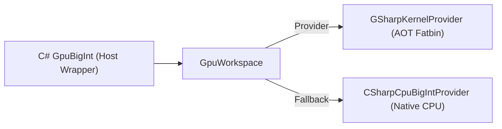
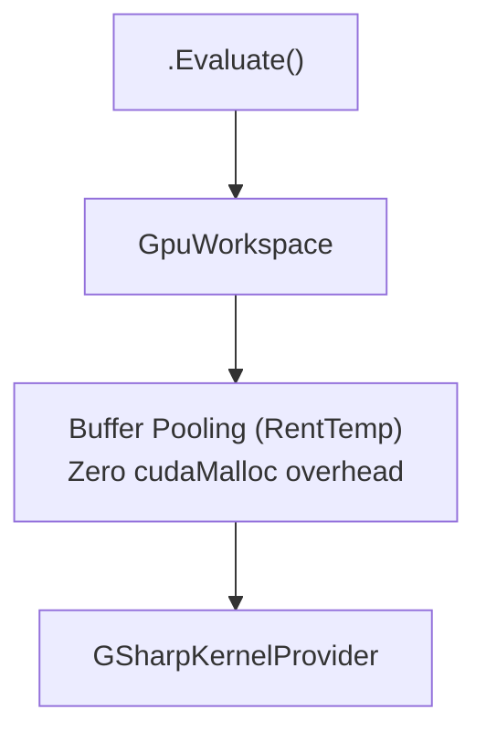
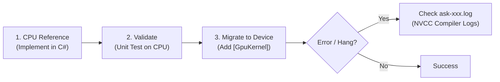

# 4. BigNum (BigInt/BigFloat) Internal Architecture

This document details the internal compiler implementation, data layout, and mathematical algorithms used under the hood for the `GpuBigInt` and `GpuBigFloat` modules.

*Note: You do not need to understand this to use the math modules.*

---

## 4.1 GpuBigFloat Architecture

## 2.1 Overview & Core Architecture

Arbitrary-precision GPU floating-point operations require predictable memory access, zero dynamic heap allocations, and zero dynamic dispatch. The module defines two primary floating-point value types:

1. **`GpuBigUFloat`**: Unsigned arbitrary-precision floating-point number.
2. **`GpuBigFloat`**: Signed arbitrary-precision floating-point number wrapping `GpuBigUFloat`.

### 2.1.1 Structural Layout & Memory Safety

The floating-point types are small host-side structs with sequential layout (`[StructLayout(LayoutKind.Sequential)]`).
The digits are not in the struct: the significand is a `GpuBigUInt`, a handle to limbs in GPU device memory.

```csharp
// Execution Context: Host (CPU)
namespace Kassyi.GSharp.Stdlib.GpuMath.BigNum;

// A handle to an unsigned big integer whose limbs are in GPU device memory
[StructLayout(LayoutKind.Sequential)]
public readonly partial struct GpuBigUInt
{
    public GpuWorkspace Workspace { get; }
    public GpuBigIntMemoryHandle Handle { get; }
}

[StructLayout(LayoutKind.Sequential)]
public readonly struct GpuBigUFloat
{
    public GpuBigUInt Significand { get; }
    public int Exponent { get; }
}

[StructLayout(LayoutKind.Sequential)]
public readonly struct GpuBigFloat
{
    public GpuBigUFloat UFloat { get; }
    public bool IsNegative { get; }
}
```

- **`Significand` (Mantissa)**: A `GpuBigUInt` holding the significant digits. Its limbs are in GPU device memory
  allocated from the pool of its `GpuWorkspace` (`GpuWorkspace.MemoryManager`); the length is chosen per value, not
  fixed by the type.
- **`Exponent`**: 32-bit signed integer representing the binary power ($2^{\text{Exponent}}$).
- **`IsNegative`**: Boolean flag indicating numerical sign (`true` for negative, `false` for non-negative).
- **Memory Ownership**: The structs themselves allocate nothing on the managed heap, but the significand owns a device
  buffer. `GpuBigUInt`, `GpuBigUFloat` and `GpuBigFloat` implement `IDisposable` (through `IGpuBigNumber<TSelf>`), and
  `Dispose()` returns the buffer to the workspace pool.
- **Fixed-Size Integers**: `GpuBigUInt<TSize>` is a different type: a value type whose limbs are an inline array
  (`TSize`, such as `LimbBuffer4`) in the struct itself, with no device allocation. It backs the fixed-width integers
  of [§2.7.1](#271-concrete-fixed-size-wrappers) (`GpuUInt128`, `GpuUInt256`, `GpuUInt512`).

---

## 2.2 Radix Point Alignment (Bit-Shifting)

When performing addition ($A + B$) or subtraction ($A - B$), the operands must be aligned to a common radix point before significand operations.

Given two operands:
$$A = (-1)^{S_A} \cdot M_A \cdot 2^{E_A}$$
$$B = (-1)^{S_B} \cdot M_B \cdot 2^{E_B}$$

### 2.2.1 Alignment Algorithm

1. **Exponent Comparison**:
   Calculate the exponent difference $\Delta E = |E_A - E_B|$.
2. **Target Exponent Selection**:
   Set the common target exponent $E_{\text{common}} = \max(E_A, E_B)$.
3. **Significand Bit-Shifting**:
   - The operand with the smaller exponent must have its significand shifted right by $\Delta E$ bits.
   - If $E_A < E_B$: $M_A' = M_A \gg \Delta E$.
   - If $E_B < E_A$: $M_B' = M_B \gg \Delta E$.
4. **Shift Overflow & Sticky Bit Preservation**:
   - If $\Delta E \ge \text{BitLength}(M)$, the smaller operand's significand shifts completely past the precision window.
   - Shifted-out bits are collapsed into a **Sticky Bit** ($S$) to preserve rounding accuracy during IEEE 754 ties-to-even evaluation.

---

## 2.3 Normalization & Rounding

### 2.3.1 Normalization Process

Following an arithmetic operation, the resulting significand $M_{\text{raw}}$ may overflow (carry out) or underflow (leading zeros). Normalization adjusts $M_{\text{raw}}$ so that its Most Significant Bit (MSB) aligns with the top bit of the allocated significand size:

1. **Overflow Normalization**:
   If addition produces a carry bit, shift $M_{\text{raw}}$ right by 1 bit and increment $E$:
   $$M_{\text{norm}} = M_{\text{raw}} \gg 1, \quad E_{\text{norm}} = E_{\text{common}} + 1$$
2. **Underflow Normalization**:
   If subtraction results in leading zeros, compute Leading Zero Count $\text{LZC}(M_{\text{raw}})$, shift $M_{\text{raw}}$ left by $\text{LZC}$, and decrement $E$:
   $$M_{\text{norm}} = M_{\text{raw}} \ll \text{LZC}, \quad E_{\text{norm}} = E_{\text{common}} - \text{LZC}$$

### 2.3.2 Rounding

There is one rounding, toward zero, and no rounding mode. A result keeps $p = 32n$ bits for the $n$ words of its significand and the discarded low bits are dropped, so a value that fits in $p$ bits is exact. See [Rounding](../03_bcl_api/math_bignum/gpu_big_float/00_index.md#rounding) for the operations it covers and the exponent overflow rule.

---

## 2.4 Algorithmic Complexity

Because floating-point operations ultimately delegate to integer significand arithmetic (plus exponent manipulation and bit-alignment), the computational time complexity scales with the configured precision ($N$ words):

- **Addition / Subtraction**: $\mathcal{O}(N)$ total work. Involves computing $\Delta E$, shifting the significand ($\mathcal{O}(N)$), performing parallel ripple-carry addition ($\mathcal{O}(N)$), and normalizing ($\mathcal{O}(N)$).
- **Multiplication**: $\mathcal{O}(N \log N)$ total work. Exponents are added ($\mathcal{O}(1)$), while significands are multiplied utilizing the underlying `GpuBigInt` NTT logic ($\mathcal{O}(N \log N)$).
- **Division**: $\mathcal{O}(N \log N)$ total work. Exponents are subtracted ($\mathcal{O}(1)$), while significands are divided utilizing Newton-Raphson iteration ($\mathcal{O}(N \log N)$).

---

## 2.5 Boundary Conditions & Edge Cases

| Boundary Condition | Expected Behavior |
| :--- | :--- |
| **Zero Significand** | Represented as $M = 0$ and $E = 0$. $0 + X = X$ and $0 \times X = 0$. |
| **Exact Power of Two** | $M$ has exactly 1 bit set. Alignment and normalization preserve bit position. |
| **Exponent Overflow** | Exponent exceeds `int.MaxValue`. The current implementation triggers checked-arithmetic overflow. |
| **Exponent Underflow** | Exponent drops below `int.MinValue`. The current implementation triggers checked-arithmetic underflow. |
| **Maximum Shift ($\Delta E \ge \text{Bits}$)** | Smaller operand becomes 0 with Sticky Bit $S = 1$ if any non-zero bits were shifted out. |
| **Sign Equivalence ($+0$ vs $-0$)** | Signed float $-0$ and $+0$ compare equal ($+0 == -0$). |

---

## 2.6 Preconditions & Invariants

1. **Unmanaged Type Constraint**: Type parameter `TSize` must be `unmanaged` to allow raw memory copy and GPU kernel execution.
2. **Static Alignment Invariant**: Field offsets for `Significand`, `Exponent`, and `IsNegative` are fixed at compile time.
3. **No Dynamic Allocation**: No `new` heap allocations occur inside device-side floating-point logic.

---

## 2.7 C# 12 Ergonomics & Developer Experience (DX)

To provide an intuitive, zero-allocation developer experience natively in C#, the module leverages advanced C# 12 features such as `[InlineArray]` and `[CollectionBuilder]`.

### 2.7.1 Concrete Fixed-Size Wrappers

Instead of requiring users to specify generic size parameters (e.g., `GpuBigUInt<LimbBuffer4>`) and define
`global using` aliases, the module provides ready-to-use concrete wrapper types for common precisions:

- **Fixed-Width Integers**: `GpuUInt128`, `GpuUInt256`, `GpuUInt512`

These structs act as ultra-thin, zero-overhead wrappers around `GpuBigUInt<LimbBuffer4>`, `GpuBigUInt<LimbBuffer8>`, and
`GpuBigUInt<LimbBuffer16>`. They provide implicit conversions and operator overloads for seamless arithmetic.

### 2.7.2 Zero-Allocation Collection Expressions

Traditional C# arrays (`new uint[] { 1, 2 }`) allocate memory on the managed heap, which is strictly prohibited for GPU device-side execution. To solve this, the module implements zero-allocation initialization using C# 12 Collection Expressions:

```csharp
// Execution Context: Host (CPU)
// Seamlessly initializes a 128-bit GPU big integer from an array-like syntax.
// The C# compiler optimizes this into a stack/register allocated sequence.
GpuUInt128 significand = [0xFFFFFFFF, 0x00000000, 0x00000000, 0x00000000];
```

This is achieved internally via:
1. **`[InlineArray]`**: Defining zero-allocation, fixed-size backing buffers (`LimbBuffer4`, `LimbBuffer8`, `LimbBuffer16`).
2. **`[CollectionBuilder]`**: Decorating the fixed-width integer structs
   (`[CollectionBuilder(typeof(GpuUInt128), nameof(GpuUInt128.Create))]`) to intercept the `[ ... ]` syntax and safely
   copy a `ReadOnlySpan<uint>` into the inline limb arrays without ever triggering a heap allocation or relying on boxed
   `IEnumerable<T>` interfaces.

---

## 4.2 GpuBigInt Architecture

### Algorithmic Complexity

Because floating-point operations ultimately delegate to integer significand arithmetic (plus exponent manipulation and bit-alignment), the computational time complexity scales with the configured precision ($N$ words):

| Operation | Complexity | Algorithm / Notes |
| :--- | :--- | :--- |
| **Addition / Subtraction** | $\mathcal{O}(N)$ | Highly parallelized across CUDA blocks. |
| **Multiplication** | $\mathcal{O}(N \log N)$ | Number Theoretic Transform (NTT) / Fast Fourier Transform (FFT). |
| **Division** | $\mathcal{O}(N \log N)$ | Newton-Raphson Iteration (utilizing NTT Multiplication). |
| **Square Root** | $\mathcal{O}(N \log N)$ | Newton-Raphson inverse square root (one cooperative mega-kernel up to `GpuWorkspace.SqrtPrecisionDoublingThresholdWords` root words, host-driven precision doubling above), one multiplication and an exact correction to the floor. |
| **Power of 10** | $\mathcal{O}(N \log N)$ | Binary Exponentiation (dominated by NTT multiplication). |
| **Bitwise Operations** | $\mathcal{O}(N)$ | Approaching $\mathcal{O}(1)$ step time due to massive parallelism. |
| **GCD** | $\mathcal{O}(N^2)$ to $\mathcal{O}(N \log^2 N)$ | Lehmer's GCD algorithm optimized for GPU execution. |
| **ModPow** | $\mathcal{O}(K \cdot N \log N)$ | Binary Exponentiation with Montgomery/Barrett Reduction ($K$ = bit-length of $b$). |
| **Fermat PRP Loop** | $\mathcal{O}(E \cdot N \log N)$ | Fermat PRP test of $2^{2E+1} - 2^E + 11$: a chain of $2E + 1$ NTT squarings, each reduced by a three-pass fold, under the Gerbicz-Li check. |
| **BBP Verification** | $\mathcal{O}(N \log N \cdot \log D)$ | BBP Formula with Modular Exponentiation ($D$ = hex digits). |

### Multi-Engine Architecture

The module utilizes a highly decoupled **Multi-Engine Execution Model** (`GpuExecutionEngine`). The physical file structure is divided into specific domains (`Kernels/`, `Providers/`, `Contexts/`, `Interop/`) to maintain modularity.



1.  **C# GpuBigInt (Host Wrapper)**: A `IDisposable` C# class that manages the `IntPtr` to the GPU device memory. It provides the high-level API for the host application to allocate, copy, and invoke operations.
2.  **G# Kernels (`GpuExecutionEngine.GSharpAot`)**: Handled via `Providers/GSharpKernelProvider.cs`, this dispatches to compiled G# device kernels natively written in C# using `[GpuKernel]` and compiled Ahead-Of-Time into GPU FATBIN modules.
3.  **CPU Fallback Backend**: A purely CPU-side fallback (`CSharpCpuBigIntProvider`) for executing identical arithmetic logic deterministically on the host CPU for non-GPU testing and debugging.

### Precision-Doubling Inverse Square Root

`SqrtFloor` takes the approximate inverse square root of the top `w = n + 1` words `A` of its operand (bit length `32w` or `32w - 1`) with `m = ceil(n / 2)` margin words, `B = 32(w + m)`. A root wider than `GpuWorkspace.SqrtPrecisionDoublingThresholdWords` words computes it from the host with ordinary launches instead of the cooperative mega-kernel (`GpuBigIntDivRem.InverseSqrtDoubling.cs`):

- **Scale**: `E = 16w + 32m + 2`. The stage of `p` working words holds `Y`, an approximation of `x* / 2^E` (`x* = 2^B / sqrt(A)`) with `32p` fraction bits.
- **Schedule**: `p_K = w + 1`, `p_(k-1) = ceil(p_k / 2) + 1` (2 before a stage of 3 words), down to a first stage of 2 words. The first stage reads the initial guess `x0` (about 30 correct bits) as `floor(x0 / 2^(E - 64))`.
- **One stage** (`dw = max(2, ceil(p / 2))`, four floors, all other products exact):
  - `S = floor(Y^2 / 2^(32(p - 1)))` (first floor);
  - `A_k = floor(A / 2^(32(w - p - 1)))`, the top `p + 1` words of `A` (second floor);
  - `D = floor((2^(64p + 60) - A_k·S) / 2^(32p + 60))`, signed (third floor);
  - `dY = floor(Yt·D / 2^(32 dw + 1))`, `Yt` the top `dw` words of `Y` (fourth floor), and `Y' = Y + dY`.
- **Signed values without a synchronization**: `D` is kept as `D + 2^(32 dw - 1)`, non-negative for every `|D| < 2^(32 dw - 1)`, and `Yt·D` as `Yt·(D + 2^(32 dw - 1)) - Yt·2^(32 dw - 1)` modulo `2^(32(p + dw + 1))`, so every step uses the unsigned multiplication, shift and modular addition already on the device. Debug builds check the bound on `D` on the device (`BigIntWideOps.CheckFitsBits`); release builds launch nothing for it.
- **Result**: `x~ = floor(Y_K / 2^(32 p_K - E))`.
- **Error bounds**: `|D| < 2^(32 dw - 1)` in every stage (at least 24 bits to spare), `|Y_K - floor(x* 2^(32 p_K - E))| <= 1` and `|x~ - floor(x*)| <= 1`, proved for `w >= 2` under the initial-guess error of at most `5·2^-32` (provable, about `2^-29.678`) with `x0 <= x*`.
- **Contract**: the approximate inverse square root returns `x~ - 1`, so its result stays at most `ApproximateInverseSqrtMaxError` below the floor and never above it, as the mega-kernel's does. `SqrtFloor` then corrects its estimate to the exact floor either way.

### Cooperative Mega-Kernel NTT

The Newton mega-kernels (`InverseSqrtNewtonRaphsonMegaKernel`, `ReciprocalNewtonRaphsonMegaKernel`,
`ModPowNttMegaKernel`) multiply with a 2-prime NTT of `M` points, the power of two that holds twice the words of the
product, inside one cooperative launch of `G` blocks of `B` threads (`G <= ` SM count). `GpuBigIntNttKernels` runs it in
one of three shapes:

| `M` | Shape | Grid syncs per transform |
| :- | :- | -: |
| `<= SharedRowMaxTransformLength` (1024) | One shared-memory row, on one block | 1 |
| `<= StridedColumnMaxTransformLength` (`2^16`) | `N1 x N2` (row-major, `N2` the smallest power of two with `N2^2 >= M`): the `N2` columns of length `N1` in place, then the `N1` rows of length `N2` | 2 |
| larger | The same split with two transposes through `TemporaryBuffer` around the rows of length `N1` | 4 |

- **Transform reuse**: operands that stay unchanged across products are transformed once into kept residue slots
  (`NttConvolutionScratchContext.Kept1`..`Kept3`, each an `NttResidues` pair) and combined by pointwise multiplication
  (`ExecuteNttPointwiseResidues`) without re-running the forward NTT. In `InverseSqrt`, `â` is transformed once before
  the loop (`Kept2`) and `x̂` once per iteration (`Kept1`); in `Reciprocal`, `b̂` (`Kept2`) and `x̂` (`Kept1`); in
  `ModPow`, `R̂` (`Kept2`) and `Q̂` (`Kept3`) are transformed once on `StartWord == 0` (persisting across chunked
  launches) and `x̂Sq` (`Kept1`) once per exponent bit.

  | Kernel | Transforms per iteration / bit (before) | Transforms per iteration / bit (after) |
  | :- | -: | -: |
  | `InverseSqrtNewtonRaphsonMegaKernel` | 9 (6 forward + 3 inverse) | 6 (3 forward + 3 inverse; final correction 9 → 5) |
  | `ReciprocalNewtonRaphsonMegaKernel` | 6 (4 forward + 2 inverse) | 4 (2 forward + 2 inverse; final correction 3 → 2) |
  | `ModPowNttMegaKernel` (bit 1 / bit 0) | 18 / 9 | 12 / 6 |

- **Rows in batches**: `ExecuteNttSharedRow` gives each butterfly one thread, so a block holds
  `rowsPerBatch = max(1, floor(B / (L / 2)))` rows of `L` points at once and synchronizes once per batch instead of once
  per row. Block `b` takes rows `b + kG`, `k = 0 .. ceil((rows - b) / G) - 1`; the last batch of a block may be short.
  Each row is computed exactly as alone, so the result does not depend on `B` or `G`.
- **Columns in place**: row `x` of the first forward pass (the last inverse pass) is column `x` of the buffer, element
  `e` at `x + e * N2` (`NumberTheoreticTransform.ColumnStride`). This places the same values in the same words as
  transposing, transforming row `x` and transposing back, without the two transposes and their two grid syncs.
- **Tiles in batches**: the transposes (`GpuBigIntFermatKernels.TransposeTileBatches`) move one `32 x 32` tile with every
  256 threads, so a block moves `min(3, B / 256)` tiles at once. Three, not four: four tiles take 16.5 KB of static
  shared memory, and with the 34048 bytes of rows of a `2^25`-point transform a block would need more than the 48 KB it
  gets without opting in. The transpose is called through a function that is not inlined (`TransposeTiles`): inlined,
  it takes the mega-kernels past 64 registers per thread.
- **The limits are measured** (both are constants, so another GPU changes one number):
  - up to 1024 points one row on one SM is faster than the split with blocks of 512 threads or more, and above 1024 the
    split is faster at every block size;
  - up to `2^16` points reading the columns in place is faster than transposing them, and from `2^17` transposing is
    faster, at every block size of 512 threads or more.
- **Shared memory**: the launcher passes `(R + R / 32) * 4 + 256` bytes of dynamic shared memory with
  `R = max(2 * 1024, L)` (`L` the longest row: `M` up to 1024 points, else `max(N1, N2)`), the most any block size
  up to 1024 threads asks for, since the size is fixed before the block size is chosen: 8704 bytes up to `2^22` points,
  17152 at `2^23` and `2^24`, 34048 at `2^25`. The kernels add 13072 bytes of static shared memory (12672 bytes for the tiles and 400 bytes of other buffers).
- **Block size**: the launcher (`CooperativeMegaKernelLauncher.ChooseBlockDim`) takes the smallest candidate `c` of
  1024 / 768 / 512 / 256 threads, at most the largest that fits an SM, with `M <= 2 * SMs * c`, and else the largest
  that fits. Under that bound every block transforms its rows in one batch (a block gets at most `2c` points, one
  butterfly per thread), so a larger block would only make more warps wait at each barrier and put
  the same work on fewer SMs; above it the grid is capped at one block per SM and a larger block runs fewer batches.
  The rule is a pure function of `M`, the SM count, the largest block that fits and the candidates; the result does
  not depend on the block size. ModPow runs on one block and applies `ChooseBlockDim` with one SM (256 threads up to
  512 points, 512 at 1024, and the largest block that fits above, 768 on sm_86 with 80 registers per thread).
- **Registers**: a block of 1024 threads fits an SM only with at most 64 registers per thread (56 for the inverse square
  root and the reciprocal). The occupancy test (`MegaKernelOccupancyTests`) asks the driver whether each mega-kernel
  fits with 1024 threads (ModPow with 768) at the least and the most shared memory, since the launcher otherwise
  takes 768 threads without a word.

### Execution Strategy & Memory Management

When `.Evaluate()` is called, the expression tree is executed using an optimized plan managed by `GpuWorkspace`.



The context routes execution to the specified engine and performs the following roles:
- **Buffer Pooling**: Pre-allocates working buffers within the workspace memory manager to avoid `cudaMalloc` overhead during computation.
- **RentTemp Object Pool**: Handles intermediate values (`GpuBigIntExpr`) dynamically without creating garbage. A rented buffer is owned and returns to the pool when it is disposed; buffers freed while a CUDA graph is captured stay with the graph until it is disposed.
- **Kernel Fusion**: Dispatches fused MegaKernels to minimize global memory bandwidth.

### GPU Debugging Best Practices (CPU-First / TDD Workflow)

Debugging complex mathematical algorithms directly within GpuBigInt kernels is exceptionally difficult due to the lack of GPU breakpoints and obscured JIT transpile errors. Always follow this workflow:



1. **CPU Reference Implementation**: Implement the mathematical logic entirely in standard C# within a temporary CPU-side scratch project.
2. **NVCC Logs Verification**: If a GPU test fails or hangs unexpectedly, check the background `ask-xxx.log` (NVCC compilation logs) to ensure the transpiler hasn't silently dropped a method.
3. **Migrate to Device Code**: Once the CPU code is mathematically sound and unit-tested, introduce `[GpuDeviceFunction]` / `[GpuKernel]` attributes and deploy it to the GPU.

### Zero-Allocation BigInt Building (`GpuBigUIntBuilder` and `LimbBuffer`)

To construct large constant values or intermediate configurations natively inside GPU kernels (e.g., setting up initial states) without allocating memory on the managed heap, G# provides the `GpuBigUIntBuilder` and `LimbBuffer` structures.

* **`LimbBuffer`**: A memory-safe, generic abstraction leveraging the C# 12 `[System.Runtime.CompilerServices.InlineArray]` feature to allocate fixed-size limb arrays (e.g., 8, 16, or 32 words) directly on the local execution stack (registers/local memory).
* **`GpuBigUIntBuilder`**: A mutating builder struct that wraps a `LimbBuffer`. It provides host-like API methods (such as `Add`, `ShiftLeft`, `SetBit`) to safely construct and manipulate small-to-medium arbitrary precision integers directly on the device before writing the final result to global memory.

```csharp
// Execution Context: G# Kernel (GPU)
// Example: Using GpuBigUIntBuilder inside a [GpuKernel]
[GpuKernel]
public static void SetupInitialState(uint[] globalOutput)
{
    // Create a 16-word (512-bit) structure from a ReadOnlySpan
    ReadOnlySpan<uint> limbs = [12345, 0, 0, 0];
    var builder = GpuBigUIntBuilder.Create<LimbBuffer16>(limbs);
    
    // ...
}
```

## See also


### BCL API > Math Bignum

- [Standard Math Library (Stdlib.Math)](../03_bcl_api/math_bignum/00_index.md)

### Guides

- [4. Practical Guides and Best Practices](../04_guides/00_index.md)
- [4. BigNum Expression Trees Guide](../04_guides/04_bignum_expression_trees_guide.md)

