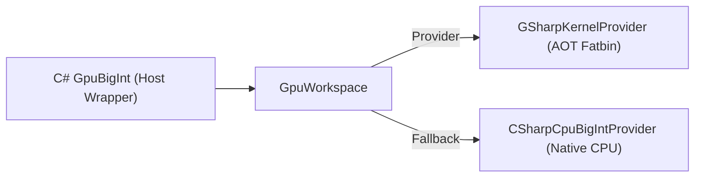
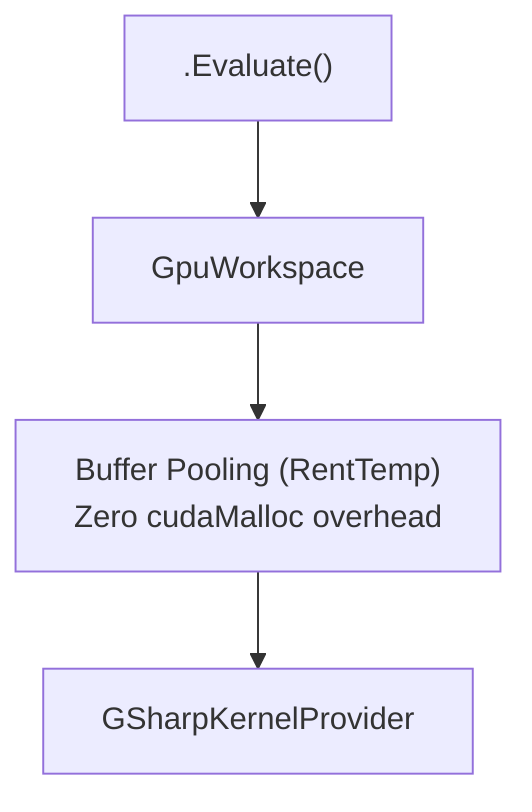
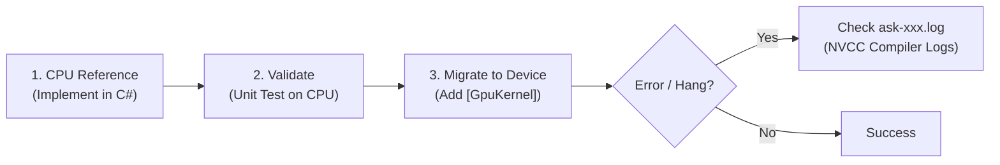

# 4. BigNum (BigInt/BigFloat) Internal Architecture

This document details the internal compiler implementation, data layout, and mathematical algorithms used under the hood for the `GpuBigInt` and `GpuBigFloat` modules.

*Note: You do not need to understand this to use the math modules.*

---

## 4.1 GpuBigFloat Architecture

## 2.1 Overview & Core Architecture

Arbitrary-precision GPU floating-point operations require predictable memory access, zero dynamic heap allocations, and zero dynamic dispatch. The module defines two primary floating-point value types:

1. **`GpuBigUFloat<TSize>`**: Unsigned arbitrary-precision floating-point number.
2. **`GpuBigFloat<TSize>`**: Signed arbitrary-precision floating-point number wrapping `GpuBigUFloat<TSize>`.

### 2.1.1 Structural Layout & Memory Safety

To guarantee static determinism and seamless mapping to CUDA C++ registers and shared memory, all types enforce sequential layout (`[StructLayout(LayoutKind.Sequential)]`):

```csharp
// Execution Context: Host (CPU)
namespace Kassyi.GSharp.Stdlib.GpuMath.BigNum;

[StructLayout(LayoutKind.Sequential)]
public struct GpuBigUInt<TSize> where TSize : unmanaged
{
    public TSize Limbs;
}

namespace Kassyi.GSharp.Stdlib.GpuMath.BigNum;

[StructLayout(LayoutKind.Sequential)]
public struct GpuBigUFloat<TSize> where TSize : unmanaged
{
    public GpuBigUInt<TSize> Significand;
    public int Exponent;
}

[StructLayout(LayoutKind.Sequential)]
public struct GpuBigFloat<TSize> where TSize : unmanaged
{
    public GpuBigUFloat<TSize> UFloat;
    public bool IsNegative;
}
```

- **`Significand` (Mantissa)**: Fixed-size unsigned big integer representing the significant digits.
- **`Exponent`**: 32-bit signed integer representing the binary power ($2^{\text{Exponent}}$).
- **`IsNegative`**: Boolean flag indicating numerical sign (`true` for negative, `false` for non-negative).
- **Zero-Allocation Guarantee**: Instances are stack- or register-allocated value types. No reference allocations, interfaces, or virtual calls are permitted on GPU device code.

---

## 2.2 Radix Point Alignment (Bit-Shifting)

When performing addition ($A + B$) or subtraction ($A - B$), the operands must be aligned to a common radix point before significand operations.

Given two operands:
$$A = (-1)^{S_A} \cdot M_A \cdot 2^{E_A}$$
$$B = (-1)^{S_B} \cdot M_B \cdot 2^{E_B}$$

### 2.2.1 Alignment Algorithm

1. **Exponent Comparison**:
   Calculate the exponent difference $\Delta E = |E_A - E_B|$.
2. **Target Exponent Selection**:
   Set the common target exponent $E_{\text{common}} = \max(E_A, E_B)$.
3. **Significand Bit-Shifting**:
   - The operand with the smaller exponent must have its significand shifted right by $\Delta E$ bits.
   - If $E_A < E_B$: $M_A' = M_A \gg \Delta E$.
   - If $E_B < E_A$: $M_B' = M_B \gg \Delta E$.
4. **Shift Overflow & Sticky Bit Preservation**:
   - If $\Delta E \ge \text{BitLength}(M)$, the smaller operand's significand shifts completely past the precision window.
   - Shifted-out bits are collapsed into a **Sticky Bit** ($S$) to preserve rounding accuracy during IEEE 754 ties-to-even evaluation.

---

## 2.3 Normalization & IEEE 754 Compliant Rounding

### 2.3.1 Normalization Process

Following an arithmetic operation, the resulting significand $M_{\text{raw}}$ may overflow (carry out) or underflow (leading zeros). Normalization adjusts $M_{\text{raw}}$ so that its Most Significant Bit (MSB) aligns with the top bit of the allocated significand size:

1. **Overflow Normalization**:
   If addition produces a carry bit, shift $M_{\text{raw}}$ right by 1 bit and increment $E$:
   $$M_{\text{norm}} = M_{\text{raw}} \gg 1, \quad E_{\text{norm}} = E_{\text{common}} + 1$$
2. **Underflow Normalization**:
   If subtraction results in leading zeros, compute Leading Zero Count $\text{LZC}(M_{\text{raw}})$, shift $M_{\text{raw}}$ left by $\text{LZC}$, and decrement $E$:
   $$M_{\text{norm}} = M_{\text{raw}} \ll \text{LZC}, \quad E_{\text{norm}} = E_{\text{common}} - \text{LZC}$$

### 2.3.2 IEEE 754 Rounding Modes (`GpuBigFloatRoundingMode`)

The module supports IEEE 754 compliant rounding modes defined in `GpuBigFloatRoundingMode`:

#### Round to Nearest, Ties to Even (`RoundToNearestEven`)
Evaluated using Guard Bit ($G$), Round Bit ($R$), and Sticky Bit ($S$):
- **$G$ (Guard Bit)**: First bit shifted out beyond target precision.
- **$R$ (Round Bit)**: Second bit shifted out.
- **$S$ (Sticky Bit)**: Bitwise OR of all remaining shifted-out bits.

**Rounding Decision Rules**:
- If $G = 0$: Round down (truncate).
- If $G = 1$ and ($R = 1$ or $S = 1$): Round up (add 1 to LSB of significand).
- If $G = 1$ and $R = 0$ and $S = 0$ (Exact Tie):
  - If LSB of normalized significand is `1` (Odd): Round up to nearest even.
  - If LSB of normalized significand is `0` (Even): Round down.

---

## 2.4 Algorithmic Complexity

Because floating-point operations ultimately delegate to integer significand arithmetic (plus exponent manipulation and bit-alignment), the computational time complexity scales with the configured precision ($N$ words):

- **Addition / Subtraction**: $\mathcal{O}(N)$ total work. Involves computing $\Delta E$, shifting the significand ($\mathcal{O}(N)$), performing parallel ripple-carry addition ($\mathcal{O}(N)$), and normalizing ($\mathcal{O}(N)$).
- **Multiplication**: $\mathcal{O}(N \log N)$ total work. Exponents are added ($\mathcal{O}(1)$), while significands are multiplied utilizing the underlying `GpuBigInt` NTT logic ($\mathcal{O}(N \log N)$).
- **Division**: $\mathcal{O}(N \log N)$ total work. Exponents are subtracted ($\mathcal{O}(1)$), while significands are divided utilizing Newton-Raphson iteration ($\mathcal{O}(N \log N)$).

---

## 2.5 Boundary Conditions & Edge Cases

| Boundary Condition | Expected Behavior |
| :--- | :--- |
| **Zero Significand** | Represented as $M = 0$ and $E = 0$. $0 + X = X$ and $0 \times X = 0$. |
| **Exact Power of Two** | $M$ has exactly 1 bit set. Alignment and normalization preserve bit position. |
| **Exponent Overflow** | Exponent exceeds `int.MaxValue`. The current implementation triggers checked-arithmetic overflow. |
| **Exponent Underflow** | Exponent drops below `int.MinValue`. The current implementation triggers checked-arithmetic underflow. |
| **Maximum Shift ($\Delta E \ge \text{Bits}$)** | Smaller operand becomes 0 with Sticky Bit $S = 1$ if any non-zero bits were shifted out. |
| **Sign Equivalence ($+0$ vs $-0$)** | Signed float $-0$ and $+0$ compare equal ($+0 == -0$). |

---

## 2.6 Preconditions & Invariants

1. **Unmanaged Type Constraint**: Type parameter `TSize` must be `unmanaged` to allow raw memory copy and GPU kernel execution.
2. **Static Alignment Invariant**: Field offsets for `Significand`, `Exponent`, and `IsNegative` are fixed at compile time.
3. **No Dynamic Allocation**: No `new` heap allocations occur inside device-side floating-point logic.

---

## 2.7 C# 12 Ergonomics & Developer Experience (DX)

To provide an intuitive, zero-allocation developer experience natively in C#, the module leverages advanced C# 12 features such as `[InlineArray]` and `[CollectionBuilder]`.

### 2.7.1 Concrete Fixed-Size Wrappers

Instead of requiring users to specify generic size parameters (e.g., `GpuBigFloat<LimbBuffer4>`) and define `global using` aliases, the module provides ready-to-use concrete wrapper types for common precisions:

- **Floating-Point**: `GpuFloat128`, `GpuFloat256`, `GpuFloat512`
- **Integer (Significand)**: `GpuUInt128`, `GpuUInt256`, `GpuUInt512`

These structs act as ultra-thin, zero-overhead wrappers around the generic `GpuBigFloat<TSize>` and `GpuBigUInt<TSize>` types. They provide implicit conversions and operator overloads for seamless arithmetic.

### 2.7.2 Zero-Allocation Collection Expressions

Traditional C# arrays (`new uint[] { 1, 2 }`) allocate memory on the managed heap, which is strictly prohibited for GPU device-side execution. To solve this, the module implements zero-allocation initialization using C# 12 Collection Expressions:

```csharp
// Execution Context: Host (CPU)
// Seamlessly initializes a 128-bit GPU float from an array-like syntax.
// The C# compiler optimizes this into a stack/register allocated sequence.
GpuUInt128 significand = [0xFFFFFFFF, 0x00000000, 0x00000000, 0x00000000];
var myFloat = new GpuFloat128(significand, exponent: 10, isNegative: false);
```

This is achieved internally via:
1. **`[InlineArray]`**: Defining zero-allocation, fixed-size backing buffers (`LimbBuffer4`, `LimbBuffer8`, `LimbBuffer16`).
2. **`[CollectionBuilder]`**: Intercepting the `[ ... ]` syntax and safely copying a `ReadOnlySpan<uint>` into the inline arrays without ever triggering a heap allocation or relying on boxed `IEnumerable<T>` interfaces.

---

## 4.2 GpuBigInt Architecture

### Algorithmic Complexity

Because floating-point operations ultimately delegate to integer significand arithmetic (plus exponent manipulation and bit-alignment), the computational time complexity scales with the configured precision ($N$ words):

| Operation | Complexity | Algorithm / Notes |
| :--- | :--- | :--- |
| **Addition / Subtraction** | $\mathcal{O}(N)$ | Highly parallelized across CUDA blocks. |
| **Multiplication** | $\mathcal{O}(N \log N)$ | Number Theoretic Transform (NTT) / Fast Fourier Transform (FFT). |
| **Division** | $\mathcal{O}(N \log N)$ | Newton-Raphson Iteration (utilizing NTT Multiplication). |
| **Square Root** | $\mathcal{O}(N \log N)$ | Heron's Method (Newton-Raphson for Square Roots). |
| **Power of 10** | $\mathcal{O}(N \log N)$ | Binary Exponentiation (dominated by NTT multiplication). |
| **Bitwise Operations** | $\mathcal{O}(N)$ | Approaching $\mathcal{O}(1)$ step time due to massive parallelism. |
| **GCD** | $\mathcal{O}(N^2)$ to $\mathcal{O}(N \log^2 N)$ | Lehmer's GCD algorithm optimized for GPU execution. |
| **ModPow** | $\mathcal{O}(K \cdot N \log N)$ | Binary Exponentiation with Montgomery/Barrett Reduction ($K$ = bit-length of $b$). |
| **Fermat PRP Loop** | $\mathcal{O}(E \cdot N \log N)$ | Fermat PRP test of $2^{2E+1} - 2^E + 11$: a chain of $2E + 1$ NTT squarings, each reduced by a three-pass fold, under the Gerbicz-Li check. |
| **BBP Verification** | $\mathcal{O}(N \log N \cdot \log D)$ | BBP Formula with Modular Exponentiation ($D$ = hex digits). |

### Multi-Engine Architecture

The module utilizes a highly decoupled **Multi-Engine Execution Model** (`GpuExecutionEngine`). The physical file structure is divided into specific domains (`Kernels/`, `Providers/`, `Contexts/`, `Interop/`) to maintain modularity.



1.  **C# GpuBigInt (Host Wrapper)**: A `IDisposable` C# class that manages the `IntPtr` to the GPU device memory. It provides the high-level API for the host application to allocate, copy, and invoke operations.
2.  **G# Kernels (`GpuExecutionEngine.GSharpAot`)**: Handled via `Providers/GSharpKernelProvider.cs`, this dispatches to compiled G# device kernels natively written in C# using `[GpuKernel]` and compiled Ahead-Of-Time into GPU FATBIN modules.
3.  **CPU Fallback Backend**: A purely CPU-side fallback (`CSharpCpuBigIntProvider`) for executing identical arithmetic logic deterministically on the host CPU for non-GPU testing and debugging.

### Execution Strategy & Memory Management

When `.Evaluate()` is called, the expression tree is executed using an optimized plan managed by `GpuWorkspace`.



The context routes execution to the specified engine and performs the following roles:
- **Buffer Pooling**: Pre-allocates working buffers within the workspace memory manager to avoid `cudaMalloc` overhead during computation.
- **RentTemp Object Pool**: Handles intermediate values (`GpuBigIntExpr`) dynamically without creating garbage. A rented buffer is owned and returns to the pool when it is disposed; buffers freed while a CUDA graph is captured stay with the graph until it is disposed.
- **Kernel Fusion**: Dispatches fused MegaKernels to minimize global memory bandwidth.

### GPU Debugging Best Practices (CPU-First / TDD Workflow)

Debugging complex mathematical algorithms directly within GpuBigInt kernels is exceptionally difficult due to the lack of GPU breakpoints and obscured JIT transpile errors. Always follow this workflow:



1. **CPU Reference Implementation**: Implement the mathematical logic entirely in standard C# within a temporary CPU-side scratch project.
2. **NVCC Logs Verification**: If a GPU test fails or hangs unexpectedly, check the background `ask-xxx.log` (NVCC compilation logs) to ensure the transpiler hasn't silently dropped a method.
3. **Migrate to Device Code**: Once the CPU code is mathematically sound and unit-tested, introduce `[GpuDeviceFunction]` / `[GpuKernel]` attributes and deploy it to the GPU.

### Zero-Allocation BigInt Building (`GpuBigUIntBuilder` and `LimbBuffer`)

To construct large constant values or intermediate configurations natively inside GPU kernels (e.g., setting up initial states) without allocating memory on the managed heap, G# provides the `GpuBigUIntBuilder` and `LimbBuffer` structures.

* **`LimbBuffer`**: A memory-safe, generic abstraction leveraging the C# 12 `[System.Runtime.CompilerServices.InlineArray]` feature to allocate fixed-size limb arrays (e.g., 8, 16, or 32 words) directly on the local execution stack (registers/local memory).
* **`GpuBigUIntBuilder`**: A mutating builder struct that wraps a `LimbBuffer`. It provides host-like API methods (such as `Add`, `ShiftLeft`, `SetBit`) to safely construct and manipulate small-to-medium arbitrary precision integers directly on the device before writing the final result to global memory.

```csharp
// Execution Context: G# Kernel (GPU)
// Example: Using GpuBigUIntBuilder inside a [GpuKernel]
[GpuKernel]
public static void SetupInitialState(uint[] globalOutput)
{
    // Create a 16-word (512-bit) structure from a ReadOnlySpan
    ReadOnlySpan<uint> limbs = [12345, 0, 0, 0];
    var builder = GpuBigUIntBuilder.Create<LimbBuffer16>(limbs);
    
    // ...
}
```

## See also


### BCL API > Math Bignum

- [Standard Math Library (Stdlib.Math)](../03_bcl_api/math_bignum/00_index.md)

### Guides

- [4. Practical Guides and Best Practices](../04_guides/00_index.md)
- [4. BigNum Expression Trees Guide](../04_guides/04_bignum_expression_trees_guide.md)

