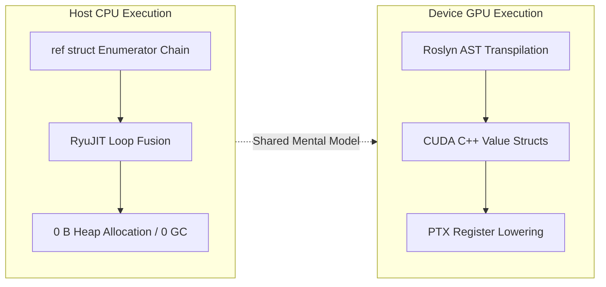

# Zero-Allocation LINQ (StackLinq)

`Kassyi.ZeroAlloc.Linq` (internally codenamed **StackLinq**) is a specialized, zero-allocation fluent sequence processing framework built from the ground up for both modern high-performance .NET applications and GPU kernels executed via G# (`Kassyi.GSharp`).

Standard `System.Linq` is fundamentally incompatible with real-time systems, low-latency loops, and GPU kernels because every query operator (`Where`, `Select`, etc.) allocates heap objects (`IEnumerable<T>`, `IEnumerator<T>`, capturing closures), introduces interface virtual dispatch overhead (`IEnumerator.MoveNext()`), and triggers garbage collection (GC).

`StackLinq` resolves this contradiction by encoding entire lazy execution pipelines into C# 12 `ref struct` state machines that reside exclusively on the execution stack and in hardware registers.

---

## The 3 Architectural Tenets of StackLinq



### 1. Absolute Zero-Allocation (0 B Heap Memory)
All enumerators are defined as `ref struct` types implementing the zero-allocation `IStackEnumerator<TSource>` contract. They cannot be boxed, cannot be cast to interface object references, and cannot escape to the managed heap. Memory allocation across all operations (`Where`, `Select`, `Take`, `Skip`, aggregators) is guaranteed to be **0 Bytes**.

### 2. Direct PTX / CUDA Lowering for GPU Native Execution
Through the `Kassyi.GSharp.Compiler` Roslyn Source Generator, StackLinq pipelines inside `[GpuKernel]` or `[GpuDeviceFunction]` methods are intercepted at compile time and lowered into native CUDA C++ templates (`GSharpSharedCudaPrelude`). 

* **No Host Round-trips**: Massive arrays and buffers resident in VRAM can be sliced, filtered, transformed, and aggregated directly within GPU thread registers.
* **Hardware Register Mapping**: The enumerator state is unrolled into local scalar registers on each Streaming Multiprocessor (SM).

### 3. Aggressive Inlining and Loop Fusion
Because enumerator calls do not use virtual method tables, modern .NET JIT compilers (RyuJIT) and NVIDIA's CUDA C++ compiler (NVCC) aggressively inline `TryGetNext` invocations. Multiple chained operations collapse into a single tight loop (Loop Fusion), achieving near-parity with handwritten `for` loops.

---

## Core Contract: `IStackEnumerator<TSource>`

```csharp
namespace Kassyi.ZeroAlloc.Linq;

/// <summary>
/// Defines a stack-only enumerator supporting zero-allocation sequential element access.
/// </summary>
/// <typeparam name="TSource">The type of elements in the sequence.</typeparam>
public interface IStackEnumerator<TSource>
{
    /// <summary>
    /// Attempts to advance to the next element of the sequence.
    /// </summary>
    /// <param name="current">When this method returns true, contains the next element in the sequence.</param>
    /// <returns>true if the enumerator successfully advanced; otherwise, false.</returns>
    bool TryGetNext(out TSource current);
}
```

Unlike `IEnumerator<T>`, which requires separate `MoveNext()`, `Current`, and `Dispose()` calls, `IStackEnumerator<TSource>` uses a single unified `TryGetNext(out TSource current)` method. This mirrors the high-efficiency `System.Threading.Channels` and `System.IO.Pipelines` patterns, minimizing branching and register spills.

---

## Entry Points: `AsStackEnumerable()`

StackLinq sequences are initiated by converting existing memory spans or arrays via the `AsStackEnumerable()` extension methods:

```csharp
using Kassyi.ZeroAlloc.Linq;

// 1. From ReadOnlySpan<T> / Span<T> (CPU & Stack-only)
ReadOnlySpan<int> span = stackalloc int[] { 1, 2, 3, 4, 5 };
int spanSum = span.AsStackEnumerable()
                  .Where(x => x % 2 == 0)
                  .Select(x => x * 10)
                  .Sum();

// 2. From standard T[] arrays (CPU and GPU Device Kernels)
int[] array = new int[] { 1, 2, 3, 4, 5 };
int arraySum = array.AsStackEnumerable()
                    .Skip(1)
                    .Take(3)
                    .Sum();
```

---

## Execution Target Comparison

| Feature | `System.Linq` | `ZLinq` | `StackLinq (Henicos)` |
| :--- | :--- | :--- | :--- |
| **Enumerator Lifetime** | Heap (`class`) | Stack / Heap (`struct`) | **Pure Stack (`ref struct`)** |
| **GC Garbage (Heap Allocation)** | High (32 B – 344 B+ per query) | Low (0 B – 64 B) | **Always 0 B** |
| **GPU Execution (`[GpuKernel]`)** | ❌ Impossible (Throws runtime error) | ❌ Unsupported | **✅ Fully Native (CUDA / PTX)** |
| **Early Exit (Short-Circuit) Speed** | Baseline | ~2.7x slower | **~2.7x faster than ZLinq** |
| **Loop Fusion Support** | ❌ (Virtual dispatch barrier) | Partial | **✅ Full (JIT & NVCC Inline)** |
| **Chain Depth Governance** | None | None | **✅ Compiler Diagnostic (`SLQ0001`)** |

---

## Supported Operations Matrix

StackLinq implements an extensive suite of standard query operators optimized for stack execution:

| Category | Supported Methods |
| --- | --- |
| **Filtering** | `Where(predicate)` (`WhereEnumerator`), `Where((item, index) => ...)` (`WhereAtEnumerator`) |
| **Projection** | `Select(selector)` (`SelectEnumerator`), `Select((item, index) => ...)` (`SelectAtEnumerator`) |
| **Partitioning & Slicing** | `Skip(count)`, `Take(count)`, `SkipLast(count)`, `TakeLast(count)` |
| **Conditional Slicing** | `SkipWhile(predicate)`, `TakeWhile(predicate)`, `SkipWhile((item, index) => ...)`, `TakeWhile((item, index) => ...)` |
| **Terminal Aggregation** | `Sum()`, `Count()`, `Aggregate(func)`, `Aggregate(seed, func)`, `Max()`, `Min()`, `Average()` |
| **Quantifiers & Search** | `Any()`, `All()`, `Contains(value)` |
| **Element Selection** | `First()`, `FirstOrDefault()`, `Last()`, `LastOrDefault()`, `Single()`, `SingleOrDefault()`, `ElementAt(index)`, `ElementAtOrDefault(index)` |
| **Materialization & Parallel** | `CopyTo(Span<T>)`, `ToArray()`, `AsParallel()` |

For full method signatures and examples, refer to [StackLinqExtensions Class](StackLinqExtensions.md) and the individual method/enumerator reference pages below.

---

## Hardware Constraints & Architectural Best Practices

### 1. The `ref struct` Constraint Boundary
Because `ref struct` types cannot cross `async`/`await` state machine boundaries or be stored in heap-allocated fields:
* StackLinq queries must be declared and consumed within a single synchronous method or loop scope.
* Queries cannot be assigned to fields inside standard classes or non-ref structs.

### 2. GPU Register Pressure & The Rule of Thumb (Diagnostic `SLQ0001`)
On GPU SMs, hardware registers per thread are strictly finite (typically 32 to 64 registers). While 2 to 3 chained operations (`Skip(10).Take(100).Select(x => x * 2)`) perform within **1.2x** of handwritten CUDA code, chaining 7 or more operations accumulates state variables, inducing **Register Spill** into local VRAM.

GSharp provides the compile-time diagnostic **[`SLQ0001`](../diagnostics/SLQ0001.md)** to warn developers when a pipeline exceeds safe nesting depth. For complex pipelines on GPU, AST Loop Fusion optimization is tracked under Issue #309.

---

## Related Documentation

### Core Types & Enumerators

* [IStackEnumerator&lt;T&gt; Interface](IStackEnumerator.md)
* [StackEnumerable&lt;TEnumerator, T&gt; Struct](StackEnumerable.md)
* [ParallelStackEnumerable&lt;TEnumerator, TSource&gt; Struct](ParallelStackEnumerable.md)
* [StackLinqExtensions Class](StackLinqExtensions.md)
* [SpanEnumerator&lt;T&gt; Struct](SpanEnumerator.md)
* [ArrayEnumerator&lt;T&gt; Struct](ArrayEnumerator.md)
* [WhereEnumerator&lt;TEnumerator, TSource&gt; Struct](WhereEnumerator.md) / [WhereAtEnumerator&lt;TEnumerator, TSource&gt; Struct](WhereAtEnumerator.md)
* [SelectEnumerator&lt;TEnumerator, TSource, TResult&gt; Struct](SelectEnumerator.md) / [SelectAtEnumerator&lt;TEnumerator, TSource, TResult&gt; Struct](SelectAtEnumerator.md)
* [TakeEnumerator&lt;TEnumerator, TSource&gt; Struct](TakeEnumerator.md) / [SkipEnumerator&lt;TEnumerator, TSource&gt; Struct](SkipEnumerator.md)
* [TakeWhileEnumerator&lt;TEnumerator, TSource&gt; Struct](TakeWhileEnumerator.md) / [TakeWhileAtEnumerator&lt;TEnumerator, TSource&gt; Struct](TakeWhileAtEnumerator.md)
* [SkipWhileEnumerator&lt;TEnumerator, TSource&gt; Struct](SkipWhileEnumerator.md) / [SkipWhileAtEnumerator&lt;TEnumerator, TSource&gt; Struct](SkipWhileAtEnumerator.md)

### Extension Method Pages

* [AsStackEnumerable Method](AsStackEnumerable.md)
* [Where Method](Where.md)
* [Select Method](Select.md)
* [Take Method](Take.md)
* [Skip Method](Skip.md)
* [TakeLast Method](TakeLast.md)
* [SkipLast Method](SkipLast.md)
* [TakeWhile Method](TakeWhile.md)
* [SkipWhile Method](SkipWhile.md)
* [Sum Method](Sum.md)
* [Count Method](Count.md)
* [Aggregate Method](Aggregate.md)
* [First Method](First.md)
* [Single Method](Single.md)
* [Any Method](Any.md)
* [All Method](All.md)
* [Contains Method](Contains.md)
* [Diagnostic SLQ0001: Excessive StackLinq Chain Depth](../diagnostics/SLQ0001.md)
* [Transpiler Architecture & Lowering Rules](../../02_architecture/00_index.md)
