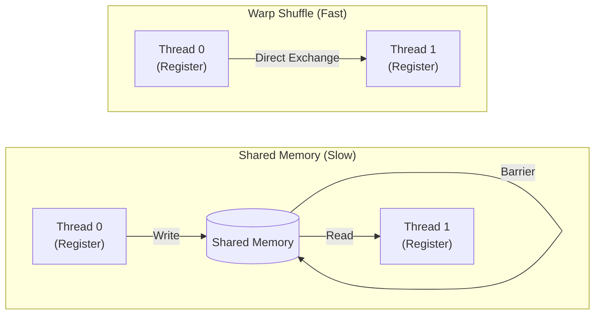
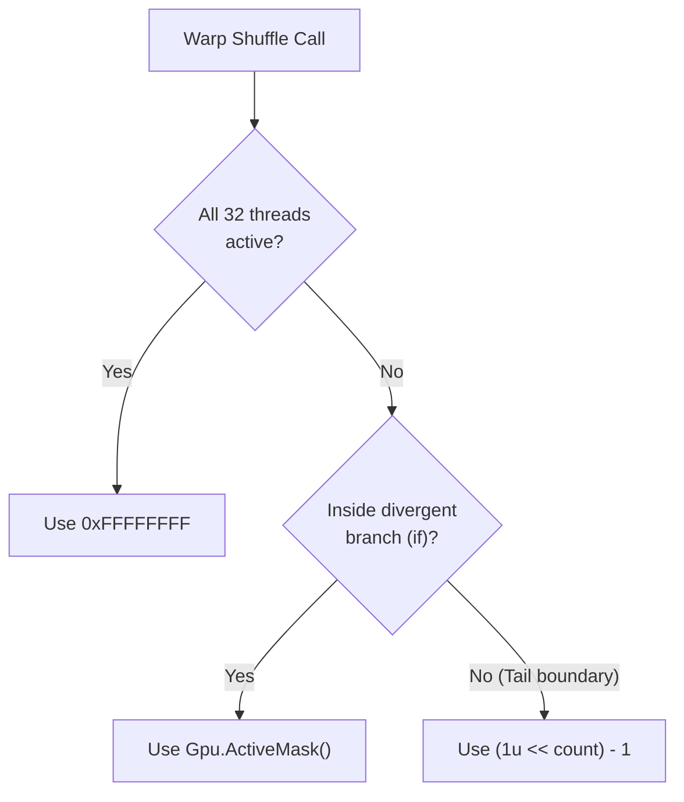

# Warp Primitives and Thread Masking Guide

---

## 1. Overview: Warp Communication vs. Shared Memory

In GPU architectures, threads are executed in lockstep groups of 32 called **Warps**. While threads within a block can communicate through Shared Memory (`SharedMemory<T>`), doing so incurs memory access latency and requires explicit barriers.

**Warp Shuffle Primitives** (`Gpu.ShuffleUpSync`, `Gpu.ShuffleDownSync`, `Gpu.ShuffleXorSync`) solve this by allowing threads to read variables directly from each other's registers.



To coordinate this direct hardware exchange safely, every warp shuffle intrinsic requires an **active thread mask** (`uint mask`) parameter.

---

## 2. Hardware Mental Model: Why Does `mask` Exist?

### 2.1 The Evolution of Warp Execution

Why do we need to explicitly pass a `mask`? It stems from how modern GPUs schedule threads:

- **Pre-Volta GPUs (Kepler, Pascal):** All 32 threads shared a single program counter (PC). Threads were physically forced to execute together.
- **Modern GPUs (Volta, Ampere, Hopper, Blackwell+):** Introduced **Independent Thread Scheduling (ITS)**. Each thread has its own PC and can execute `if-else` branches at different times.

Because threads can now arrive at a shuffle instruction independently, the hardware requires an explicit "participant roster" to know who to wait for:

```csharp
// Execution Context: G# Kernel (GPU)
[GpuKernel]
public static void DemonstrateItsBehavior(int myVal)
{
    // Scenario: Half of the warp (Threads 0-15) enters the 'if', the other half skips.
    if (ThreadIndex.X < 16)
    {
        // [ITS Behavior] Threads 0-15 arrive here. Threads 16-31 are doing something else.
        // If we tell the hardware "Wait for all 32 threads" (0xFFFFFFFF), it will wait forever!
        // We must pass a mask indicating ONLY threads 0-15 are participating.
        uint mask = Gpu.ActiveMask(); 
        int val = Gpu.ShuffleDownSync(mask, myVal, 1);
    }
}
```

The `mask` parameter is exactly this roster. The hardware suspends the arriving threads until everyone listed in the `mask` has arrived, performs the exchange, and resumes execution.

---

## 3. The 32-bit Mask Representation

Conceptually, the `mask` parameter acts as an **attendance roster** (a bit flag) for the 32 threads in the warp. Because a warp consists of exactly 32 threads, a single 32-bit unsigned integer (`uint`) perfectly represents the participation state of every thread, packed bit-by-bit.

```csharp
// Execution Context: G# Kernel (GPU)
// Using C# binary literals to visualize the 'Attendance Roster'
// 1 = Thread Participates, 0 = Thread Skipped

// Scenario A: Everyone participates (e.g., standard reduction)
uint allThreads = 0b_11111111_11111111_11111111_11111111; // 0xFFFFFFFF

// Scenario B: Only even-numbered threads participate
uint evenOnly   = 0b_01010101_01010101_01010101_01010101; // 0x55555555

// The hardware internally checks if Lane N is expected:
bool isLane5Active = (mask & (1u << 5)) != 0;
```

As demonstrated above:
- **Bit 0 (rightmost bit)** corresponds to Lane 0.
- **Bit 31 (leftmost bit)** corresponds to Lane 31.

If a bit is set to `1`, that thread is expected to arrive at the synchronization point. If a bit is `0`, the hardware ignores that thread.

### Common Mask Constants

| Hex Literal | Binary Representation | Practical Use Case |
| :--- | :--- | :--- |
| **`0xFFFFFFFF`** | `1111...1111` (All 32 bits = `1`) | Entire warp participates unconditionally. |
| **`0x55555555`** | `0101...0101` (Even bits = `1`) | Only even lane IDs participate. |
| **`0xAAAAAAAA`** | `1010...1010` (Odd bits = `1`) | Only odd lane IDs participate. |
| **`(1u << K) - 1`** | `0000...1111` (First $K$ bits = `1`) | Partial warp handling (first $K$ threads active). |

---

## 4. Decision Tree: How to Choose `mask`

Choosing `mask` follows three practical rules:



### Safe Implementation Patterns

#### Pattern 1: Uniform Execution (95%+ of cases)
When all 32 threads in the warp execute the shuffle together unconditionally (e.g., standard reductions, scans, matrix tiles, **outside of any `if` blocks**):
```csharp
// Execution Context: G# Kernel (GPU)
[GpuKernel]
public static void UniformExecution(int val)
{
    // SAFE: There is no divergence here. All 32 threads are guaranteed to arrive.
    // Therefore, we can safely tell the hardware to wait for everyone.
    int result = Gpu.ShuffleDownSync(0xFFFFFFFF, val, 16);
}
```

#### Pattern 2: Divergent Execution (`if` branches)
When the shuffle occurs inside a conditional block where some threads in the warp do not enter:
```csharp
// Execution Context: G# Kernel (GPU)
[GpuKernel]
public static void DivergentExecution(int val)
{
    // SAFE: ActiveMask dynamically computes who is actually executing this branch.
    if (ThreadIndex.X % 2 == 0) // Only even threads enter
    {
        uint activeMask = Gpu.ActiveMask();
        int result = Gpu.ShuffleDownSync(activeMask, val, 1);
    }
}
```

#### Pattern 3: Partial Warp Processing (Tail Boundaries)
When the total data size $N$ is not a multiple of 32, the final warp only processes $K$ active items:
```csharp
// Execution Context: G# Kernel (GPU)
[GpuKernel]
public static void PartialWarpProcessing(int totalElements, int warpOffset, int val)
{
    // SAFE: Explicitly mask out threads that are out of bounds.
    int validThreads = Math.Min(32, totalElements - warpOffset);
    uint tailMask = (1u << validThreads) - 1; // e.g., K=10 -> 0x3FF

    int result = Gpu.ShuffleDownSync(tailMask, val, 1);
}
```

---

## 5. The Critical Pitfall: GPU Deadlock (Hang)

> [!CAUTION]
> **Passing `0xFFFFFFFF` in Divergent Code Crashes or Freezes the GPU**

If `mask` includes a thread that never reaches the shuffle instruction, the hardware waits indefinitely for that thread to arrive at the synchronization barrier. This results in an unrecoverable **GPU Kernel Timeout (TDR)** or device hang.

Think of the `mask` as an attendance roster presented to the hardware at the exact moment the shuffle method is invoked. The hardware reads this roster and forces all currently arrived threads to wait (suspend execution) until every thread marked as "participating" on the roster also arrives. If a thread listed on the roster bypassed the shuffle instruction due to an `if` branch, the waiting threads will wait forever.

### Dangerous Antipattern:
```csharp
// Execution Context: G# Kernel (GPU)
[GpuKernel]
public static void DeadlockExample(int val)
{
    // ❌ DANGEROUS: Causes GPU Deadlock!
    if (ThreadIndex.X < 16) // Threads 16..31 will never execute this branch
    {
        // The shuffle method acts as a synchronization barrier (wait point).
        // The mask 0xFFFFFFFF tells the hardware: "Wait until all 32 threads arrive."
        // However, threads 16..31 bypassed this block and will never arrive.
        // Result: Threads 0..15 wait indefinitely. (Deadlock)
        int partner = Gpu.ShuffleXorSync(0xFFFFFFFF, val, 1);
    }
}
```

### Safe Solution:
```csharp
// Execution Context: G# Kernel (GPU)
[GpuKernel]
public static void SafeActiveMaskExample(int val)
{
    // ⭕ SAFE: Use Gpu.ActiveMask() in divergent branches
    if (ThreadIndex.X < 16)
    {
        uint mask = Gpu.ActiveMask(); // Automatically resolves to 0x0000FFFF
        int partner = Gpu.ShuffleXorSync(mask, val, 1);
    }
}
```

---

## 6. Warp Shuffle Operation Summary

| Method | Conceptual Action | Key Use Cases |
| :--- | :--- | :--- |
| **`ShuffleSync(mask, var, srcLane)`** | Broadcasts from a specific `srcLane` | Pivot distribution, broadcasting warp leader's value. |
| **`ShuffleDownSync(mask, var, delta)`** | Reads from higher lane (`LaneId + delta`) | Parallel tree reductions (Sum, Max, Min). |
| **`ShuffleUpSync(mask, var, delta)`** | Reads from lower lane (`LaneId - delta`) | Prefix sums (scans), 1D/2D stencil neighbor reads. |
| **`ShuffleXorSync(mask, var, laneMask)`** | Swaps with paired lane (`LaneId ^ laneMask`) | Butterfly reductions, Bitonic sort, FFT. |

---

## 7. Complete Code Examples

### 7.1 Warp-Level Sum Reduction (`ShuffleDownSync`)

Cascading tree reduction where each step halves the active distance. The total sum is accumulated in Lane 0:

```csharp
// Execution Context: G# Kernel (GPU)
[GpuKernel]
public static unsafe void WarpSumReduction(int* data, int* results)
{
    int val = data[ThreadIndex.X];

    // Tree reduction across 32 lanes
    for (uint offset = 16; offset > 0; offset /= 2)
    {
        val += Gpu.ShuffleDownSync(0xFFFFFFFF, val, offset);
    }

    // Lane 0 holds the warp sum
    if (ThreadIndex.X % 32 == 0)
    {
        results[ThreadIndex.X / 32] = val;
    }
}
```

### 7.2 All-Thread Butterfly Reduction (`ShuffleXorSync`)

Unlike `ShuffleDownSync`, `ShuffleXorSync` leaves the final reduced sum in **all 32 threads** without needing a broadcast step:

```csharp
// Execution Context: G# Kernel (GPU)
[GpuKernel]
public static unsafe void WarpButterflyAllReduce(int* data)
{
    int val = data[ThreadIndex.X];

    // Butterfly reduction: 16 -> 8 -> 4 -> 2 -> 1
    for (int offset = 16; offset > 0; offset /= 2)
    {
        val += Gpu.ShuffleXorSync(0xFFFFFFFF, val, offset);
    }

    // Every thread now has the total sum
    data[ThreadIndex.X] = val;
}
```

---

## 8. See Also

- [4. Practical Guides Overview](00_index.md)
- [Gpu BCL API Overview](../03_bcl_api/00_index.md)
- [Gpu.ActiveMask BCL Reference](../03_bcl_api/gpu_class/00_index.md)
- [Gpu.ShuffleUpSync](../03_bcl_api/gpu_class/WarpShuffleUp.md)
- [Gpu.ShuffleDownSync](../03_bcl_api/gpu_class/WarpShuffleDown.md)
- [Gpu.ShuffleXorSync](../03_bcl_api/gpu_class/WarpShuffleXor.md)
- [Execution and Concurrency Model](../01_language/04_execution_model.md)
