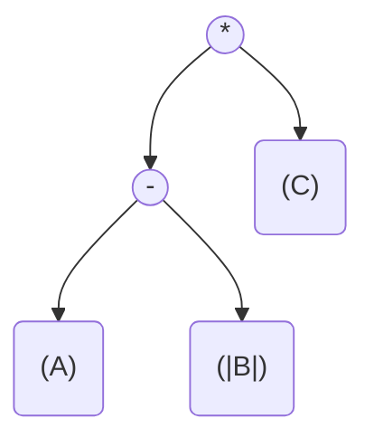

# Advanced Math & Lazy Evaluation (Expression Trees)

GSharp provides powerful arbitrary-precision arithmetic libraries (`GpuBigInteger`, `GpuBigFloat`) in the `Kassyi.GSharp.Stdlib.Math` namespace. However, if you look at the API reference, you'll notice a strict warning: **These types cannot be used inside `[GpuKernel]` methods.**

Why? And why do their operator overloads (`+`, `*`) return strange `Expr` (Expression Tree) types instead of the computed results?

This guide explains the architectural necessity behind this design: how GSharp conquers GPU Register Pressure and the Zero-Allocation rule using **Lazy Evaluation**.

---

## 1. The Challenge: Why Naive BigMath Fails on GPUs

To understand the solution, we must first look at how standard C# `.NET` math works on a CPU, and why that approach is catastrophically hostile to a GPU.

### The Allocation Problem (`new` Keyword Taboo)
In standard C#, when you write `BigInteger c = a + b;`, the CPU allocates a brand new byte array on the heap to store the result. 
As covered in the [Anti-Patterns Guide](06_antipatterns_and_best_practices.md), **dynamic heap allocation (`new`) inside a GPU kernel is strictly forbidden** due to performance and architectural constraints (the Zero-Allocation rule).

```csharp
// ❌ Bad: Allocation inside a kernel (Compile Error)
// Execution Context: G# Kernel (GPU)
[GpuKernel]
public static void BadAllocationKernel() {
    BigInteger a = 100;
    BigInteger b = 200;
    // Fatal: This requires a hidden `new byte[]` allocation on the heap!
    BigInteger c = a + b; 
}
```

### The Register Pressure Problem (Heavy Structs)
If we can't allocate on the heap, can we just make `GpuBigInteger` a massive `struct` (e.g., a 256-byte `struct` holding an inline array of 64 `uint`s) and pass it by value?

On a CPU, this is fine. The CPU has massive L1 caches.
On a GPU, local variables are stored in **Registers**. A GPU SM (Streaming Multiprocessor) has a fixed number of registers shared among thousands of concurrent threads. If your kernel uses massive `struct` variables, you will exhaust the registers immediately.
When registers run out, the GPU is forced to "spill" the data into **Local Memory** (which physically resides in the extremely slow global VRAM). This is called **Register Spilling**, and it causes performance to drop by factors of 100x or more.

```csharp
// ❌ Bad: Heavy struct by-value (Register Spilling)
// Execution Context: G# Kernel (GPU)
public struct HeavyBigInt {
    public fixed uint Data[64]; // 256 bytes per instance
}

[GpuKernel]
public static void BadRegisterPressureKernel(HeavyBigInt a, HeavyBigInt b) {
    // Fatal: Computing massive structs by value instantly exhausts 
    // the thread's registers, causing catastrophic local memory spills.
    HeavyBigInt c = Compute(a, b);
}
```

---

## 2. The Solution: Lazy Evaluation & Expression Trees

If we cannot allocate heap memory inside the kernel, and we cannot use massive value-type structs without destroying performance, how do we perform math like `D = (A + B) * C`?

**The answer: We don't do it inside the kernel. We orchestrate it from the Host.**

GSharp implements **Lazy Evaluation** using **Expression Trees (AST)**.

### How it Works

When you write the following code on the Host (CPU):

```csharp
// Execution Context: Host (CPU)
using var context = new GpuContext(maxWords: 1024);

// A is positive, B is negative, C is positive
var A = new GpuBigInteger(GpuUIntBigInteger.FromBigInteger(context, 100), isNegative: false);
var B = new GpuBigInteger(GpuUIntBigInteger.FromBigInteger(context, 50), isNegative: true);
var C = new GpuBigInteger(GpuUIntBigInteger.FromBigInteger(context, 2), isNegative: false);

// We write an addition, but since B is negative, the CPU evaluates the signs
// and swaps the node into a Subtraction behind the scenes!
var expr = (A + B) * C;
```

Absolutely **zero math** is performed at this stage, and **zero GPU memory** is allocated for the intermediate result of `(A + B)`.
Instead, the overloaded `+` and `*` operators construct a lightweight C# Abstract Syntax Tree (AST). Notice how the addition `A + (-B)` was transparently optimized into a pure subtraction `A - |B|`:



The variable `expr` is of type `GpuBigIntExpr`. It simply represents the *intent* to calculate `(A - |B|) * C`.

### The `Evaluate` Step and Memory Pooling

To actually compute the result, you must call `.Evaluate()` and provide a `GpuContext`:

```csharp
// Execution Context: Host (CPU)
using var result = expr.Node.Evaluate(context, null);
```

When you call `Evaluate`, the GSharp Runtime does something magical:
1. It analyzes the Expression Tree to determine exactly how much intermediate memory is needed.
2. It "checks out" temporary buffers from the `GpuContext`'s pre-allocated memory pool.
3. It dispatches a highly optimized CUDA kernel to compute `A + B`, writing the result directly into the checked-out temporary buffer.
4. It immediately dispatches the next CUDA kernel to multiply that temporary buffer by `C`, writing into the final result buffer.
5. It returns the temporary buffer back to the `GpuContext` pool.

By deferring the execution (Lazy Evaluation), the runtime avoids redundant `cudaMalloc` calls, completely eliminates inside-kernel allocations, and keeps register pressure at absolute zero.

---

## 3. The Architecture: Signed vs. Unsigned Separation

Another core optimization you will notice in the `GpuBigInt` module is the strict structural separation between `GpuUIntBigInteger` (Unsigned memory) and `GpuBigInteger` (Signed wrapper).

### Why Separate Them? (Avoiding Warp Divergence)
As explained in the Anti-Patterns guide, GPUs suffer massive performance penalties from `if-else` branches (Warp Divergence). If a GPU kernel had to check `if (isNegative)` during every bitwise addition or multiplication step, it would cause catastrophic divergence and pipeline stalls.

To prevent this, GSharp enforces a strict rule: **All GPU kernels operate purely on unsigned memory buffers (`GpuUIntBigInteger`)**. The GPU never knows or cares about the "sign" of a number.

### Sign-Magnitude vs Two's Complement
Unlike standard CPU integers (which use Two's Complement representation), GSharp uses a **Sign-Magnitude** representation for arbitrary-precision numbers:
- **Magnitude**: The underlying `GpuUIntBigInteger` array sitting in GPU VRAM.
- **Sign**: A simple boolean flag (`IsNegative`) managed entirely on the Host CPU.

Using Two's Complement for multi-megabyte integers would require sweeping across the entire array and flipping millions of bits just to change a sign (`-A`). With Sign-Magnitude, negating a massive number is a zero-cost operation on the CPU (just flipping the boolean flag).

### The Host-Side Wrapper

The `GpuBigInteger` is merely a lightweight C# wrapper struct that lives on the Host CPU. It pairs the unsigned memory buffer with the `IsNegative` flag.

```csharp
// The wrapper struct only exists on the Host CPU
public readonly struct GpuBigInteger
{
    public GpuUIntBigInteger Value { get; }
    public bool IsNegative { get; }
}
```

When you write `A + B` on the Host, the C# operator overload evaluates the `IsNegative` flags *before* talking to the GPU. 
If it detects you are adding a negative number (`A + (-B)`), the CPU orchestrator intelligently swaps out the addition node for a subtraction node (`A - B`) in the expression tree. 
As a result, the GPU only ever receives pure, branchless math kernels to execute.

---

## 4. What if I need math inside a kernel? (Alternatives)

Given that `GpuBigInteger` and `GpuBigFloat` are strictly Host-Side orchestration types, what should you do if your GPU kernel actually needs to perform mathematics?

> [!WARNING]
> **What happens if I use GpuBigInteger inside a `[GpuKernel]`?**
> If you attempt to instantiate a `GpuBigInteger` or evaluate `A + B` inside a kernel, the GSharp Roslyn Transpiler will immediately halt the build with a **compilation error** (such as [`GSH0001: Object creation not supported in GPU kernels`](../03_bcl_api/diagnostics/GSH0001.md) or [`RS0030: Banned API usage`](../03_bcl_api/diagnostics/RS0030.md)). 
> Because GBI/GBF are not annotated with `[GpuDeviceFunction]` and they allocate AST nodes on the managed heap, the transpiler's static analyzer guarantees at compile-time that these orchestration types cannot leak into device code.

### Use Standard Primitives
If your mathematical bounds fit within standard IEEE 754 precision or 64-bit integers, simply use C# primitives like `long`, `ulong`, `float`, or `double` along with standard `System.Math`. 

The GSharp transpiler effortlessly converts standard C# math into ultra-fast, native PTX register instructions. Because these are scalar primitives, they fit perfectly into GPU registers without causing spills.

```csharp
// ✅ Good: Using native primitives inside a kernel
// Execution Context: G# Kernel (GPU)
[GpuKernel]
public static void FastMathKernel(float[] data, int index) {
    // Native PTX execution, zero allocations, fits in registers
    data[index] = MathF.Sqrt(data[index] * 2.0f);
}
```

### Redesign for Orchestration (or Write a Custom Kernel)

If you truly need *arbitrary-precision* math (millions of bits), **do not compute it inside a monolithic kernel using standard variables**. 
Instead, you have two options:
1. **Host-Side Orchestration**: Let the Host (CPU) build the Expression Tree (`expr = A + B * C;`) and dispatch the computation across the grid collectively using `GpuContext`. The GPU excels at massively parallel orchestration, not at running massive, monolithic scalar calculations within a single thread.
2. **Advanced Custom Kernels**: If you are implementing a novel arbitrary-precision algorithm (e.g., custom cryptography), you must write a custom `[GpuKernel]` that operates directly on `uint[]` arrays using PTX intrinsics like `Gpu.AddWithCarry`. For a detailed tutorial on this, see [Advanced: Writing Custom Math Kernels](08_advanced_custom_math_kernels.md).

---

## Conclusion

When working with `Stdlib.Math`, always remember:
1. **You are a conductor**: You build the mathematical symphony (Expression Trees) on the CPU.
2. **Context is King**: The `GpuContext` manages the VRAM memory pools required to execute the symphony without allocation overhead.
3. **Kernels are Unsigned**: The GPU executes pure, branchless unsigned math. The CPU handles the signed logic.

## See also

- [Gpu BCL API Overview](../03_bcl_api/00_overview.md)
- [Arbitrary-Precision Math Overview](../03_bcl_api/math_bignum/00_overview.md)
- [Bignum Expression Trees Guide](04_bignum_expression_trees_guide.md)
- [Advanced Custom Math Kernels Guide](08_advanced_custom_math_kernels.md)
