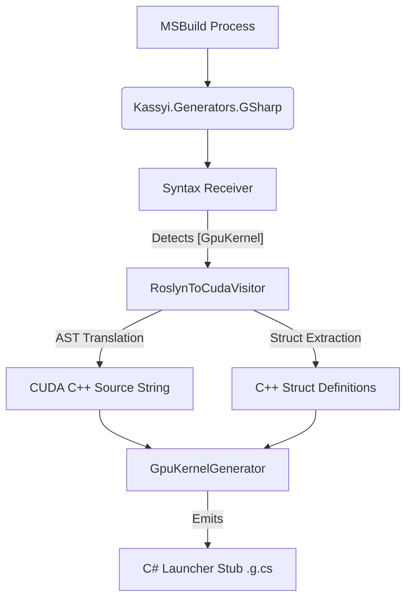

# 5. Generator Architecture (`Kassyi.Generators.GSharp`)

This document defines the internal architecture of the Ahead-Of-Time (AOT) transpilation layer implemented via Roslyn Source Generators.

## 7.1 Pipeline Overview

The `Kassyi.Generators.GSharp` project intercepts the MSBuild compilation process, analyzes the C# Abstract Syntax Tree (AST), and generates both the intermediary CUDA C++ source strings and the C# execution stubs.



1. **Syntax Receiver**: Scans for methods decorated with the `[GpuKernel]` attribute.
2. **AST Translation**: Delegates the syntax node of the decorated method to `RoslynToCudaVisitor`.
3. **Source Construction**: Converts the C# AST into a raw CUDA C++ string.
4. **Stub Emission**: Injects a new `.g.cs` file into the host project containing a launcher method that interfaces with the G# Runtime (`JitEngine`).

## 7.2 Translation Algorithm (`RoslynToCudaVisitor`)

The core translation logic resides in the `RoslynToCudaVisitor` class, inheriting from `CSharpSyntaxWalker`. It traverses the C# syntax nodes recursively and emits equivalent C++ tokens.


### 7.2.1 Struct Extraction and Generation
During AST traversal, if the transpiler encounters a user-defined custom `struct` (whether passed by value, by pointer, or used as an array element), it tracks it in a `_usedStructs` set. Before generating the final C++ method, the transpiler dynamically emits the C++ equivalent of all collected `struct` definitions at the top of the source string to ensure type definitions are valid in CUDA.

> [!NOTE]
> To prevent Multiple Definition errors (e.g., `class has already been defined`) when multiple kernels utilizing the same struct are JIT-compiled together in a shared dynamic source string, the generator automatically wraps every emitted struct definition with a preprocessor header guard (e.g., `#ifndef __GSHARP_STRUCT_Name__`).

### 7.2.2 Parameter Filtering
The transpiler analyzes parameter attributes during signature generation.
* Parameters marked with `[JitConstant]` are intentionally omitted from the generated `__global__ void` C++ signature.
* Instead, they are deferred to the `GpuKernelGenerator` for preprocessor `#define` injection.

## 7.3 Stub Emission (`GpuKernelGenerator`)

Once the CUDA C++ string is constructed, `GpuKernelGenerator` creates a C# partial class containing a launcher method (e.g., `Launch[MethodName]`).

### 7.3.1 Launcher Signature
The generator appends seven implicit trailing parameters to every launcher method to control CUDA execution dimensions and dynamic shared memory. These default to 1 and 0 respectively:
```csharp
public static void Launch_[KernelName](
    /* Original non-JitConstant parameters */,
    uint gridDimX = 1, uint gridDimY = 1, uint gridDimZ = 1, 
    uint blockDimX = 1, uint blockDimY = 1, uint blockDimZ = 1, 
    uint sharedMemBytes = 0)
```

### 7.3.2 Dynamic String Assembly
The generated launcher method constructs the final C++ source string dynamically at runtime:
1. It injects `#define [Name] [Value]` directives at the top of the string for all parameters marked with `[JitConstant]`.
2. It appends the static C++ logic generated by `RoslynToCudaVisitor`.

### 7.3.3 Implicit Pointer Marshaling
The launcher generates `unsafe` memory marshaling code to construct an array of `IntPtr` (representing `void**` in the CUDA Driver API). 

* **Array Marshaling**: If a parameter is an array, the launcher automatically computes its byte size, allocates GPU memory (`cuMemAlloc_v2`), pins the host array (`GCHandle.Alloc`), and copies the data Host-to-Device (`cuMemcpyHtoD_v2`).

### 7.3.4 Deep Struct Marshaling
To support advanced contexts (e.g., `NttContext` in GpuBigInt) containing managed arrays (`T[]`), the transpiler implements a recursive Deep Struct Marshaling protocol.

When a struct parameter is detected, the `GpuKernelGenerator` recursively traverses its AST graph to locate any internal `IArrayTypeSymbol` fields. If found, the generator emits:
1. **Shadow Structures**: A native proxy struct (e.g., `__Native_NttContext`) where all `T[]` fields are replaced with `IntPtr`.
2. **Deep Allocation**: During invocation, `Marshal_NttContext` performs a deep traversal. For every non-null host array field, it computes the total byte length, issues `cuMemAlloc_v2`, pins the host array with `GCHandle`, executes a `cuMemcpyHtoD_v2`, and injects the resulting GPU device pointer into the corresponding `IntPtr` field of the shadow structure.
3. **Data Recovery**: After kernel execution, `Unmarshal_NttContext` traverses the shadow struct and issues `cuMemcpyDtoH_v2` calls to pull modified array data from the GPU back into the host's managed arrays before cleaning up the handles.

> [!IMPORTANT]
> This implicit deep marshaling empowers developers to pass complex, nested C# objects into the GPU without manually writing verbose and unsafe P/Invoke memory management code.

* **Scalar Marshaling**: Primitive types are allocated using `Marshal.AllocHGlobal` and written via `Marshal.StructureToPtr`.
* **Execution & Cleanup**: The launcher invokes `JitEngine.GetOrCompileKernel` and subsequently `CudaDriverApi.cuLaunchKernel`. Post-execution, it automatically copies the array data back Device-to-Host (`cuMemcpyDtoH_v2`) and frees all allocated device memory.
* **Exceptions**: `[JitConstant]` parameters are strictly excluded from this marshaling array, as they exist exclusively in the preprocessor domain.

