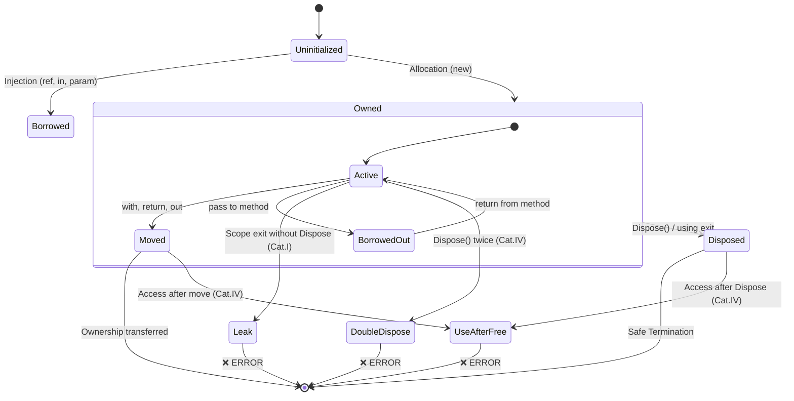
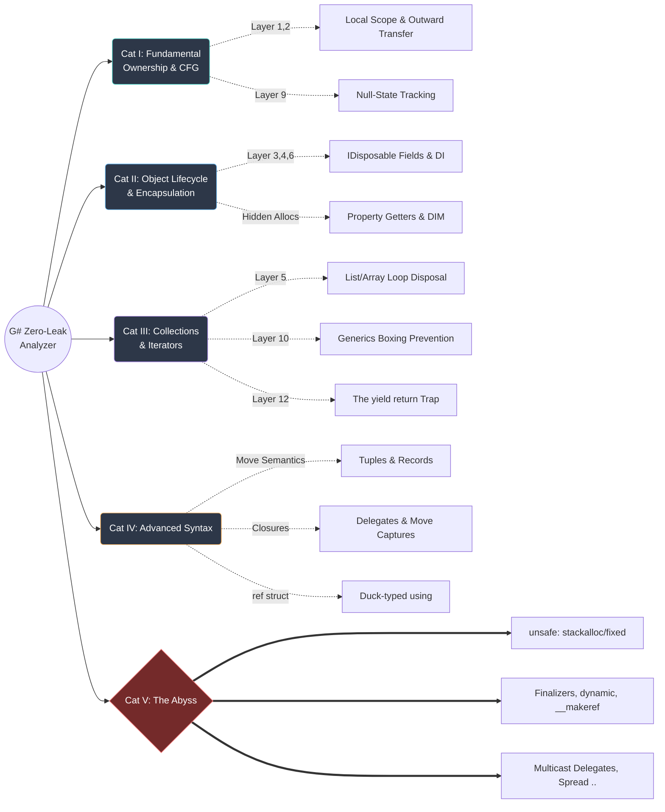

# 11. Strict Memory Management and Ownership Patterns (Zero-Leak Analyzer)

---

## 11.1 Overview & Core Principles

Based on the engineering principle that **"Software execution paths are finite, bounded, and exhaustively verifiable,"** this specification defines the complete matrix of C# memory management patterns (ownership, lifecycle, disposal, and unsafe escape hatches) enforced by G#.

By encoding these rules into Roslyn Diagnostic Analyzers, G# guarantees **zero VRAM leaks and zero false positives** at compile-time while maximizing developer ergonomics.

The foundational principle maps to an **Ownership Model** (analogous to Rust and C++ RAII):
When a resource (such as `new GpuContext()`) is instantiated, an ownership binding is created. The owner must either **consume (`Dispose`)** the resource or **transfer** ownership to an outer or companion scope.



---

## 11.2 Category I: Fundamental Ownership & Control Flow

Consolidates basic variable lifecycles, execution paths, and null safety.

### 11.2.1 Local Scope & CFG Verification

#### ❌ Banned: Discarded Allocation

Immediate leak. Instantiated without binding or scope management.

```csharp
new GpuContext();
// Error: Resource discarded without assignment
```

#### ❌ Banned: Undisposed Local

Local variable leaves scope without invoking `Dispose()`.

```csharp
var ctx = new GpuContext();
// Error: Missing ctx.Dispose()
```

#### ⭕ Safe: Scoped Disposal (Standard)

Guaranteed automatic disposal upon scope exit.

```csharp
using var ctx = new GpuContext();
```

#### ⭕ Safe: Explicit Manual Disposal

Satisfies disposal criteria.

```csharp
var ctx = new GpuContext();
ctx.Dispose();
```

#### ❌ Banned: Control Flow Bypass (Manual Dispose Leak)

When manual disposal is used (without `using`), the analyzer performs **Control Flow Graph (CFG) analysis**. If _any_ execution path (`return`, `break`, `goto`, or exceptions) exits the scope without hitting `Dispose()`, it is flagged as a leak.

```csharp
var ctx = new GpuContext();
if (error) return; // Error: Leak detected on early return path
ctx.Dispose();
```

#### ❌ Banned: `async void` (Fire-and-Forget Exceptions)

An `async void` method returns no `Task`. If it takes ownership of a resource and crashes internally, the exception is swallowed by the synchronization context, and the resource leaks invisibly without any CFG path recognizing it.

```csharp
async void ProcessAndDispose(GpuContext ctx) // Error: async void is strictly banned
{
    await Task.Delay(10);
    ctx.Dispose();
}
```

### 11.2.2 Ownership Transfer (Outward Propagation)

#### ⭕ Safe: Return Value Transfer

Ownership propagates to the caller. The call-site variable is now subject to Layer 1 validation.

```csharp
public GpuContext Create()
{
    return new GpuContext();
}
```

#### ⭕ Safe: Output Parameter (`out`)

Ownership propagates to the caller's target variable.

```csharp
public void Create(out GpuContext ctx)
{
    ctx = new GpuContext();
}
```

### 11.2.3 Null-State Tracking & NRT

#### ⭕ Safe: Null-Conditional Disposal

When a resource is explicitly marked as nullable (`?`), the analyzer enforces safe traversal or null-conditional disposal (`?.Dispose()`).

```csharp
GpuContext? ctx = condition ? new GpuContext() : null;
ctx?.Dispose(); // Safe and correct
```

#### ❌ Banned: Unsafe Disposal of Nullable

Directly calling `.Dispose()` on a nullable resource without checking.

```csharp
GpuContext? ctx = GetContextOrNull();
ctx.Dispose(); // Error: CS8602 Dereference of a possibly null reference.
```

#### ⭕ Safe: Null-Assignment to Prevent Use-After-Free

After disposing an owned resource, assigning `null` integrates with C#'s native NRT flow analysis to catch subsequent invalid accesses.

```csharp
var ctx = new GpuContext();
ctx.Dispose();
ctx = null;
// ctx.Compute(); -> Caught by standard CS8602 NullReference analyzer
```

#### ❌ Banned: Null-Assignment without Disposal

Overwriting a tracked resource with `null` before it is disposed is treated as a leak (identical to Layer 3 overwrites).

```csharp
var ctx = new GpuContext();
ctx = null; // Error: Previous instance leaked before null assignment
```

## 11.3 Category II: Object Lifecycle & Encapsulation

Consolidates class/struct state management and object boundaries.

### 11.3.1 Field Chaining & IDisposable

#### ❌ Banned: Missing `IDisposable` on Class

Class holds a disposable GPU resource but does not implement `IDisposable`.

```csharp
class A
{
    GpuContext _c = new GpuContext();
} // Error: GSH021
```

\n#### ❌ Banned: Undisposed Field in `Dispose()`

`Dispose()` AST does not contain an invocation of `_c.Dispose()` or `_c?.Dispose()`.

```csharp
class A : IDisposable
{
    GpuContext _c = new GpuContext();
    public void Dispose() { } // Error: GSH022
}
```

#### ⭕ Safe: Clean Chained Disposal

Layer 3 validation passed. Resource lifecycle is safely chained.

```csharp
class A : IDisposable
{
    GpuContext _c = new GpuContext();
    public void Dispose()
    {
        _c.Dispose();
    }
}
```

#### ❌ Banned: Unsafe Field Overwrite

Reassigning an owned field without prior disposal leaks the previous instance.

```csharp
public void Update()
{
    _c = new GpuContext(); // Error: Overwrite without disposal
}
```

### 11.3.2 Implicit Allocation Bans

#### ❌ Banned: Property Getter Side-Effects

A property getter (`get`) that allocates and returns a new resource. If invoked as part of a larger expression without being bound to a variable, the resource is instantly leaked (equivalent to a discarded allocation, but completely hidden).

```csharp
public GpuContext Context => new GpuContext(); // Error: Property getters must not allocate disposable resources
// ...
obj.Context.Compute(); // Leak! The context is created, used, and discarded silently.
```

#### ❌ Banned: Implicit Cast Operators (`implicit operator`)

User-defined implicit conversions can allocate new resources silently. Since the cast operator is invoked implicitly by the compiler, the allocation and ownership transfer do not appear in the syntax tree of the calling method, entirely blinding the CFG analyzer.

```csharp
public static implicit operator GpuContext(MyWrapper w) => new GpuContext(); // Error: Implicit allocation is strictly banned
// ...
GpuContext ctx = wrapper; // Invisible allocation happens here!
```

### 11.3.3 Initialization & Statics

#### ❌ Banned: Unguarded Multi-Allocation

Multiple allocations in a constructor without error handling. If `_c2` throws, `_c1` leaks.

```csharp
public A()
{
    _c1 = new GpuContext();
    _c2 = new GpuContext(); // Error: Risk of partial leak
}
```

#### ⭕ Safe: Factory Pattern

Preferred architecture. Assembles resources within a protected `using`/`try` scope before constructing the object.

```csharp
public static A Create()
{
    var c1 = new GpuContext();
    try
    {
        var c2 = new GpuContext();
        return new A(c1, c2);
    }
    catch
    {
        c1.Dispose();
        throw;
    }
}
```

#### ❌ Banned: Static Lifecycle (`static` Fields and Constructors)

Resources allocated in a `static` field or `static` constructor live for the duration of the application (or the GPU kernel execution). Since there is no deterministic point to call `Dispose()` on a static field, it represents an intentional but permanent memory leak (VRAM consumption until kernel exit).

```csharp
static class GpuCache
{
    public static readonly GpuContext GlobalCtx = new GpuContext(); // Error: Static allocations create permanent leaks
}
```

### 11.3.4 Dependency Injection\n\n#### ⚠️ Safe: Standard Injection (Borrowing)

Class `A` does not own `_c`. Calling `_c.Dispose()` inside `A.Dispose()` is flagged as a double-dispose hazard.

```csharp
public A(GpuContext c)
{
    _c = c; // Borrowed
}
```

#### ⭕ Safe: Explicit Ownership Transfer

Explicit attribute transfers ownership. Class `A` is now required to dispose of `_c` in its `Dispose()` implementation.

```csharp
public A([TakesOwnership] GpuContext c)
{
    _c = c; // Owned
}
```

### 11.3.5 Interface Blackboxes

#### ❌ Banned: Default Interface Methods (DIM)

C# 8.0 introduced Default Interface Methods. If an interface provides a default implementation for `Dispose()` or a method that takes ownership, the implementing struct/class lacks the AST for that method. This creates a blackbox where ownership is consumed invisibly.

```csharp
interface IResource
{
    void Process(GpuContext ctx) { ctx.Dispose(); } // Error: Default implementations taking ownership are banned
}
```

---

## 11.4 Category III: Collections, Iterators, & Generics

Consolidates data grouping, zero-allocation rules, and looping.

### 11.4.1 Zero-Allocation Generics

#### ❌ Banned: Interface Boxing

Assigning a disposable `struct` to an `IDisposable` interface variable or parameter causes a heap allocation (boxing), which is strictly banned in GPU execution contexts.

```csharp
public ref struct GpuSpan { public void Dispose() {} }
// ...
IDisposable resource = new GpuSpan(); // Error: Boxing allocation detected
```

#### ⭕ Safe: Generic Constraints (Monomorphization)

Use generic constraints instead of interfaces. This allows the Transpiler to use monomorphization (C++ templates), guaranteeing static dispatch and zero allocations.

```csharp
void Process<T>(T resource) where T : IDisposable
{
    resource.Dispose(); // OK: No boxing, statically resolved
}
```

#### ⭕ Safe: Generic Factory with Ownership

The analyzer traces ownership out of generic factory methods using constraints.

```csharp
T CreateResource<T>() where T : IDisposable, new()
{
    return new T(); // OK: Ownership transfers to caller
}
```

### 11.4.2 Collection Lifecycles

#### ⭕ Safe: Collection Ingestion

Ownership is transferred to the collection container.

```csharp
var list = new List<GpuContext>();
list.Add(new GpuContext());
```

#### ❌ Banned: Undisposed Collection Field

Container class `Dispose()` lacks an iteration/clear loop over elements.

```csharp
class Container : IDisposable
{
    List<GpuContext> _list = new();
    public void Dispose() { } // Error: Collection elements undisposed
}
```

#### ⭕ Safe: Exhaustive Loop Disposal

AST confirms an exhaustive traversal loop executing `.Dispose()` on each element.

```csharp
public void Dispose()
{
    foreach (var c in _list)
    {
        c.Dispose();
    }
}
```

#### ⭕ Safe: Implicit `foreach` Disposal

C# `foreach` loops secretly emit a `finally` block calling `Dispose()` on the enumerator if it implements `IDisposable`. The analyzer correctly traces this implicit consumption.

```csharp
foreach (var item in GpuQuery())
{
    /* ... */
} // OK: Enumerator implicitly disposed by compiler-generated finally block
```

### 11.4.3 Collection Traps

#### ❌ Banned: Collection Spread Operator Ownership Duplication (`..`)

C# 12 introduced collection expressions with the spread operator. Spreading an array of owned resources into a new collection duplicates the references, leading to ambiguous ownership and double-disposal.

```csharp
Span<GpuContext> contexts = [ctx1, ctx2];
Span<GpuContext> newContexts = [..contexts]; // Error: Ambiguous ownership duplication via Spread
```

#### ⭕ Safe: Deferred Enumeration (`yield`)

Ownership transfers to the `IEnumerable` consumer. Disposed automatically when the consumer exits `foreach`.

```csharp
public IEnumerable<GpuContext> Generate()
{
    yield return new GpuContext();
}
```

#### ❌ Banned: Unconsumed Custom Enumerators (The `yield return` Trap)

The most notorious memory leak in C# involves Iterators. If a method contains `yield return` and a `using` block, the `finally` block of the `using` is **only** executed if the caller fully consumes the enumerator or explicitly calls `IEnumerator.Dispose()`.
If the caller grabs the enumerator manually but drops it, the resource inside the iterator leaks silently.

```csharp
// The Caller's Trap:
var enumerator = Generate().GetEnumerator();
enumerator.MoveNext();
// Error: If enumerator.Dispose() is missing here, any 'using' inside Generate() NEVER fires!
```

_G# Defense_: The analyzer enforces that any `IEnumerator` explicitly instantiated (outside of a `foreach` loop) is strictly tracked under Layer 1 ownership rules and must be disposed.

---

## 11.5 Category IV: Advanced Syntax & Functional Patterns

Consolidates modern C# features, closures, and structural types.

### 11.5.1 Structs & Tuples

#### ⭕ Safe: Tuple Return

Ownership of the context is safely transferred to the caller.

```csharp
public (GpuContext, int) Create() => (new GpuContext(), 0);
```

#### ⭕ Safe: Deconstruction

Deconstructed variables are tracked independently under Layer 1 rules.

```csharp
var (ctx, _) = Create();
ctx.Dispose();
```

#### ❌ Banned: Undisposed Deconstruction

`ctx` leaves scope without being disposed.

```csharp
var (ctx, status) = Create();
// Error: Missing ctx.Dispose()
```

#### ❌ Banned: Tuple Field Leak

The tuple is a local container. Its disposable elements must be consumed.

```csharp
var tuple = Create();
// Error: Missing tuple.Item1.Dispose()
```

### 11.9.2 Record Types and `with` Expressions (Linear Typing & Move)

C# 9+ `record` types use shallow copying for `with` expressions. To prevent double-dispose bugs, G# enforces **Move Semantics (Linear Typing)** for records containing GPU resources.

#### ⭕ Safe: Move (`with` expression)

The `with` expression **moves** ownership from `a` to `b`. Disposing `b.Ctx` is safe and correct.

```csharp
var a = new Holder(new GpuContext());
var b = a with { ID = 2 };
b.Ctx.Dispose();
```

#### ❌ Banned: Access After Move

`a.Ctx` is marked as **Consumed/Moved**. Accessing or disposing a moved resource is prohibited.

```csharp
var a = new Holder(new GpuContext());
var b = a with { };
a.Ctx.Dispose(); // Error: Access to moved resource
```

#### ❌ Banned: Double Dispose

Double dispose detected due to access of moved resource `a`.

```csharp
var a = new Holder(new GpuContext());
var b = a with { };
a.Ctx.Dispose();
b.Ctx.Dispose(); // Error: Double dispose
```

### 11.9.3 Closures, Lambdas, and Local Functions

Capturing a GPU resource in a closure can lead to implicit leaks if the delegate escapes the current scope. G# distinguishes between **Borrowing** and **Move Captures**.

#### ❌ Banned: `Deconstruct` Ownership Splitting

C# 7.0 introduced deconstruction. If a custom class implements `public void Deconstruct(out T1 a, out T2 b)` returning multiple owned resources, the `var (a, b) = obj;` syntax implicitly executes the method. This causes sudden, untrackable ownership bifurcation.

```csharp
var (ctx1, ctx2) = resourceManager; // Error: Deconstruction of owned resources is banned
```

n#### ⭕ Safe: Duck-Typed `using`

Analyzer recognizes `public void Dispose()` and tracks ownership identical to standard `IDisposable`.

```csharp
public ref struct GpuSpan
{
    public void Dispose() {}
}

using var span = new GpuSpan();
```

#### ❌ Banned: Undisposed `ref struct`

`span` leaves scope without being disposed.

```csharp
var span = new GpuSpan();
// Error: Missing span.Dispose()
```

### 11.9.5 Asynchronous Disposal (`IAsyncDisposable`)

For operations involving CUDA streams or asynchronous memory transfers.

### 11.5.2 Delegates & Functions\n\n#### ⭕ Safe: Borrowing (Scoped Execution)

The delegate `act` does not escape the scope. `ctx` is safely borrowed by the closure and disposed by `using`.

```csharp
using var ctx = new GpuContext();
Action act = () => ctx.Compute();
act();
```

#### ❌ Banned: Escaping Borrowed Resource

The delegate escapes the scope, but `ctx` is destroyed locally. This causes a dangling reference (Use-After-Free).

```csharp
using var ctx = new GpuContext();
return () => ctx.Compute(); // Error: Delegate escapes with borrowed resource
```

\n#### ⭕ Safe: Move Capture (Factory/Escaping)

`ctx` is consumed inside the closure, and the delegate assumes ownership.

```csharp
var ctx = new GpuContext();
Action act = () => {
    ctx.Compute();
    ctx.Dispose();
};
return act;
```

#### ❌ Banned: Undisposed Move Capture

`ctx` is captured and escapes the method, but is never disposed inside the closure. Leak detected.

```csharp
var ctx = new GpuContext();
return () => ctx.Compute(); // Error: Captured resource never disposed
```

### 11.9.4 `ref struct` and Duck-Typed `Dispose`

To maintain Zero-Allocation guarantees, temporary GPU wrappers are often declared as `ref struct`. Since `ref struct` cannot implement `IDisposable`, G# supports Duck-Typing.

#### ❌ Banned: Local Functions with Implicit Capture

C# 7.0 introduced local functions. While they avoid heap allocations (unlike delegates), if a local function captures a disposable resource and is passed around or invoked conditionally, it obfuscates the CFG beyond static analysis limits.

```csharp
void M()
{
    var ctx = new GpuContext();
    void LocalDispose() { ctx.Dispose(); } // Error: Local functions cannot capture owned resources
    if (cond) LocalDispose();
}
```

#### ❌ Banned: Multicast Delegate Double-Dispose (`+=`)

Delegates in C# can be multicast. If a delegate capturing ownership is combined (`+=`), a single invocation will call `Dispose()` multiple times, triggering a double-dispose exception.

```csharp
Action act = () => ctx.Dispose();
act += () => ctx.Dispose();
act(); // Error: Structural double-dispose via multicast delegate
```

_G# Defense_: The analyzer forbids attaching (`+=`) or combining delegates that capture resource ownership.

#### ❌ Banned: Expression Trees (`Expression<T>`)

C# 3.0 Expression Trees represent code as data. Capturing an owned resource inside an `Expression<Action>` postpones its evaluation until runtime compilation (which is impossible on the GPU anyway).

```csharp
Expression<Action> expr = () => ctx.Dispose(); // Error: Expression trees cannot capture resources
```

### 11.5.3 Ref Modifiers & Async\n\n#### ⭕ Safe: Reassignment

The previous resource is explicitly disposed before being overwritten.

```csharp
void Update(ref GpuContext ctx)
{
    ctx.Dispose();
    ctx = new GpuContext();
}
```

#### ❌ Banned: Leaking Reassignment

The previous instance of `ctx` is overwritten without disposal, causing a leak.

```csharp
void Update(ref GpuContext ctx)
{
    ctx = new GpuContext(); // Error: Reassigned without disposal
}
```

#### ❌ Banned: The `in` / `ref readonly` Mutation Trap

Passing a resource as an `in` parameter implies immutable borrowing. Calling `Dispose()` mutates the resource's internal state, violating the semantic contract of `readonly`.

```csharp
void Process(in GpuContext ctx)
{
    ctx.Dispose(); // Error: Cannot mutate/dispose a readonly borrowed resource
}
```

#### ⭕ Safe: `await using`

Correctly tracked. Transpiles to C++ async cleanup or stream synchronization.

```csharp
await using var ctx = await Gpu.CreateAsync();
```

#### ❌ Banned: Sync Dispose on Async Resource

Resource implements `IAsyncDisposable`. `DisposeAsync()` (via `await using`) must be used.

```csharp
var ctx = await Gpu.CreateAsync();
ctx.Dispose(); // Error: Should use await using
```

### 11.9.6 `ref` Parameter Reassignment

Passing a resource by reference (`ref`) allows the callee to overwrite it. This can cause the original resource to leak if not explicitly handled.

---

## 11.6 Category V: Unmanaged Boundaries & The Abyss

Consolidates low-level operations and strictly banned compiler esoteric features.

### 11.6.1 Unsafe Code

#### ❌ Banned: Unbounded Pointer Operation

Prohibited by standard C# language semantics.

```csharp
int* ptr = GetPointer(); // Error: Requires unsafe context
```

#### ⭕ Safe: Stack Allocation (`stackalloc`)

Transpiles directly to a C++ local stack array. Automatically reclaimed on scope exit.

```csharp
unsafe
{
    int* p = stackalloc int[10];
}
```

#### ⭕ Safe: Memory Pinning (`fixed`)

GC pinning and unpinning are scoped to the block. Fully safe.

```csharp
unsafe
{
    fixed (byte* p = arr) { /* Use p */ }
}
```

#### ⚠️ Warning: Dynamic Device-side Allocation

Emits a compiler warning (GSW010): "Manual unmanaged memory allocation detected. Ensure corresponding Free is called."

```csharp
unsafe
{
    void* p = Gpu.Unsafe.Malloc(sz); // Warning: GSW010
}
```

#### ❌ Banned: `stackalloc` Loop Exhaustion (Stack Overflow)

While `stackalloc` is safe in a localized scope (Layer 7), placing it inside a loop allocates memory on the stack _without_ freeing it until the method returns, causing an instant VRAM stack overflow on the GPU.

```csharp
while (true)
{
    int* p = stackalloc int[10]; // Error: Recursive stackalloc in loop causes instant VRAM overflow
}
```

#### ❌ Banned: Finalizers / Destructors (`~Class`)

GPU environments lack a Garbage Collector. Relying on C# Finalizers for cleanup is structurally impossible and strictly banned.

```csharp
class GpuContext
{
    ~GpuContext() { Free(); } // Error: Finalizers are not supported on GPU. Use IDisposable.
}
```

#### ❌ Banned: `dynamic` and Late-Bound Ownership

The `dynamic` keyword bypasses static type checking and Roslyn's AST analysis, making memory tracking impossible.

```csharp
dynamic ctx = new GpuContext(); // Error: Dynamic dispatch is strictly banned on GPU
```

#### ❌ Banned: Undocumented TypedReference (`__makeref`)

C# contains undocumented keywords (`__makeref`, `__refvalue`, `__reftype`) for untyped reference pointers. These obliterate static type analysis and ownership tracking.

```csharp
var ctx = new GpuContext();
TypedReference tr = __makeref(ctx); // Error: TypedReference operations are banned
```

#### ❌ Banned: COM Interop, P/Invoke, and `GCHandle`

GPU kernels execute in isolated VRAM/PTX environments without an OS-level DLL loader. Attempting to use `[DllImport]`, `Marshal.AllocHGlobal`, or `GCHandle.Alloc` is a structural violation.

```csharp
GCHandle handle = GCHandle.Alloc(ctx); // Error: GCHandle is a CPU-GC concept
```

---

## 11.7 Conclusion: Absolute Safety Harmonized with Developer Freedom

By implementing these 15 layers as static Roslyn Diagnostic Analyzers:

1. **Standard Code**: Eliminates human-error VRAM leaks by 100% at compile-time.
2. **Advanced C# Code**: Preserves the power of Tuples, Records, and Closures by injecting Rust-like Move Semantics and Borrowing directly into the C# authoring experience.
3. **Safety Integrations**: Synergizes natively with C# features like Nullable Reference Types (NRT) to prevent null-pointer and Use-After-Free exceptions.
4. **Zero-Allocation Enforcement**: Prevents accidental heap allocations through generic constraints and boxing detection.
5. **Exhaustive Path Verification**: Employs Control Flow Graph (CFG) analysis to prevent leaks hiding in `goto`, `break`, or early returns.
6. **Sealing the Abyss**: Protects against the deepest C# compiler traps, including unconsumed iterators and undocumented keywords.
7. **The Absolute Zero**: Closes modern C# 12+ anomalies like Spread operators (`..`), Multicast Delegates, and GPU-specific `stackalloc` loops.
8. **The Final Constructs**: Bans `async void`, `Deconstruct` splitting, Expression Trees, and implicit local function captures.
9. **The Final 0.1% (Implicit Anomalies)**: Completely seals invisible allocations and structural blackboxes, including `implicit operator`, Property getter side-effects, DIM, and `static` lifecycles.
10. **Advanced Systems Code**: Preserves bare-metal expressiveness through explicit `unsafe` scopes.

This achieves a memory management architecture that brings C#'s expressive ergonomics, high-level abstractions, and absolute mathematical safety directly to native CUDA execution.



---

## 11.10 Category V: Concurrency & Shared Memory Ownership

While Categories I-IV focus on single-threaded AST and Control Flow Graph (CFG) analysis, mapping C#'s single-threaded concepts (Ownership, Move, and Borrow) to the Massively Parallel Processor (MPP) architecture of the GPU introduces profound concurrency challenges. 

### 11.10.1 Thread-Local Ownership (The Zero-Allocation Guarantee)

In G#, **all allocations inside a kernel (e.g., `new List<T>()` or `new GpuContext()`) are strictly value-types (`struct`) allocated on the thread's local stack/registers.**
The transpiler (e.g., in `Prelude.cu`) implements these collections as fixed-capacity stack structs (e.g., `T _items[Capacity]`).

Because these objects never use heap allocation (`cudaMalloc`), they are completely **Thread-Local**.
* **Zero Contention**: Thread A's `List<T>` and Thread B's `List<T>` are physically isolated. 
* **Zero Race Conditions**: A simple `Dispose()` of a local variable does not cause double-free or race conditions across threads. The ownership lifecycle is safely contained within the single thread's execution path.

### 11.10.2 Global Memory and Shared Memory Constraints

When threads must cooperate (e.g., stencil operations, image blurring), they require shared access to memory.

1. **Global Memory (Host-Allocated Arrays)**: CPU passes massive data buffers (e.g., `int[]` or `GpuSpan<T>`) into the kernel. The GPU kernel only **borrows** (`ref`) these pointers. The kernel is strictly forbidden from owning or disposing of Global Memory.
2. **Shared Memory (`SharedMemory<T>`)**: Used as a high-speed L1 cache shared across all threads in a Block. 

**Rule:** It is strictly prohibited to write an `IDisposable` (Owned Resource) into `SharedMemory<T>`.

### 11.10.3 Why Not Atomic Reference Counting (ARC)?

If multiple threads need to share ownership of a disposable resource, modern CPU languages (like Rust's `Arc<T>` or C++'s `std::shared_ptr`) use Atomic Reference Counting (ARC).

**G# strictly rejects ARC (Dynamic Ownership) for the following reasons:**

1. **The Performance Bottleneck**: Reference counting requires hardware atomic instructions (`Gpu.AtomicAdd`). If 1,024 threads in a GPU block simultaneously attempt to increment a shared reference counter, memory access is strictly **serialized**, creating a massive stall (bottleneck) that entirely defeats the purpose of using a massively parallel GPU.
2. **Read-Modify-Write Hazards**: Using non-atomic operations for reference counting results in fatal Data Races (Read-Modify-Write hazards), leading to inevitable memory leaks (e.g., two threads subtract 1 simultaneously, but the count only decreases by 1).
3. **The Zero-Cost Abstraction**: To preserve the GPU's extreme parallel execution speed, all ownership and lifetimes *must* be resolved statically at compile-time.

Therefore, G# enforces **Strict Static Analysis (Lexical Scoping and RAII)**. The thread that acquires the resource (allocates it) is absolutely responsible for disposing it. If it moves the resource, the responsibility moves. Shared ownership is rejected in favor of static, zero-cost borrowing (`ref`).

> [!NOTE]
> **The Kindergarten Toy Analogy (Mental Model for RAII on GPU)**
> To understand G#'s strict ownership rules, consider the fundamental rule of a kindergarten classroom:
> 
> * **Ownership (Allocation)**: If you take a toy out of the box (`new`), **you** are personally responsible for putting it back (`Dispose`). You cannot expect someone else to clean up after you.
> * **Move (Transfer)**: If you give the toy entirely to a friend, it is no longer yours. The responsibility to put it back is transferred to them.
> * **Borrow (`ref`)**: If you let a friend look at or touch the toy while you are still playing with it, they can use it, but **you** still retain the ultimate responsibility to put it back.
> 
> By forcing developers to strictly follow this "personal responsibility" rule at compile-time via Roslyn Analyzers, G# entirely avoids the need for a runtime "janitor" (Garbage Collector) or complex "sharing agreements" (ARC) that would stall the massively parallel GPU hardware.

---
## Appendix: What about Runtime Code Generation (IL Weaving / Reflection.Emit)?

A truly malicious or highly unconventional developer might attempt to bypass all of the above static analysis layers by generating code at runtime. Examples include:

- Generating MSIL (Microsoft Intermediate Language) directly via `Reflection.Emit`.
- Constructing raw unmanaged instruction codes (machine code) and attempting to execute it.
- Using IL weavers (like Fody) to manipulate the compiled assembly _after_ the Roslyn AST analysis has finished.

**Why G# doesn't need to analyze this:**
G# inherently nullifies these execution-level tampering attempts through its core architectural design (Tenet 1 & 3).
G# is an **AST-to-CUDA Transpiler**, not a standard .NET JIT/AOT runtime. The GPU kernel is compiled directly from the Roslyn Abstract Syntax Tree (C# Source) at compile-time. Any dynamic code generation (`Reflection.Emit`, `ILGenerator`) happens at CPU runtime, meaning the Transpiler simply will not compile it into the PTX (NVIDIA GPU Assembly) binary. It is structurally impossible to execute runtime-generated CPU MSIL on the GPU via G#.
