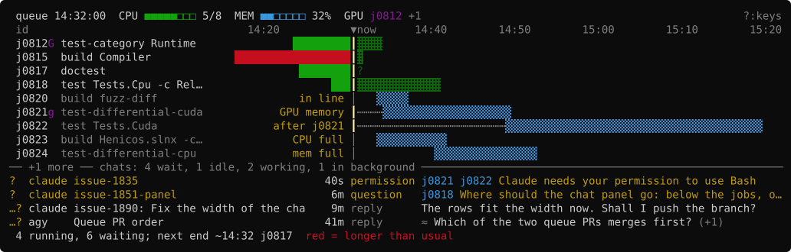
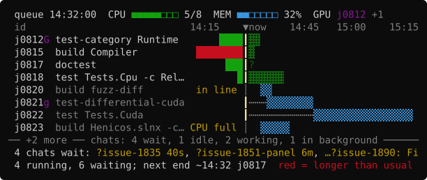
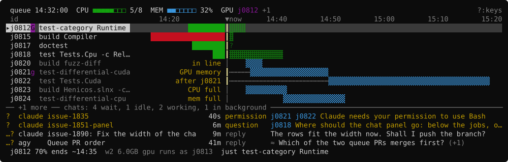
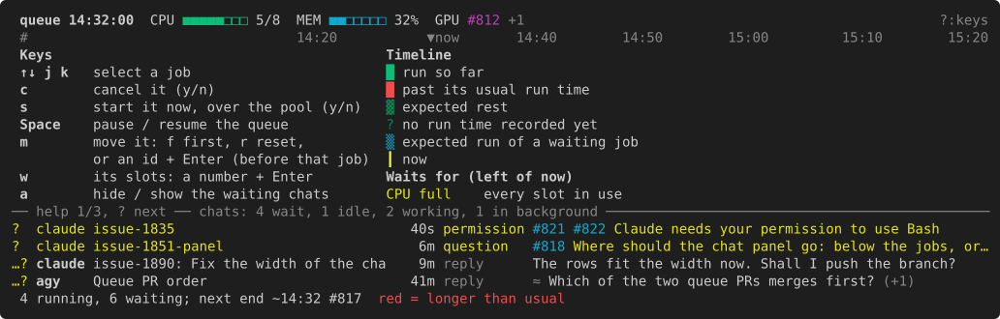
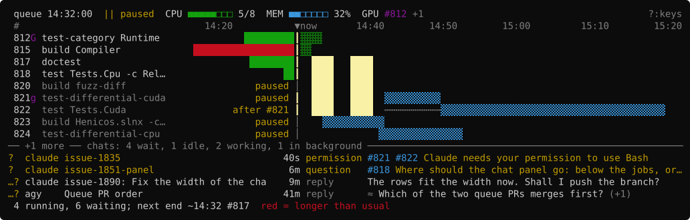
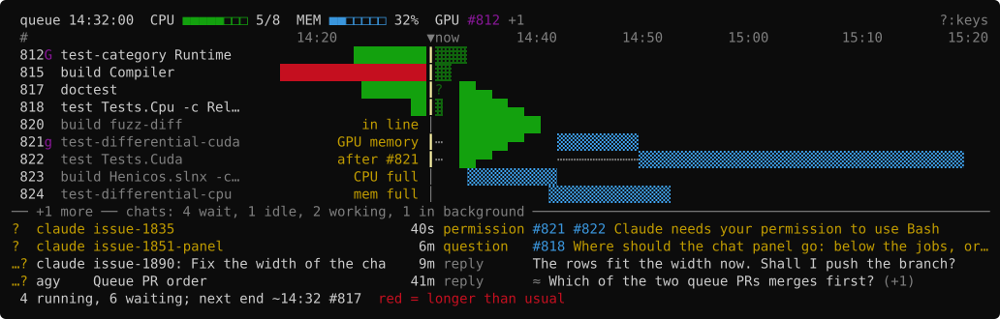
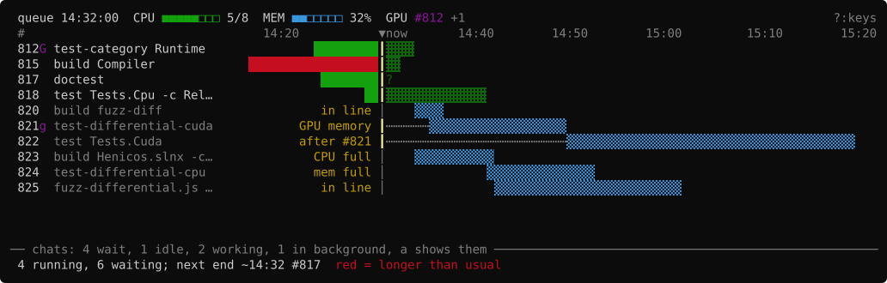
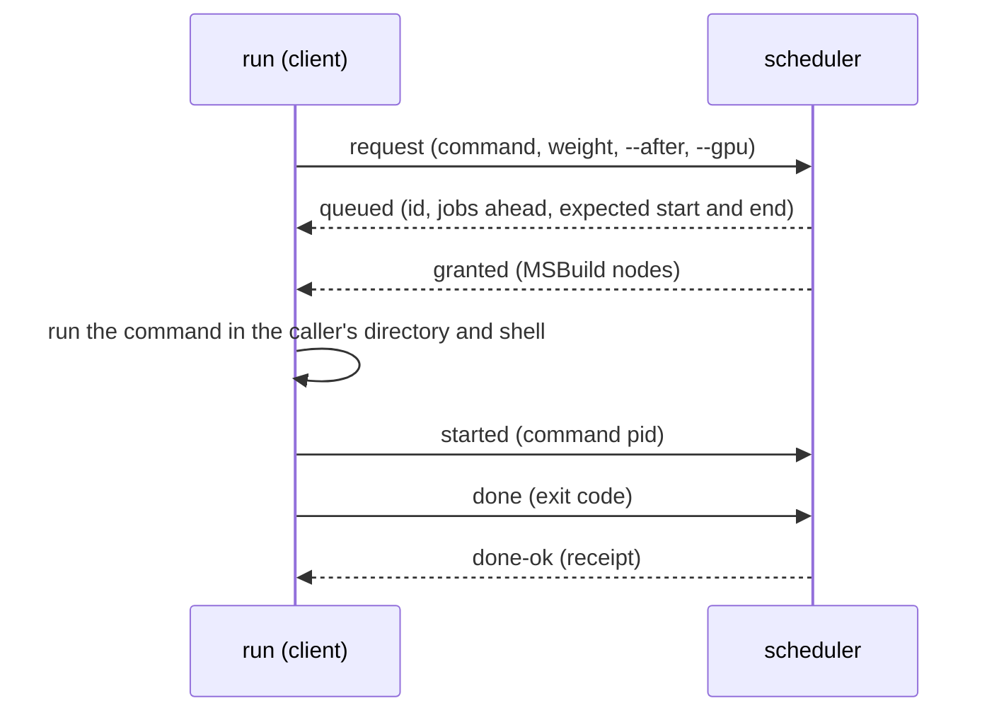

# Job queue

The local queue for long-running commands (builds, test runs, fuzzing, benchmarks) on a machine that several agents,
worktrees and people share. One scheduler process grants slots of a CPU pool and turns at the GPU; every caller runs
its command through `run` and waits until it is granted.

How to use it (commands, options, the `just` recipes, what an agent should do) is in
[job-queue.md](../../../.agents/rules/job-queue.md) (the short form) and
[job-queue-reference.md](../../../.agents/rules/job-queue-reference.md). This file is for changing the queue itself.

```sh
node scripts/human/job-queue.js run -- "dotnet build X && dotnet test X --no-build"
node scripts/human/job-queue.js run --gpu -- "just test"
node scripts/human/job-queue.js status
node scripts/human/job-queue.js wait <id>
node scripts/human/job-queue.js --screenshots scripts/human/job-queue/images
```

## Live view

`status --watch` (`just queue-watch`) shows the queue in the terminal, one line per job with its timeline. The images
below are drawn by `--screenshots` from a fixed sample status at a fixed time (`screenshot.ts`), not from a real
terminal, so they are the same on every run. A change to what the view shows regenerates them with
`node scripts/human/job-queue.js --screenshots scripts/human/job-queue/images` in the same change.

A terminal of 120 columns: running jobs first (green run so far, red past the usual run time, a `G` for the GPU job and
its holder under the GPU lock as one line, `g` for a shared GPU turn), then the waiting jobs with what each waits for, left of now:



A split pane of 70 columns and 13 rows: a shorter timeline, and the jobs that do not fit counted on the rule:



A job selected with the arrows: the line in reverse video and its details at the bottom (weight, memory, the holder it
runs as, the full command):



The help (`?`): the keys and what the marks of the timeline, the wait reasons and the chat marks mean, drawn in their
screen colors. While it is open only `?` (next page), Esc (close), `q` and Ctrl+C act; any other key would act on jobs
the help covers, so it only says how to leave:



Space pauses and resumes the queue, like the space bar of a video player, with no question (both ways are harmless and
undone by pressing it again). The key flashes a big mark for a second over the middle of the job rows, in plain ASCII
so that every terminal draws it the same: two bars for a pause, a triangle pointing right for a play (not on the help,
and not on a screen too small for it). While the queue is paused (also by `pause`), the header keeps `|| paused` and
every waiting job waits for `paused`; `s` still starts a selected job, since `start <id>` is the one grant a pause does
not hold back. The screen below is the second after Space:



The second after Space again: the queue runs, the play mark is on the screen and the header no longer says paused:



Below the jobs, the agent chats that wait for an answer of the person (the files of
`scripts/human/chat-status.js`, read every 2 s): one row per chat, first those that ask through a tool (`?`, a choice
question or a permission prompt, in yellow), then those whose reply leaves a question open (`…?`); the most recent wait
first in each. Claude Haiku decides through the Claude Code CLI which questions a reply leaves open (also one asked in
an earlier turn and not answered yet), else a question mark in the reply's last paragraph does
(`scripts/human/chat-status/README.md`); a chat that only reported is idle and gets no row. A row shows the agent, the
chat's title (Antigravity's, else Haiku's, else the start of its first prompt; after the worktree unless that is the
main checkout, the worktree alone without a title), how long it has waited, the kind, the ids of the jobs it queued
(the client sends `CLAUDE_CODE_SESSION_ID` or `ANTIGRAVITY_CONVERSATION_ID`; a job without one counts for the chats of
its worktree, paths compared as the queue keys them, but never in the main checkout, where every chat is), and the
text: the start of a tool's question, Haiku's newest open question marked `≈` with `(+n)` for the others, or the end
of the asking paragraph. The rule above counts the chats by state (`idle`: a report). The help says who decides and
how to turn Haiku on. The job list keeps at least four rows; a terminal of fewer than 16 rows (the 70 x 13 pane above)
shows the waiting chats in one line instead. `a` hides the panel; the rule then still says how many chats wait:



When `chat-status.js` cannot be loaded or its directory read, the view has no panel.

## Layout

`scripts/human/job-queue.js` is a plain JavaScript entry: it checks the Node version (22.18 / 23.6 or later, which
run TypeScript by stripping the types) and imports `cli.ts`. Configuration lives in `job-queue.config.json` at the
repository root (discovered via `JOB_QUEUE_CONFIG` or upward from the entry script). The modules use erasable syntax
only (no `enum`, `namespace` or parameter properties) and Node built-in modules only
([agent-scripts.md §1](../../../.agents/rules/agent-scripts.md#1-language)).

| Module | Responsibility |
| :- | :- |
| `cli.ts` | Parses the arguments and runs the mode (`run`, `status`, `wait`, `cancel`, `move`, `serve`, ...) |
| `client.ts` | `run`: checks the options, runs a command inside a queued job at once, and otherwise hands it to a `QueuedRun` |
| `client-build-step.ts` | `runBuildStep`: the builds of a `run --gpu` run as a queued job without the GPU before the turn (a `QueuedRun` whose `RunHost` resolves its exit code instead of ending the process) |
| `client-queued-run.ts` | `QueuedRun`: registers a job, waits for the grant, runs the command, reports its end, re-registers after a scheduler restart |
| `client-run-host.ts` | `RunHost`, the effects of a `QueuedRun` (connection, command, exit), and `ProcessRunHost`, the real one; `commandEnd`, how a command's end is reported after a cancel; the GPU turn's run under `gpu-lock.js` (`gpuLockArguments`: `--mode shared` for a shared lock alone) |
| `client-share-checks.ts` | Self-test checks of the share of a `--gpu` run against a fake scheduler and `RunHost`: what the turn asks for (request and adopt, not the holder), the lock mode for each `granted` echo, an older scheduler, `--gpu-exclusive`, no plugins |
| `client-connect.ts` | One-shot requests to the scheduler, and `SchedulerLauncher`: connects, starts the scheduler on demand, reports a job's end to the next scheduler |
| `client-commands.ts` | The other modes: `status`, `cancel`, `move` / `set-weight`, `start`, `pause` / `resume`, `wait`, `stop` |
| `watch.ts` | `status --watch` (`just queue-watch`): the live view on the alternate screen, its refresh, the lower panel read through the plugins' `panel` hook every 2 s, and `reduceKey`, the keys as a pure function |
| `view.ts` | The screen of the live view as lines, with no I/O: header, one line per job with its timeline, the plugin's lower panel (a `ViewPanel`), the bottom line; narrow and short layouts |
| `view-flash.ts` | The big pause or play mark that Space flashes over the job rows for a second; pure |
| `view-state.ts` | The state of the live view that the keys change and the screen reads (selection, scroll, prompt, message, help page, hidden panel, flash) |
| `screen-line.ts` | Styled text for the live view: the styles, the width of a string in terminal cells, `ScreenLine` |
| `screenshot.ts` | `--screenshots`: the ANSI lines of the live view as an SVG of a terminal, and the sample screens of this README |
| `view-sample.ts` | The fixed sample status and chats the view's self-test and the screenshots draw from |
| `server.ts` | `JobServer`, the scheduler process: the TCP server, the job records, outcomes, the settle step and the timers |
| `server-observe.ts` | `DetachedObserver`: every 2 s, what the processes show of the records whose client is away, applied per epoch (`planObservation`) |
| `server-connection.ts` | `Connection`: one client connection, the dispatch of its messages to one handler per message type, and what its close means for the job |
| `server-job-messages.ts` | The handlers of the messages about the client's own job: `request`, `adopt`, `started`, `done`, `report` |
| `server-job-state.ts` | The decisions about one job record as pure functions: identity (`isSameClient`), `planRegistration`, `planClose`, `planObservation`, `planReport`, `outcomeOfEnd`, `cancelTargets` |
| `server-control-messages.ts` | The handlers of the messages that act on the queue: `status`, `cancel`, `move`, `set-weight`, `start`, `pause`, `resume`, `await`, `stop` |
| `server-job.ts` | The job record the server keeps (`ServerJob`), how `status` shows it, and the invariant of the records (`checkRecords`, for the self-test) |
| `server-store.ts` | `JobStore`: the state file `jobs-<port>.json`, written after every event and read when the scheduler starts, restoring every record as held |
| `scheduler.ts` | The scheduling decisions, with no I/O: order, grants, backfilling, GPU turns, the memory pool, the forecast |
| `resources.ts` | The turn resources, with no I/O: `ResourceSpec`, `resourceOf`, `usageOf` (the use of a resource counted from the running jobs) and `turnVerdict` (the grant rule) |
| `remotes.ts`, `remote-checks.ts` | Remote CPU workers (`RemoteSpec`, `RemoteState`, health/probe freshness, `fitsRemote`, `describeRemote`), with no I/O, and unit checks (`RemoteChecks`) |
| `remote-command.ts`, `remote-sync.ts`, `remote-runner.ts` | Transparent SSH offload of self-contained CPU test runs: fail-closed Windows-to-Linux bash command translation (`translateForRemote`), SHA-256 worktree manifest diffing with local stat cache (`collectLocalManifest`, `diffManifests`), and `flock` + stdin-EOF lifeline SSH execution with `*.received.*` artifact pull-back (`executeRemotePlan`) |
| `resource-checks.ts` | Self-test checks of the turn resources (run through the unit checks) |
| `server-probe.ts` | The probe of a turn resource: `runProbe` runs the program of `resources.<name>.probe` without a shell (ok on exit 0 and a first number of at least `min`; a timeout, a failure to start or no number is not ok), `ProbeRunner` keeps one per resource, five seconds apart, and kills them when the scheduler stops |
| `server-shared-checks.ts`, `server-probe-checks.ts` | Self-test checks of shared turns against a scheduler in the test's own process (the `share` of a grant, the probe before a second shared turn, restore, `status` resources, the log of a failed shared turn) and of `runProbe` and the `serve --gpu-slots` range |
| `protocol.ts` | The messages between clients and the scheduler (one JSON object per line) and the protocol versions |
| `job-id.ts` | `formatJobId` (`j` and the last four digits, for every printed id), `parseJobRef` (what a person typed: a full id or the last digits), `pickSuffixMatch` (the scheduler's `resolve`: a live match, else the newest ended one); lib/resource-lock.js keeps a copy of the one-line formatter |
| `environment-hash.ts` | The environment of a queued job as the scheduler logs it: a short hash of each variable's value by name and one of them all (`environmentHash`), without `VolatileEnv` and the names of the plugins' `volatileEnv`; `differingNames` for the log line |
| `history.ts` | The recorded run times per command text (`history.json`), for ordering and forecasts; `estimateWithFallback` guesses a command with no record from similar ones |
| `command-reader.ts` | The shared reader of a command line: the plain form `planBuildStep` accepts (`rawWords`, `segmentsOf`, `segmentParts`, `variablePrefix`) and `readCommand`, which reads steps, words, assignments and redirections for the estimate keys, or says the line cannot be read (`readCommandLine` also says whether a `|` stands outside quotes); pure |
| `estimate-key.ts`, `estimate-fallback.ts` | The keys under which commands are compared (`commandKeys`: normalized, shape, kind, built from the words of `readCommand` and delegated `stepKeys`), the fallback over them, and the accuracy log (`accuracy.json`) behind `status --accuracy` |
| `estimate-checks.ts` | Self-test checks of the core keys, the fallback order and the accuracy log (run through `SchedulerChecks`) |
| `machine.ts` | `MachineProfile`, hardware defaults for CPU slots and the memory pool parameterized by `config.pools` |
| `shell.ts` | `CommandShell`, the shell a command runs in and quoting of pre-split words |
| `system.ts` | The state directory, and `ProcessTable`, the processes of the machine (liveness, process trees, stopping them) |
| `config.ts` | Typed schema and validation for `job-queue.config.json`, unknown-key warnings, defaults when missing, and mode-specific invalid-config handling |
| `plugin-api.ts` | The plugin API contract (`PluginApiVersion = 1`, `QueuePlugin`, `AssertModule`, context/result/panel types) and re-exported pure helpers |
| `short-name.ts` | `dropShortWords`, the word walk the `shortName` hooks of plugins share (re-exported by `plugin-api.ts`) |
| `plugin-host.ts` | Client- and view-side `PluginHost` (synchronous hooks, and the asynchronous `contentDigest` and `checkShare`, which has a 180 s limit and takes the GPU exclusively on a throw, a time out or an invalid value; `stillValid` of its answer has 30 s): `JOB_QUEUE_PLUGINS=0` opt-out, dynamic `plugin.ts` loading with 5 s timeout, hook composition, per-plugin exception isolation, slowness warnings, return validation, and dynamic `checks.ts` discovery for the self-test |
| `plugins/dotnet/` | Built-in `dotnet` plugin (`plugin.ts`, `estimate-keys.ts`, `build-split.ts`, `msbuild-nodes.ts`, `checks.ts`, `hook-rules.js`, `hook-checks.js`): `dotnet` estimate keys, `planBuildStep` pre-turn build split, MSBuild `-m:<n>` node limits, `GSHARP_JOB_QUEUE_MSBUILD_ARGS` and the `RequestCores` bound (`MSBUILDCORELIMIT`, `MSBUILDNODECOREALLOCATIONWEIGHT`), `classify`, `shortName`, `api` (`isDotnetTest`, `selectsCategory`), and hook command rules / `splitForRewrite` / CPU-build rewrite |
| `plugins/just/` | Built-in `just` plugin (`plugin.ts`, `checks.ts`, `hook-rules.js`, `justfile.js`, `hook-checks.js`): `just` recipe estimate keys (`stepKeys`), short command labels (`shortName`), and recipe hook rules (`options.hookRecipes` / `options.hookDryRunRecipes`) + `justfile` queue option lookup |
| `plugins/nvidia-gpu/` | Built-in CJS-only `nvidia-gpu` `holderWatch` plugin (`holder-watch.js`, `holds.js`, `pools.js`, `fault-watch.js`, `checks.ts`, `hook-rules.js`, `hook-checks.js`, `README.md`): GPU hold sampling (`gpu-hold-log.tsv` with `mode` column) and Windows kernel pool / Event 153 watches (`gpu-pool-log.tsv`); the sanitizer and profiler runners of the PreToolUse hook (`hook-rules.js`) |
| `plugins/git/` | Built-in `git` plugin (`plugin.ts`, `checks.ts`): `contentDigest`, the tree `git write-tree` gives for what `git add -A` would stage, through a copy of the index and a temporary object directory with the worktree's objects as alternates, with the settings that write into .git turned off (split index, every configured clean filter such as Git LFS, file system monitor, automatic gc) and Verify's `*.received.*` files left out, so that the worktree's .git gains nothing (git only refreshes the time of an object it would write again); a process that exits during a digest removes its scratch folder and stops its git at exit; its checks run on throwaway repositories |
| `plugins/agents/` | Built-in `agents` plugin: the chat `session` of a job (`plugin.ts`, from the `sessionEnv` variables of its options, which `volatileEnv` also names, so that the environment hash leaves them out), the chat panel of the live view (`panel.ts` loads the `chatStatus` module, `view-chats.ts` draws the chats that ask the person in order, one row each or one summary line, and the chat part of the help; pure), its checks (`checks.ts`, `self-test-chats.ts`), and PreToolUse payload parsing and denial/rewrite formatting for Claude Code and Antigravity (`hook-io.js`, `hook-checks.js`) |
| `../job-queue-henicos/` | Repository plugin (`plugin.ts`, `budgets.ts`, `share-rules.ts`, `name-filter.ts`, `name-filter-checks.ts`, `target-dialect.js`, `checks.ts`, `hook-rules.js`, `hook-checks.js`): test classification, the GPU share of a `--gpu` run (`share-rules.ts`; `name-filter.ts` for a filter of test names alone; options `exclusiveCategories`, `exclusiveEnv`, `sharedRecipes`), `tests/memory-budgets.yml` budgets, `--gpu` `fuzz-diff`/`long-checks` refusal and CPU-only project hints (`GSharpTargetDialect` Cpu), `Kassyi.GSharp.` short-name trimming, hook `nodeScripts` / `legacyQueueScripts` / test-project GPU lookup / hook messages |
| `lib/main-checkout.js` | Resolves the main checkout root directory (parent of git common-dir) for CJS and TS callers |
| `lib/process-liveness.js` | Windows process table query, parsing, `isGone`, and command process tree resolution |
| `lib/config-file.js` | Discovers `job-queue.config.json` via `JOB_QUEUE_CONFIG` (or explicit override) or upward from the entry script directory, and parses it |
| `lib/seat-lock.js` | Generic 1-or-2-seat directory lock (`exclusive` and `shared` acquisition, per-seat stale takeover including `acquiring`, `stage` transitions, cleanup; an exclusive waiter's intent directory `<seat 0>.exclusive-wait` stops new shared seats so that overlapping shared holders cannot starve it) |
| `lib/resource-lock.js` | Generic resource lock CLI/runner (`--resource`, `--mode`, 10 s jitter wait backoff, `holderWatch` lifecycle, shared failure overlap report, signal handling) |
| `lib/types.ts` | Pure TypeScript interfaces for the shared `lib/` modules |
| `lib-checks.ts` | Checks of the shared `lib/` modules (`main-checkout.js` and `process-liveness.js`) |
| `plugin-checks.ts` | Checks of config discovery/validation, `PluginHost` loading/composition/validation, dynamic `checks.ts` loader verification, and the hardening of plugin names, command environments and `--config` forwarding |
| `scheduler-intake-checks.ts` | Checks of the scheduler side of the optional `memoryMb`/`keys` fields: the job record, history key lookup/preservation, state-file `keys` persistence, and version skew |
| `constants.ts` | Shared constants and the `GSHARP_JOB_QUEUE_*` variable names |
| `self-test*.ts`, `scheduler-checks.ts`, `scheduler-fairness-checks.ts`, `server-job-checks.ts`, `queue-hint-checks.ts` | The self-test (`job-queue.js --self-test`); runs core unit checks, loads plugin `checks.ts` suites dynamically via `plugin-host.ts`, and runs end-to-end checks; `self-test-support.ts` holds its fixture, `QueueFixture`; `server-job-checks.ts` checks the plans and a scheduler in the self-test's own process; `self-test-client.ts` drives a client (`QueuedRun` with a fake `RunHost`) in process; `self-test-view.ts` draws the live view from a fixed status and drives its keys; `queue-hint-checks.ts` checks what a waiting job is told (`waitFor`, the latest end), `status --here`, the worktree notice and the environment log; a plugin's `checks.ts` loads its own checks (the agents plugin's `self-test-chats.ts` draws its chat panel) |

## How a job runs



- **Scheduler state** lives in `JobServer` (`server.ts`: job records, outcomes) and `scheduler.ts` (waiting and running lists,
  slots and memory in use). The server feeds every event to the scheduler; the scheduler never does I/O, so the unit
  checks drive it directly.
- **One settle step per event**: a message, a closed connection or a timer only changes the jobs. At the end of the
  event, `settle()` cancels the jobs whose predecessor did not succeed (along chains), records predecessors that were
  lost, grants once and saves the state. Nothing is granted while an event is still changing the jobs.
- **Pause**: `Scheduler.paused` is read in one place, `grant()`, right after the order is set: a paused scheduler grants
  only what is granted at once (GPU holders and `start <id>`), so no slot and no GPU turn goes to a waiting job and
  backfilling does nothing; the places are still ordered and told. `pause` and `resume` set the flag and the settle that
  follows saves it (`paused` and `pausedAt` in `jobs-<port>.json`, restored by `JobStore.restore`), and a paused
  scheduler does not exit when idle. The forecast replays the grants as if the queue were resumed now, and `status`
  says that it is paused. Each waiting client is sent `paused` once, and a client that queues later has `paused` in its
  `queued`; both print one line.
- **Dependencies grant on evidence**: a job `--after` another is granted only when that job has a recorded outcome
  that lets it run (`succeeded`, or any outcome with `--keep-if-failed`), never because the other job is gone.
- **Order**: response ratio (`hrrn`, the default), then two fairness rules (`fairOrder`): a job that has waited longer
  than max(`OverdueMs`, its typical run time) goes ahead, oldest first, and the others are taken round-robin across
  worktrees (one job per worktree per round, the worktree served longest ago first; the slots and the GPU turns keep
  separate rotations, in memory only). EASY backfilling reserves the start of the first job of that order; `move`
  and `--before` place jobs ahead of all of it. `backfill` and `fifo` keep arrival order without the fairness rules.
  The forecast replays the same grants on copies of the jobs and of the rotation.
- **Resources**: CPU slots (one per 3 cores by default), a memory pool that test runs take their budget of
  `tests/memory-budgets.yml` from, and the turn resources (`gpu`): at most `slots` shared turns at a time, one with
  `slots` 1. A GPU holder (the command under `gpu-lock.js`) is granted at once, over the pools, so it never deadlocks
  with a job that holds a slot and waits for the GPU.
  The default slots were measured on a 24-core machine with 64 GB (a mix of 4 forced rebuilds and 4 test runs of
  Tests.Cpu, two rounds each): 8 slots with test runs of 1 slot finished in 518 s on average, 6 slots with 1 slot in
  555 s, 8 slots with test runs of 2 slots in 587 s and 6 slots with 2 slots, the earlier default, in 676 s at 76%
  CPU; each test run took about its budget in memory.
- **Turn grants** (`turnVerdict`): only the first waiting turn of a resource is looked at, so an exclusive turn is
  never passed by a shared one behind it. Use is counted from the running jobs on every grant, never stored. Only a
  turn with `share` "shared" shares; a turn without it, and a holder that no running turn started, are exclusive. A
  second shared turn also needs a probe result that is ok, at most `ProbeFreshMs` old and of the current generation
  (the generation grows with every grant, so one result serves one grant); the first needs none, and neither does a
  resource without a probe. A resource the configuration does not name gets one slot and no probe. The forecast
  assumes every probe passes. `probeWanted` names the resources that wait for a measurement once the command of each
  running shared turn has held the lock for `settleMs` (from the latest start of its holders, not from the grant; a
  turn whose command holds nothing yet has not settled). A holder counts on the resource of the turn that started it.
- **What a waiting job waits for**: `Scheduler.waitFor` answers by the rules of `grant()`, in its order: the
  predecessor (`after`), the client (`away`), the startup grace (`restart`), the pause, a turn (`gpu`, or `gpu-memory`
  when the first waiting turn of its resource waits for the probe), the slots, the memory pool, else the jobs ordered
  first (`in-line`). It goes out in every outlook (`queued`, `waiting`, `status`) with `latestEndAt`, the end at the
  longest recorded run time. The scheduler tells every change of it; the client prints a new one at most every 30 s
  (`ReasonNoticeMs`), later if it still holds then. A job the next grant takes has none. The live view uses it and guesses from the totals only
  for an older scheduler.
- **The worktree as queued**: the client takes the plugins' `contentDigest` of its worktree when it queues and again
  when it is granted, both beside the work (the request and the command never wait for them), and prints one line when
  they differ. A GPU holder takes none: its turn did. A job granted before its first digest came takes no second one,
  and `GSHARP_JOB_QUEUE_DIGEST=0` turns digests off (the self-test's clients set it).
- **The log of a queued job**: the queue line of `server.log` has the job's cwd, worktree and environment hash
  (`environment-hash.ts`); the scheduler keeps the last environment per command and worktree in memory (at most 500)
  and logs the names that differ from it. Values never leave the client.
- **A slot follows the command**: when a client dies while its command runs on, the scheduler keeps the slot and polls
  the processes until the command has exited.

## The build step of `--gpu`

A `--gpu` job holds the GPU turn for its whole command, so a build inside it holds the GPU idle for minutes. Before it
asks for the turn, `run --gpu` (`client.ts`) asks `splitBeforeTurn` (`plugins/dotnet/build-split.ts`) for the builds
of its command: the `dotnet build` segments before the first test, and a `dotnet build` of each project that a
`dotnet test` without `--no-build` names, with the options the build reads too. `runBuildStep` (`client-build-step.ts`) runs them as a job of
their own, an ordinary `QueuedRun` on CPU slots with its own id, MSBuild node limit and run time in `history.json`,
and the run then queues the tests, with `--no-build` added, for the turn. Two jobs instead of one job with two phases:
no change to the protocol or the scheduler, a scheduler of an older checkout serves both, and each part is recorded
and forecast by its own run time. The plan only reads plain commands (segments joined by `&&`, bare `dotnet build` /
`dotnet test`, known options, bash assignments before a segment, output redirections after it, a leading `export` /
`$env:` prefix copied to both steps, no other shell syntax outside quotes) and keeps each word as written; the test
appends (`>>`) to the log its build wrote, so the log holds what the one command wrote. Anything else runs
as before. Inside a queued job the builds run at once on that job's slots. The Claude Code hook splits
`dotnet build X && dotnet test X --no-build` the same way into two queued runs (`queue-rewrite.js`).

## The share of a `--gpu` run

The turn of a `--gpu` run (`QueuedRun` with `gpuTurn`) classifies its command once, at its first registration, after
the build step, with the resource `{ name: "gpu", forcedExclusive }` (`--gpu-exclusive`), and sends `resource: "gpu"`
and `share` (`"shared"` only for exactly that answer, else `"exclusive"`) with `request` and `adopt`. Without plugins
it sends no `share`; the GPU holder and a job without a turn send neither. The repository's rules are in
`../job-queue-henicos/share-rules.ts` (job-queue-reference.md lists them). Once granted, the turn runs `gpu-lock.js
--mode shared` only when it asked for `"shared"` and `granted.share` is exactly `"shared"`: the scheduler and the lock
then agree on every shared turn, and every other case (no echo from an older scheduler, an echo it did not ask for,
the direct lock under a scheduler without turns) takes the lock exclusively.

When no plugin's classify gives a share (an explicit `"exclusive"` is a veto, as is `--gpu-exclusive`) and `--after` is
not set, `QueuedRun` awaits the plugins' `checkShare` (async, `PluginHost.checkShare`) once, before it connects, so that
a slow answer does not hold an idle connection; the answer is kept for the re-registrations. The check runs after the
build job that `run --gpu` splits off has ended (`runGpuTurn` in `client.ts` awaits `runBuildStep` before the turn's
`QueuedRun.run()`; the self-test drives it with a fake host), and the client is not in the GPU line meanwhile (180 s at
most). An answer may be a `ShareAnswer`: `"shared"` with a `stillValid` that the client calls once the shared turn is
granted and before it takes the lock (`requeueIfStale`). When it says no, throws or takes more than 30 s, the client
sends `downgrade`: the scheduler takes the granted shared turn out of the running turns and queues the same job, under
the same id and queue time, as an exclusive turn (`wait <id>` and `--after <id>` still see the one run). The client
asks only when the grant says `downgrade: true` (an older scheduler closes the connection at a message it does not
know); for an older one, and when the scheduler refuses (a non-ending `not-downgradable` error), the client
gives the grant back (a `done` that records no run, under which the old id ends as cancelled) and queues the turn again
as a new exclusive job. Grants that arrive between the message and the answer are the old shared one and are not
started; messages of a replaced connection are not read. The check sits before the lock, so the short wait for the lock and a command already running at an
`adopt` after a scheduler restart are not covered; a turn that queues again after a lost connection is checked at its
next grant.

The henicos plugin answers for a `dotnet test` whose `--filter` is positive name terms alone (`nameFilterCheck`). The
list must read the assembly the run reads, so only a command of one `dotnet test` step with `--no-build`, started by
nothing but `DiffEngine_Disabled=...` and run by `dotnet`, `dotnet.exe` or an absolute path to one (no `cd`, `export`,
other leading assignment or other step except `echo`), whose project is a `.csproj` or a directory with exactly one
`.csproj` and no solution, with no brace or glob character, is read. It runs `dotnet test <project> --no-build
--list-tests --filter "(<names>)&(Category=<each exclusive category>)"` as a CPU job of the queue (`job-queue.js run`,
without `--gpu`, output read from its standard output) and answers `"shared"` only for exit code 0, the runner's `No
test matches the given testcase filter` line and no test name in the output. Anything else (a failure, a missing build,
a time out) is exclusive. The assemblies are the `Test run for <path> (<framework>)` lines of the output, one per target
framework: none named, one missing, one written after the list job started, or one that is not among the
`<project name>.dll` files under the project's `bin` that were hashed before the list job started (or whose hash changed
since: MSBuild copies a build from `obj` to `bin` and keeps the compile time, so the time alone does not show a copy
that lands during the list; a custom assembly name is not in that snapshot either) is exclusive;
otherwise the SHA-256 of each is the fingerprint, and the `stillValid` of the answer hashes them again, so a rebuild
while the turn waited sends it back as exclusive. The list runner and the files are parameters of `nameFilterShare`, so
the self-test never starts a real `dotnet test` and stays offline. The list job's process tree is killed on a time out
(`ProcessTable.killTree`), and a command whose every test step is a `--list-tests` takes the normal memory budget, not
the stress one. For a command `nameFilterCheck` reads, the henicos `classify` has no opinion on the share, so only
`checkShare` judges it.

## Job records

The server keeps one `ServerJob` per id, from the first `request` (or its restore) until a final outcome is recorded:
`JobServer.records` is the one index, and an id is either a record or an outcome, never both (`checkRecords`). A
record has a phase (`waiting`, `running`, or `ended` with a provisional outcome) and at most one bound connection.

- **Identity**: a client is the same when its pid, the `queuedAt` it sends in every `request` and `adopt`, and (when
  both sides know it) its command's process match (`isSameClient`). The id alone or the pid alone never proves it.
- **Registration** (`planRegistration`): the same client's `request` or `adopt` re-binds its record; the old connection
  is unbound and ended, so that its late close changes nothing. Another client's record is never touched. A final
  outcome is never overwritten: the client gets a new id, or `cancelled` when its job was cancelled while it was away.
- **Close** (`planClose`): a closed connection only detaches the record: a waiting one keeps its place (it is not
  granted while detached, and `start` refuses it), a running one its slots. Nothing ends on a close alone, except a waiting job whose client
  process is gone, or a job whose client said `done`.
- **Observation** (`planObservation`, every 2 s): for each detached record the client's liveness and, for a running one,
  whether a process of its command is left. A command that is gone frees the slots; the outcome is a final `lost` when
  the client process is gone too, else a provisional `lost` that the client's `report` replaces (`planReport`), final
  after `ClientGraceMs` (60 s). A step applies only to the epoch of the record it read. Dependents, the cascade in
  `settle` and `wait` act on final outcomes only; `status` lists no provisional record.
- **Cancel**: a cancel of a GPU holder also cancels the `--gpu` run whose turn started it (`cancelTargets`; the holder
  names it in the field `turn` of its request).
- **Client**: `QueuedRun` takes its effects through `RunHost`; after a cancel, the command's result decides how the job
  ends (`commandEnd`): a command that ended with 0 by itself succeeded.

## State on disk

The scheduler runs in `tmp/job-queue` of the main checkout (never a worktree, so that it holds none open):

| File | Content |
| :- | :- |
| `server.log` | The scheduler log, rotated at 5 MB |
| `history.json` | Run times per command text (last 9 runs, last 500 commands) |
| `accuracy.json` | The last 1000 estimates with the run times that followed: time, source of the estimate, expected ms, actual ms |
| `jobs-<port>.json` | `format` 2, the next id, every record (`jobs`: running, `waiting`, `provisional`), the ids of all records (`pending`, for an older scheduler) and the last 500 final outcomes (`ended`), and `paused` / `pausedAt` while the queue is paused; written to a temporary file and renamed, and not written once the scheduler is stopping |

Estimates: a command with no record of its own is estimated from the others of `history.json`, narrow to wide: `normalized` (the steps as the reader reads them, with the projects and scripts resolved against the step's directory (the job's, after a `cd`, `Set-Location` or `Push-Location`, back after `Pop-Location`) and written relative to the root of the worktree that holds them, so that a project of another worktree shares its runs, the options that change the work (`-c`, `-f`, `-r`, `-p:`, `--no-build`, `--filter` and its value) and nothing else: no redirections, logger or MSBuild node options, assignments, comment, quotes or pipe into a filter), `shape` (each step's kind, the projects it names, `--no-build`, a filter present), `kind` (the kinds of step alone; a step whose project or script no worktree holds (`:outside`, a scratch project in a temporary folder) or the worktree that holds it ignores (`:ignored`, a probe in an ignored folder), and inline `node -e` code each have a kind of their own, so they never take the repository's times), else `none` (`UnknownTypicalMs`). The estimate is the median of the matched commands' typical times (longest: of their longest times). Each run that ends by itself adds [time, source, expected, actual] to `accuracy.json`; `status --accuracy` prints per source the median error, the share within 50% and how many times off the estimate was (the median of the larger of expected / actual and actual / expected; the error in percent has no bound for a short run estimated long). A command the reader cannot read (a substitution, a heredoc, a group, an unbalanced quote) has no `normalized` key and no shape, only the kind of its first program. The client looks up where each project and script lies when it queues the job (`path-places.ts`: the nearest folder above it that holds `.git`, and one `git check-ignore` per worktree) and sends it with the job (`places`), so the keys need no file system and follow the repository's own `.gitignore`; a job from an older client is judged against its worktree alone. The keys are made when a run is recorded, in the job's directory and worktree, and kept with the entry in `history.json` (`keys`); an entry without them (an older history) has its keys made from its text with its paths as written. The levels and the median were chosen by a leave-one-out check over a real `history.json`.

A restarted scheduler restores every record as held and detached: running jobs count their slots whether their client
lives or not, waiting jobs keep their place, provisional ones wait for a report; a client's `adopt`, `request` or
`report` re-binds or ends its record, and the observation ends the records nobody claims. With a current file nothing
waits for a grace. Without one (a first start, a deleted file) nothing is known about the running jobs, so nothing is
granted for the first 1.5 s while their clients re-register. A file of an older scheduler (no `format`) restores its
running jobs as held and each other pending id as a stub that `--after`, `wait` and the cascade know until the job
comes back under its id or 60 s pass; the 1.5 s grace is kept for it too. A crash (not a stop) between a grant and its
save restores the granted job as waiting until its client adopts it.

## Compatibility

Clients and schedulers of different checkouts work together. `ProtocolVersion` (3) adds placement, dependencies and
the exit code in `done`; the scheduler still accepts version 2 clients (`BaseProtocolVersion`), and a version 3 client
falls back where an older scheduler refuses (for example `run --gpu` takes the GPU lock directly). Add a field as
optional, and send a higher version only on the messages that need it (`wireVersion` in `protocol.ts`). `pause` and
`resume` are version 3 messages like `start`, with no new version: a scheduler of version 3 from an older checkout
answers `unknown message type` (the client prints the hint to stop it), and ignores `paused` in the state file.

A shared GPU turn is the same kind of addition: `share` and `resource` in `request` and `adopt`, `share` in `granted`,
`resource`, `share` and `turn` in a job of `status` and of the state file, and `resources` in `status`. All are
optional and need no new version, and each falls back to the stricter reading when it is ignored: an older client sends
no `share`, so its turn is exclusive; an older scheduler never sends `share` in `granted`, so a client takes the lock
exclusively; an older scheduler that reads a state file with two running shared turns restores both as running turns
and grants no other turn until both end; a view that gets no `resources` draws the header and the marks as before. `downgrade` (a granted shared turn waits again as an exclusive one under its id) is a version 3 message like `pause`; the grant of a shared turn says `downgrade: true`, and a client asks only then, so an older scheduler is never sent it.

The optional fields `turn` (in `request` and `adopt`) and `pid` / `queuedAt` (in `report`) need no new version: an
older scheduler ignores them, and an older client that sends none is matched by its pid and command, and its report is
accepted as before. An older scheduler that reads a file of format 2 finds `nextId`, `ended`, `pending` and `jobs` with
their old meaning.

## Changing it

1. Type-check: `node scripts/human/check-types.js` (installs `tsc` and `@types/node` into `tmp/typecheck/` on first
   use; until then an editor reports `Cannot find name 'process'`).
2. Self-test: `node scripts/human/job-queue.js --self-test` (plus `node scripts/human/gpu-lock.js --self-test` and
   `node scripts/human/gpu-fault-watch.js --self-test` when the lock or the NVIDIA watch modules change). The unit
   checks print `job-queue self-test: <n> assertions in the unit checks` before the end-to-end `QueueFixture` parts, and
   dynamically run every bundled `plugins/*/checks.ts` and every `config.plugins[]` entry's `checks.ts` (even when
   `JOB_QUEUE_PLUGINS=0` is set; an enabled plugin lacking `checks.ts` fails the self-test). It starts schedulers on
   private ports with a private state directory and never touches the machine's queue. Run it on Windows (Git Bash and
   PowerShell) and Linux; CI runs it on both (`.github/workflows/script-types.yml`). A failure prints the check or the
   part that failed before the error. The ports are below 32768 (`firstTestPort`): Linux gives the ports from there up
   to outgoing connections, and a scheduler cannot listen on a port one of them uses.
3. For a change to a scheduling decision, add a case to `scheduler-checks.ts` and show that a one-line mutant of the
   changed condition fails it.
4. Wait on state, not on time, in the self-test (`waitFor`, `runningWith`, `jobsWith`): fixed delays failed on busy
   CI runners.
5. After the merge, the running scheduler keeps the old code until it exits (30 idle minutes) or is stopped:
   `node scripts/human/job-queue.js stop` from an updated checkout, then any `run` from that checkout starts the new
   one. Running jobs keep running and re-register.
6. After a change to the live view, regenerate the images: `node scripts/human/job-queue.js --screenshots
   scripts/human/job-queue/images`.
7. Update the usage text in `cli.ts`, the header of `job-queue.js`, the catalog row in
   [agent-scripts.md](../../../.agents/rules/agent-scripts.md) and
   [job-queue-reference.md](../../../.agents/rules/job-queue-reference.md) with a change of behavior.

The PreToolUse hook that sends build and test commands through the queue is a separate script,
`scripts/agent/check-queued-command.js` (generic engine modules `hook.js`, `queue-rewrite.js`, `command-rules.js`,
`plugin-loader.js`, `rules/`, `shell-reader.js`, plus `hook-rules.js` and `hook-io.js` from the plugins configured in
`job-queue.config.json`); the GPU lock facade is `scripts/human/gpu-lock.js` (backed by `lib/seat-lock.js`,
`lib/resource-lock.js`, and `plugins/nvidia-gpu/`).
The hook asks the plugins in the order of `plugins` in `job-queue.config.json`, and the first answer wins: the rules of
`hook-rules.js` (the first rule that matches a program decides), `rewrite` (the first plugin that returns an answer
decides the queue options) and `messages` (the first plugin that has them). A repository plugin therefore comes before
the built-in plugins it refines: `job-queue-henicos` answers the `--gpu` question of `dotnet test` before `dotnet`,
which alone can only call it undecided (`checkRepoBaselineConfig` fixes that order).
