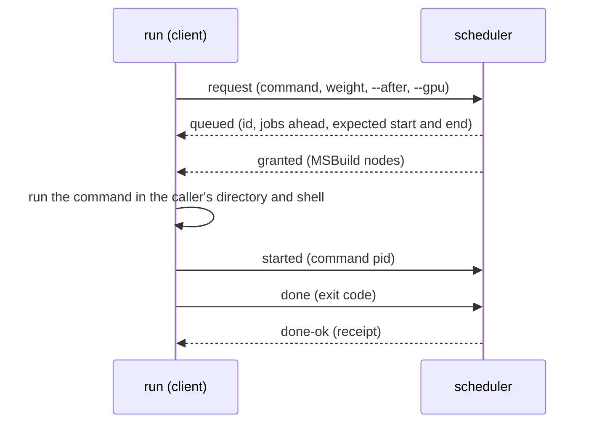

# Job queue

The local queue for long-running commands (builds, test runs, fuzzing, benchmarks) on a machine that several agents,
worktrees and people share. One scheduler process grants slots of a CPU pool and turns at the GPU; every caller runs
its command through `run` and waits until it is granted.

How to use it (commands, options, the `just` recipes, what an agent should do) is in
[job-queue.md](../../../.agents/rules/job-queue.md). This file is for changing the queue
itself.

```sh
node scripts/human/job-queue.js run -- "dotnet build X && dotnet test X --no-build"
node scripts/human/job-queue.js run --gpu -- "just test"
node scripts/human/job-queue.js status
node scripts/human/job-queue.js wait <id>
```

## Layout

`scripts/human/job-queue.js` is a plain JavaScript entry: it checks the Node version (22.18 / 23.6 or later, which
run TypeScript by stripping the types) and imports `cli.ts`. The modules use erasable syntax only (no `enum`,
`namespace` or parameter properties) and Node built-in modules only
([agent-scripts.md §1](../../../.agents/rules/agent-scripts.md#1-language)).

| Module | Responsibility |
| :- | :- |
| `cli.ts` | Parses the arguments and runs the mode (`run`, `status`, `wait`, `cancel`, `move`, `serve`, ...) |
| `client.ts` | `run` and its `QueuedRun`: registers a job, waits for the grant, runs the command, reports its end, re-registers after a scheduler restart |
| `client-connect.ts` | One-shot requests to the scheduler, and `SchedulerLauncher`: connects, starts the scheduler on demand, reports a job's end to the next scheduler |
| `client-commands.ts` | The other modes: `status`, `cancel`, `move` / `set-weight`, `wait`, `stop` |
| `server.ts` | `JobServer`, the scheduler process: the TCP server, the job records, outcomes, the settle step, the orphan poll and the timers |
| `server-connection.ts` | `Connection`: one client connection, the dispatch of its messages to one handler per message type, and what its close means for the job |
| `server-job-messages.ts` | The handlers of the messages about the client's own job: `request`, `adopt`, `started`, `done`, `report` |
| `server-control-messages.ts` | The handlers of the messages that act on the queue: `status`, `cancel`, `move`, `set-weight`, `await`, `stop` |
| `server-job.ts` | The job record the server keeps (`ServerJob`) and how `status` shows it |
| `server-store.ts` | `JobStore`: the state file `jobs-<port>.json`, written after every event and read when the scheduler starts |
| `scheduler.ts` | The scheduling decisions, with no I/O: order, grants, backfilling, GPU turns, the memory pool, the forecast |
| `protocol.ts` | The messages between clients and the scheduler (one JSON object per line) and the protocol versions |
| `history.ts` | The recorded run times per command text (`history.json`), for ordering and forecasts |
| `machine.ts` | `MachineProfile`, the defaults that follow the machine: slots from the cores, the memory pool, test budgets |
| `shell.ts` | `CommandShell`, the shell a command runs in: quoting of pre-split words, the MSBuild node limit; which commands run tests |
| `system.ts` | The state directory, and `ProcessTable`, the processes of the machine (liveness, process trees, stopping them) |
| `constants.ts` | Shared constants and the `GSHARP_JOB_QUEUE_*` variable names |
| `self-test*.ts`, `scheduler-checks.ts` | The self-test (`job-queue.js --self-test`); `self-test-support.ts` holds its fixture, `QueueFixture` |

## How a job runs



- **Scheduler state** lives in `JobServer` (`server.ts`: job records, outcomes) and `scheduler.ts` (waiting and running lists,
  slots and memory in use). The server feeds every event to the scheduler; the scheduler never does I/O, so the unit
  checks drive it directly.
- **One settle step per event**: a message, a closed connection or a timer only changes the jobs. At the end of the
  event, `settle()` cancels the jobs whose predecessor did not succeed (along chains), records predecessors that were
  lost, grants once and saves the state. Nothing is granted while an event is still changing the jobs.
- **Dependencies grant on evidence**: a job `--after` another is granted only when that job has a recorded outcome
  that lets it run (`succeeded`, or any outcome with `--keep-if-failed`), never because the other job is gone.
- **Order**: response ratio (`hrrn`, the default), with EASY backfilling that reserves the first job's start;
  `move` and `--before` place jobs ahead of that order. The forecast replays the same grants on copies of the jobs.
- **Resources**: CPU slots (one per 3 cores by default), a memory pool that test runs take their budget of
  `tests/memory-budgets.yml` from, and one GPU turn at a time. A GPU holder (the command under `gpu-lock.js`) is
  granted at once, over the pools, so it never deadlocks with a job that holds a slot and waits for the GPU.
- **A slot follows the command**: when a client dies while its command runs on, the scheduler keeps the slot and polls
  the processes until the command has exited.

## State on disk

The scheduler runs in `tmp/job-queue` of the main checkout (never a worktree, so that it holds none open):

| File | Content |
| :- | :- |
| `server.log` | The scheduler log, rotated at 5 MB |
| `history.json` | Run times per command text (last 9 runs, last 500 commands) |
| `jobs-<port>.json` | Next id, running jobs, ids of jobs that had not ended, and the last 500 outcomes; written to a temporary file and renamed, and not written once the scheduler is stopping |

A restarted scheduler restores this file, waits up to 60 s for the jobs that had not ended to come back, and grants
nothing for the first 1.5 s while running clients re-register.

## Compatibility

Clients and schedulers of different checkouts work together. `ProtocolVersion` (3) adds placement, dependencies and
the exit code in `done`; the scheduler still accepts version 2 clients (`BaseProtocolVersion`), and a version 3 client
falls back where an older scheduler refuses (for example `run --gpu` takes the GPU lock directly). Add a field as
optional, and send a higher version only on the messages that need it (`wireVersion` in `protocol.ts`).

## Changing it

1. Type-check: `node scripts/human/check-types.js` (installs `tsc` and `@types/node` into `tmp/typecheck/` on first
   use; until then an editor reports `Cannot find name 'process'`).
2. Self-test: `node scripts/human/job-queue.js --self-test`. It starts schedulers on private ports with a private state
   directory and never touches the machine's queue. Run it on Windows (Git Bash and PowerShell) and Linux; CI runs it
   on both (`.github/workflows/script-types.yml`).
3. For a change to a scheduling decision, add a case to `scheduler-checks.ts` and show that a one-line mutant of the
   changed condition fails it.
4. Wait on state, not on time, in the self-test (`waitFor`, `runningWith`, `jobsWith`): fixed delays failed on busy
   CI runners.
5. After the merge, the running scheduler keeps the old code until it exits (30 idle minutes) or is stopped:
   `node scripts/human/job-queue.js stop` from an updated checkout, then any `run` from that checkout starts the new
   one. Running jobs keep running and re-register.
6. Update the usage text in `cli.ts`, the header of `job-queue.js`, the catalog row in
   [agent-scripts.md](../../../.agents/rules/agent-scripts.md) and
   [job-queue.md](../../../.agents/rules/job-queue.md) with a change of behavior.

The PreToolUse hook that sends build and test commands through the queue is a separate script,
`scripts/agent/check-queued-command.js`; the GPU lock is `scripts/human/gpu-lock.js`.
